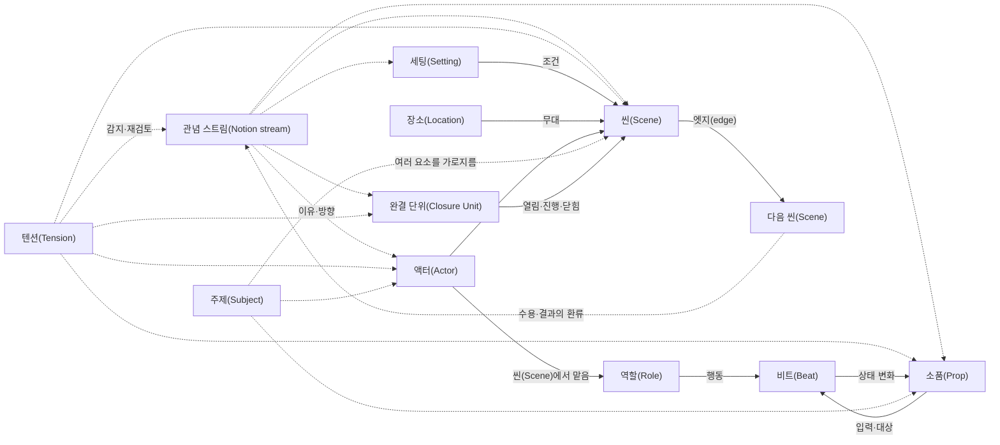

# 핵심 모델

Scenario-Semantic Synthesis(SSS)의 가장 중요한 설명은 [관념(Notion)](00-notion.md)이다. 그러나 관념(Notion)은 아래 요소들을 먼저 이해해야 한 방향으로 축소되지 않는다. [텐션(Tension)](01-tension.md)은 그 과정에서 아직 설명되지 않은 감각과 관점 차이를 보존한다. 이 문서는 관념(Notion)이 관통하되 지배하지 않는 구체 단위들을 설명한다.

## 0. Scenario-Semantic Synthesis(SSS)의 방법적 위치

Scenario-Semantic Synthesis(SSS)는 아래 요소를 하나의 Scenario 객체 안에 넣는 데이터 모델이 아니다. `Scenario`는 액터(Actor)·역할(Role)·소품(Prop)·세팅(Setting)·장소(Location)·씬(Scene)·비트(Beat)·인과·완결(Closure)을 구체적 맥락(Context)에서 읽는 **시나리오적 전개(Scenario-like Unfolding)**라는 방법적 성질을 가리킨다.

따라서 다음 등식은 성립하지 않는다.

```text
Scenario ≠ 씬(Scene)의 목록
Scenario ≠ 시퀀스(Sequence)
Scenario ≠ 완결 단위(Closure Unit)
Scenario ≠ 사용 사례(Use Case)나 선형 정상 경로
Scenario ≠ 모든 SSS 요소의 상위 컨테이너
```

`Semantic`은 요소에 미리 부착된 고정 의미가 아니라, 관계·인과·맥락과 제작자·구성·소비자의 관점을 통과하며 형성되는 의미를 가리킨다. `Synthesis`는 이 의미를 하나로 환원하는 최종 통합이 아니라, 분석·설계·실현·수용에서 흩어진 구조와 차이를 연결해 다시 읽는 **비환원적 종합(Non-reductive Synthesis)**이다.

```text
비환원적 종합(Non-reductive Synthesis)
= 함께 읽고 구성할 수 있게 연결함
+ 출처와 근거(Evidence)를 보존함
+ 국소 논리와 관점 차이를 보존함
+ 텐션(Tension)·미확인(Unknown)·반례를 남김
≠ 합의·평균·단일 해석·완성 선언
```

아래 코어 요소들은 Scenario의 하위 부품이 아니다. 각자 고유한 경계와 논리를 가지며, SSS는 이들이 구체적 전개 속에서 어떤 의미를 만들고 서로 어떻게 영향을 주는지 종합한다.

## 1. 액터(Actor)와 역할(Role)

액터(Actor)는 정보를 읽고 판단하거나 행동하여 상태를 바꾸는 지속 주체다. 사람, 조직, AI, 규칙 엔진, 작품 속 집단이 될 수 있다. 액터(Actor) 문서는 여러 씬(Scene)을 관통하는 정체성·목표·지식·권한의 연속성을 기록한다.

역할(Role)은 액터(Actor)가 **그 씬(Scene)에서만** 맡는 기능이다. 같은 사용자는 진입 씬(Scene)에서는 방문자, 설계 씬(Scene)에서는 설계 책임자, 결과 씬(Scene)에서는 책임 수령자가 될 수 있다. 역할(Role)을 분리하면 “누가 실제로 결정했는가”와 “누구에게 결과가 보이는가”를 정확히 적을 수 있다.

액터(Actor) 판정의 핵심은 외형이 아니라 책임이다.

- 입력을 해석하는가?
- 대안 중 하나를 선택하거나 규칙으로 판정하는가?
- 다른 상태, 액터(Actor)의 권한 또는 소품(Prop)을 바꾸는가?
- 여러 구현 조각을 하나의 책임으로 묶을 수 있는가?

단순 데이터 레코드나 버튼은 보통 액터(Actor)가 아니다. 다만 같은 대상이 한 관점에서는 액터(Actor), 다른 관점에서는 소품(Prop)일 수 있다. 지속 편제는 지휘 주체로 보면 액터(Actor)이고 편제표로 보면 소품(Prop)이다. 이중성을 금지하지 말고 관점을 명시한다.

## 2. 소품(Prop)

소품(Prop)은 액터(Actor)가 읽고, 소유하고, 전달하거나 변화시키지만 스스로 판단하지 않는 의미 단위다. UI 위젯이나 변수 하나가 아니라 씬(Scene) 사이에서 정체성이 유지되는 정보·자원·문서·물체·상태 묶음이다.

좋은 소품(Prop) 문서는 다음을 답한다.

- 누가 만들고 소유하는가?
- 어느 씬(Scene)에서 읽히고 바뀌는가?
- 어떤 상태 호(state arc)를 가지는가?
- 어느 인과성(Causality) 엣지(edge)를 타고 전달되는가?
- 완결(Closure)이 닫힌 뒤 잔여물로 남는가?

## 3. 세팅(Setting)과 장소(Location)

장소(Location)는 액터(Actor)가 만나 소품(Prop)을 다루는 **구체적 또는 논리적 무대**다. 실제 방, 화면, 작업 공간처럼 표현할 수도 있고, 직접 보이지 않는 자동 판단 구간을 “결정 공간”으로 추상할 수도 있다. 후자의 경우 그것이 실제 객체나 물리 공간이라는 주장을 하지 않는다고 밝혀야 한다.

세팅(Setting)은 여러 장소(Location)와 씬(Scene)을 가로지르며 가능한 행동과 의미를 바꾸는 시대·시간·사회·환경 조건이다. “전시”, “야간”, “저중력”, “신뢰가 붕괴한 조직” 같은 조건은 장소(Location)가 아니라 세팅(Setting)이다.

구분 질문은 간단하다.

- 액터(Actor)가 **어디에서** 행동하는가? → 장소(Location)
- 무엇이 여러 장소(Location)에서 행동 가능성과 의미를 **조건 짓는가**? → 세팅(Setting)

### 복합 실체와 다중 읽기

코어 요소는 실체를 하나의 상자에 넣는 배타적 분류가 아니다. 같은 실체도 범위와 관점에 따라 여러 방식으로 읽힐 수 있다. 이동 수단은 액터(Actor)가 사용하는 소품(Prop)이면서 내부에서 여러 씬(Scene)이 벌어지는 장소(Location)일 수 있고, 자동 판단 능력이 있다면 일부 씬(Scene)에서는 액터(Actor) 관점도 가질 수 있다. 거대한 시설, 조직, 플랫폼, 라이브러리, 프레임워크도 같은 원리로 읽는다.

이때 하나의 문서에서 모든 읽기를 합치거나 실체마다 가능한 분류를 전부 부여하지 않는다. 현재 질문에서 실제로 성립하는 책임과 관계만 기록하고 서로 링크한다.

- 무엇을 판단하고 변화시키는가? → 액터(Actor) 관점
- 무엇이 사용·전달·변경되는가? → 소품(Prop) 관점
- 무엇 안에서 활동이 벌어지는가? → 장소(Location) 관점
- 무엇이 여러 활동의 가능성과 규칙을 조건 짓는가? → 세팅(Setting) 관점
- 그 구성이 어떤 의미 방향을 운반·강화·굴절하는가? → 관념 스트림(Notion stream)과의 관계

마지막 질문은 그 실체가 관념(Notion)이라는 뜻이 아니다. 실체의 기능·배치·경험이 관념 스트림(Notion stream)에 참여한다는 뜻이다. 또한 여기서 말하는 여러 읽기는 액터(Actor)가 특정 씬(Scene)에서 맡는 역할(Role)과 다르다.

다른 제작 맥락에서 만들어져 현재 구성에 들어온 대상을 **편입 구성(Imported Configuration)**이라고 부를 수 있다. 이는 새 코어 요소가 아니라 외부·재사용 구성이 기능뿐 아니라 원래의 규칙과 전제를 함께 가져오는지 살피기 위한 선택적 분석명이다. 편입 구성(Imported Configuration)을 볼 때는 다음 세 렌즈를 구분한다.

- **성립 조건(Constitutive Condition):** 그 구성의 의미 있는 기능과 정체성이 성립하려면 필요한 조건
- **환경 전제(Environmental Premise):** 원래 환경이 제공했기 때문에 당연하게 포함됐지만 다른 환경에서는 성립하지 않을 수 있는 조건
- **관념적 선택(Notional Choice):** 제작자가 바람직하거나 자연스럽다고 보아 채택한 의미 방향과 구성 방식

이 셋은 인과성(Causality)의 새 유형이나 영구적인 본질 분류가 아니다. 같은 조건도 범위와 관점이 달라지면 다르게 읽힐 수 있다. 목적은 재사용 가능성을 점수화하는 것이 아니라, 무엇을 보존하고 무엇을 조정하며 어떤 충돌을 텐션(Tension)이나 새 가능성으로 관찰할지 드러내는 데 있다.

## 4. 씬(Scene)

씬(Scene)은 하나의 즉시 목적 아래 액터(Actor), 역할(Role), 소품(Prop), 세팅(Setting), 장소(Location), 권한과 비트(Beat)가 결합하는 최소 경험·판단 단위다.

씬(Scene)의 경계는 표면 구획이나 자료·구현의 구성 단위가 아니라 다음 변화로 잡는다.

- 즉시 목적이 바뀐다.
- 주요 액터(Actor) 또는 역할(Role)이 바뀐다.
- 판단에 필요한 정보가 바뀐다.
- 권한의 소유자가 바뀐다.
- 시간 척도나 세계 상태가 달라진다.
- 종료 조건과 다음 가능한 전이가 달라진다.

씬(Scene) 문서에는 최소한 목적, 진입 조건, 종료/전이, 액터(Actor)와 역할(Role), 소품(Prop), 세팅(Setting), 장소(Location), 권한, 비트(Beat), 근거 상태가 있어야 한다.

## 5. 비트(Beat)

비트(Beat)는 한 액터(Actor)의 판단이나 행동이 소품(Prop), 관계, 지식, 권한, 목표 또는 세계 상태를 실제로 바꾸는 최소 의미 변화다.

```text
액터(Actor) + 현재 역할(Role) + 입력/소품(Prop)
        └─ 판단·행동 ─▶ 변화된 상태 + 다음 가능성
```

비트(Beat)는 함수 하나, 대사 한 줄, 클릭 한 번과 일대일로 대응하지 않는다. 여러 함수가 하나의 비트(Beat)를 구현할 수 있고, 한 함수 안에 여러 비트(Beat)가 있을 수 있다. “사용자가 목록을 클릭했다”는 변화가 없으면 조작이고, “후보를 선택해 발주 의무가 생겼다”는 비트(Beat)다.

## 6. 시퀀스(Sequence)

시퀀스(Sequence)는 관련 씬(Scene)들이 공간·시간·목적상 이어지는 상위 묶음이다. SSS에서 시퀀스(Sequence)는 단일 선형 순서를 강제하지 않는다. 분기, 반복, 병렬, 장거리 환류를 포함할 수 있다. 오버뷰를 읽기 쉽게 만드는 내비게이션 층이며 완결 단위(Closure Unit)와 같지 않다.

- 시퀀스(Sequence): 씬(Scene)들을 함께 읽는 상위 진행 묶음
- 완결 단위(Closure Unit): 어떤 미결 상태가 열리고 닫히는 생애

하나의 시퀀스(Sequence) 안에서 여러 완결(Closure)이 열리고 닫힐 수 있고, 하나의 완결(Closure)이 여러 시퀀스(Sequence)를 가로지를 수 있다.

## 7. 주제(Subject)

주제(Subject)는 작품이나 시스템 전체에 반복되는 주제(Subject), 질문, 규칙과 지식을 느슨하게 묶는 중첩 가능한 라이브러리다. 씬(Scene)처럼 시간·장소(Location)·종료 조건을 갖지 않는다.

주제(Subject)는 다음과 같은 질문을 위해 존재한다.

- “신뢰”가 어떤 씬(Scene), 액터(Actor), 소품(Prop)에서 다른 형태로 나타나는가?
- “설계”라는 주제(Subject)와 지식이 연구, 생산, 실제 성능에서 어떻게 이어지는가?
- “정보의 비대칭”이 사람과 AI의 판단을 어디서 바꾸는가?

주제(Subject) 간 중복은 결함이 아니다. 각 주제(Subject)는 소유권이 아니라 관점을 선언한다. 배타적 분류가 필요하면 별도의 분류체계(taxonomy)를 만들고 주제(Subject)에 그 분류 기능을 떠넘기지 않는다.

## 8. 인과성(Causality), 개연성(Plausibility), 핍진성(Verisimilitude)

씬(Scene) 간 연결은 세 질문으로 나누어 평가한다.

### 인과성(Causality)

앞 씬(Scene)의 변화가 뒤 씬(Scene)을 발생시키거나, 허용하거나, 제한하거나, 입력을 제공하는가? 구현의 호출, 상태 전달, 규칙 조건, 서사의 사건 결과가 주된 근거다.

### 개연성(Plausibility)

해당 액터(Actor)가 가진 정보·목표·권한으로 그 판단과 전이가 납득되는가? 관점 의존적이다. 시스템 내부에서 정확한 판정도 사용자에게 중간 상태가 보이지 않으면 낮게 느껴질 수 있다.

### 핍진성(Verisimilitude)

그 표현과 결과가 작품이 약속한 세계, 장르, 조직, 물리, 역사 또는 자체 규칙과 일관되는가? 현실성만을 뜻하지 않는다. 판타지 규칙도 일관되면 핍진성(Verisimilitude)이 높다.

세 평가는 서로 대체하지 않는다.

| 사례 | 인과성(Causality) | 개연성(Plausibility) | 핍진성(Verisimilitude) |
|---|---|---|---|
| 숨은 점수로 결과가 정확히 결정됨 | 높음 | 사용자 관점에서는 낮을 수 있음 | 세계 규칙에 따라 별도 |
| 극적인 우연이 사건을 연결함 | 존재함 | 낮거나 관점 의존 | 장르에 따라 높을 수 있음 |
| 사실적인 화면이나 대사지만 상태 전달이 없음 | 낮음 | 높아 보일 수 있음 | 높을 수 있음 |

## 9. 완결 단위(Closure Unit)

완결 단위(Closure Unit)는 목표·질문·갈등·작업·의무 같은 미결 상태가 열리고, 하나 이상의 씬(Scene)과 비트(Beat)를 거쳐 닫히는 극작적 완결 단위(Closure Unit)다.

반드시 시작과 끝이 있지만 일대일 대응은 아니다.

- 같은 시작이 성공, 실패, 취소, 중단, 상위 단위(Unit) 흡수라는 다른 끝을 가질 수 있다.
- 하나의 종료 비트(Beat)가 여러 완결(Closure)을 동시에 닫을 수 있다.
- 하위 UI 완결(Closure)이 닫혀도 그 안에서 시작한 의미적 완결(Closure)은 계속될 수 있다.
- 닫힌 완결(Closure)의 잔여물이 새로운 완결(Closure)을 열 수 있다.

각 단위(Unit)는 시작, 열린 상태, 전형적 과정, 정상 완결, 대안 완결, 잔여물, 중첩 관계를 기록한다. 전형적 과정은 알고리즘이나 필연적 단계가 아니다.

## 10. 관념(Notion)

관념(Notion)은 모든 추상적 개념의 방향성 있는 스트림(stream) 집합이다. 제작자의 의도이자 소비자가 새로 창조하는 의미이며, 개념·인과성(Causality)·관계·맥락을 관통하는 어휘다.

주제(Subject)가 `무엇에 관해 읽는가`를 제공한다면 관념(Notion)은 `왜 이런 구성과 변화가 필요하며, 서로 다른 변화가 어떤 큰 의미 방향을 만드는가`를 설명한다. 장르는 전통적으로 공유된 관념(Notion)의 집합이 될 수 있지만 관념(Notion)은 장르나 주제(Subject)에 한정되지 않는다.

관념(Notion)은 하나가 아니며, 같은 개념을 공유하지 않아도 서로 정렬될 수 있다. 제작 참여자와 소비자의 복수 스트림(stream), 겹침과 정렬, 비지배 원칙, 분석·설계 운용은 [관념(Notion) 본문](00-notion.md)을 따른다.

## 11. 텐션(Tension)

텐션(Tension)은 특정 관점에서 대상에 대해 감지되지만 아직 원인·성질·가치가 확정되지 않은 미묘한 감각이다. SSS의 세계 객체나 구조 단위가 아니라 액터(Actor), 소품(Prop), 씬(Scene), 엣지(edge), 완결(Closure), 주제(Subject), 관념(Notion)과 그 사이 관계 어디에나 부착할 수 있는 횡단 관찰층이다.

텐션(Tension)이 필수라는 것은 모든 씬(Scene)에서 발견하거나 해결해야 한다는 뜻이 아니다. 설명되지 않은 감각을 기록하고 필요할 때 다시 볼 통로가 필수라는 뜻이다. 감지, 해석, 평가, 활용을 구분하며 미해석·무조치를 허용한다. 자세한 원칙은 [텐션(Tension) 본문](01-tension.md)을 따른다.

## 12. 전체 관계



이 도식의 점선은 관념(Notion)이 요소를 명령하거나 소유한다는 뜻이 아니다. 각 요소는 자체 논리로 성립하며, 관념(Notion)은 그 구성 이유와 누적 의미 방향을 설명하고 결과에 의해 다시 변한다. 텐션(Tension)의 점선도 해당 요소가 문제라는 뜻이 아니라, 특정 관점에서 그 지점이나 관계에 미확정 감각이 감지될 수 있음을 뜻한다.
