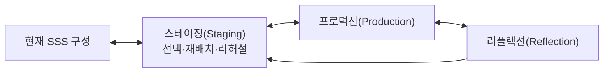

# 스테이징(Staging)

스테이징(Staging)은 현재 SSS로 기술된 대상을 특정 참여자·관점·질문에서 실제로 경험하고 제작할 수 있도록 **잠정적으로 무대에 올려 보는 리허설 과정**이다.

Scenario-Semantic Synthesis(SSS)의 Scenario는 스테이징(Staging) 결과 하나를 뜻하지 않는다. 스테이징(Staging)은 가능한 전개와 관점 중 일부를 구체화해 보는 작업 뷰(Working View)이며, 하나의 리허설을 전체 대상의 대표 시나리오로 승격하지 않는다.

스테이징(Staging)은 새로운 코어(Core)가 아니다. [핵심 모델](02-core-model.md)의 요소와 [근거 구분](03-evidence-and-epistemics.md)을 그대로 사용하며, 스테이징(Staging) 편의를 위해 다시 정의하지 않는다.

> 스테이징(Staging)은 완성된 의미를 직책별 산출물로 번역하는 절차가 아니라, 현재 구성을 여러 관점(Perspective)에서 구체적으로 재배치하고 어떤 관념(Notion)이 어떻게 표현되고 경험될지 시험하는 작업 공간이다.

## 1. 목적

같은 SSS를 읽더라도 기획자, 개발자, 디자이너, 테스터, 운영자, 연기자, 소비자는 서로 다른 것을 먼저 보고 다른 해상도로 이해한다. 이 차이는 제거해야 할 오차가 아니다. 각자가 가진 경험과 책임, 도구, 관념 스트림(Notion stream)이 다르기 때문에 생기는 자연스러운 차이다.

스테이징(Staging)은 다음을 돕는다.

- 현재 범위(Scope)에서 실제로 등장하는 액터(Actor)와 역할(Role)을 구체화한다.
- 씬(Scene)의 목적, 비트(Beat), 소품(Prop) 변화, 세팅(Setting)과 장소(Location)의 작용을 한 자리에서 리허설한다.
- 여러 씬(Scene)을 가로지르는 인과성(Causality)·개연성(Plausibility)·핍진성(Verisimilitude)과 완결(Closure) 생애를 확인한다.
- 선언된 관념(Notion)이 아니라 실제 구성에서 드러나는 관념 스트림(Notion stream)을 읽는다.
- 참여자별 해석 차이와 아직 설명되지 않는 감각을 텐션(Tension)으로 보존한다.
- 프로덕션(Production) 전에 서로 다른 이해를 외부화하되 하나의 정답 표현으로 통일하지 않는다.
- 구현이나 표현을 준비하다 발견한 새 의미를 정본 문서로 되돌려보낸다.

## 2. 현재 SSS에서 스테이징(Staging)의 위치

스테이징(Staging)은 분석과 설계 어느 쪽에서도 사용할 수 있다.

### 분석에서

복원한 씬(Scene)을 다시 연기하거나 시뮬레이션하여 다음을 살핀다.

- 문서상 액터(Actor)와 실제 판단 주체가 같은가?
- 기록된 비트(Beat)가 실제 변화를 설명하는가?
- 사용자가 경험하는 완결(Closure)과 시스템이 닫는 완결(Closure)이 같은가?
- 관찰자가 재구성한 관념(Notion)과 구성에서 실제로 드러나는 관념(Notion)이 어떻게 다른가?

### 설계에서

초기 관념(Notion) 씨앗과 현재 구성요소를 잠정적으로 배치해 실제 경험을 만들어 본다.

- 씬(Scene)이 목적을 가졌는가?
- 액터(Actor)의 역할(Role)과 권한이 비트(Beat)를 가능하게 하는가?
- 소품(Prop)과 피드백이 변화의 인과를 드러내는가?
- 완결(Closure)이 열리고 닫히는 감각이 형성되는가?
- 초기 문장과 무관하게 어떤 관념 스트림(Notion stream)이 실제로 생겼는가?

스테이징(Staging)은 프로덕션(Production) 앞에만 한 번 수행하는 단계가 아니다. 프로덕션(Production) 중 발견된 현실을 다시 올려볼 수도 있고, [리플렉션(Reflection)](11-reflection.md)에서 발견한 차이를 새로운 스테이징(Staging)으로 시험할 수도 있다.



화살표는 필수 순서를 뜻하지 않는다.

## 3. 관념(Notion)을 다루는 방식

관념(Notion)은 스테이징(Staging)의 가장 중요한 종합 설명이지만 승인 기준이나 연출 명령이 아니다.

스테이징(Staging)을 시작할 때 기존 관념(Notion) 문서는 다음 정도만 제공한다.

- 현재까지 관찰되거나 의도된 스트림(stream) 후보
- 서로 다른 제작 참여자와 소비자 관점
- 정렬·긴장·단절이 의심되는 곳
- 아직 지배적으로 설명하지 않기로 한 범위

그 뒤에는 관념(Notion) 문장을 잠시 내려놓고 액터(Actor), 역할(Role), 씬(Scene), 비트(Beat), 소품(Prop), 세팅(Setting), 장소(Location), 인과 연결과 완결(Closure)을 실제로 배치한다. 리허설 뒤에 구성에서 형성된 스트림(stream)을 다시 읽는다.

따라서 다음 두 방향을 모두 허용한다.

```text
잠정 관념(Notion) 씨앗 → 구성요소 배치 → 실제로 형성된 관념(Notion) 재발견

구성요소와 경험 → 반복되는 방향 관찰 → 관념 스트림(Notion stream) 추론
```

두 결과가 같지 않아도 된다. 차이는 수정 명령이 아니라 리플렉션(Reflection)과 텐션(Tension)의 후보가 된다.

## 4. 관점과 역할(Role)을 구분한다

스테이징(Staging)에는 서로 다른 두 종류의 역할(Role) 표현이 나타날 수 있다.

### 세계 안의 역할(Role)

액터(Actor)가 특정 씬(Scene)에서 가진 목표·권한·책임이다. 현재 SSS 코어(Core)의 `역할(Role)`을 뜻한다.

역할(Role)은 액터(Actor)의 고정 속성이 아니다. 액터(Actor)가 가진 관념(Notion), 씬(Scene)에서 작동하는 다른 스트림(stream), 사건에 대한 해석과 권한 구조가 특정 조건에서 표현된 결과다.

### 스테이징 관점(Staging Perspective)

기획자, 개발자, 디자이너, 테스터, 운영자, 연기자, 소비자처럼 현재 리허설을 읽는 위치다. 이는 세계 안의 역할(Role)을 새로 정의하는 말이 아니다.

```text
세계 안의 역할(Role) ≠ 스테이징 관점(Staging Perspective) ≠ 실제 사람의 직책
```

한 사람이 여러 스테이징 관점(Staging Perspective)을 오갈 수 있고, 여러 사람이 하나의 관점을 함께 볼 수 있다. 관점마다 고정된 어휘 우선순위를 미리 배정하지 않는다.

## 5. 스테이징(Staging)의 범위(Scope)와 Anchor

스테이징(Staging)은 모든 문서를 한꺼번에 재현하지 않는다. 현재 질문에 따라 범위(Scope)와 임시 Anchor를 고른다.

가능한 Anchor의 예:

- 특정 씬(Scene)의 경험과 비트(Beat)
- 하나의 완결 단위(Closure Unit) 전체 생애
- 액터(Actor)가 여러 씬(Scene)에서 바꾸는 역할(Role)
- 소품(Prop)의 상태 호와 전달
- 주제(Subject)를 가로지르는 여러 씬(Scene)
- 하나의 인과 엣지(edge)와 그 개연성(Plausibility)·핍진성(Verisimilitude)
- 관념 스트림(Notion stream)이 강화·반전·보류되는 구간
- 감지된 텐션(Tension) 주변의 구성

Anchor는 스테이징(Staging)을 시작하기 위한 손잡이지 새 정본이 아니다. 질문이 바뀌면 Anchor도 바뀔 수 있다.

## 6. 재구성 연산

스테이징 관점(Staging Perspective)은 원래 SSS를 단순히 필터링하지 않는다. 목적에 따라 다음과 같이 재구성할 수 있다.

- **선택:** 현재 질문과 관련된 요소만 올린다.
- **확대:** 하나의 비트(Beat)나 짧은 완결(Closure)을 높은 해상도로 펼친다.
- **축소:** 여러 세부 변화를 하나의 흐름으로 묶어 본다.
- **분리:** 하나로 보이던 액터(Actor), 역할(Role), 씬(Scene), 완결(Closure)을 관점상 나누어 본다.
- **병합:** 구분된 요소를 하나의 경험이나 책임으로 함께 본다.
- **재배치:** 공간·시간·설명 순서를 바꾸어 의미 차이를 시험한다.
- **대체:** 같은 목적을 다른 소품(Prop), 세팅(Setting), 장소(Location), 표현으로 실현해 본다.
- **누락:** 일부 요소를 의도적으로 제거해 무엇이 사라지는지 본다.

이 연산은 정본을 소급 변경하지 않는다. 재구성으로 새 의미가 발견되면 근거와 함께 해당 액터(Actor)·씬(Scene)·엣지(edge)·완결(Closure)·관념(Notion) 등의 정본으로 환류한다.

## 7. 기본 스테이징(Staging) 흐름

다음은 유용한 진행 예이지 필수 워크플로(Workflow)가 아니다.

### 7.1 질문과 관점을 정한다

- 무엇을 이해하거나 시험하려는가?
- 누가 이 리허설을 보고 있는가?
- 현재 범위(Scope)와 임시 Anchor는 무엇인가?
- 어떤 자료가 관찰이고 무엇이 설계 의도인가?

### 7.2 씬(Scene)과 완결(Closure)을 올린다

- 어떤 미결 상태가 이미 열려 있는가?
- 현재 씬(Scene)의 즉시 목적은 무엇인가?
- 어디에서 정상·실패·취소·중단·흡수로 닫힐 수 있는가?
- 하위 UI 완결(Closure)과 장기 의미 완결(Closure)이 어떻게 중첩되는가?

씬(Scene) 하나만 리허설하더라도 그 씬(Scene)이 어떤 완결(Closure)의 중간인지 살핀다. 반대로 완결(Closure) 전체를 본다고 모든 씬(Scene)을 상세히 올릴 필요는 없다.

### 7.3 액터(Actor)와 역할(Role)을 배치한다

- 지속 액터(Actor)는 누구인가?
- 각 씬(Scene)에서 어떤 역할(Role)로 나타나는가?
- 무엇을 알고, 원하고, 판단하며, 바꿀 수 있는가?
- 권한과 책임, 정보가 어긋나는가?
- 같은 액터(Actor)의 역할(Role) 변화는 어떤 관념(Notion) 변화의 결과인가?

### 7.4 소품(Prop)·세팅(Setting)·장소(Location)를 배치한다

- 액터(Actor)가 읽고 소유·전달·변경하는 소품(Prop)은 무엇인가?
- 세팅(Setting)이 가능한 행동과 해석을 어떻게 제한하는가?
- 장소(Location)가 액터(Actor)와 소품(Prop)의 만남을 어떻게 조직하는가?
- 같은 소품(Prop)이 관점에 따라 다른 주제(Subject)와 관념(Notion)을 드러내는가?

### 7.5 비트(Beat)를 리허설한다

비트(Beat)는 다음 형태로 외부화할 수 있다.

| 액터(Actor)/역할(Role) | 알고 있는 것 | 행동 | 변화 | 관찰 가능한 피드백 | 관련 완결(Closure) |
|---|---|---|---|---|---|

클릭, 대사, 함수 호출을 나열하는 데서 멈추지 않는다. 상태·정보·관계·권한·해석 중 무엇이 달라지는지 본다.

### 7.6 연결의 설득력을 확인한다

중요한 비트(Beat)와 씬(Scene) 전환마다 [인과성(Causality)·개연성(Plausibility)·핍진성(Verisimilitude)](02-core-model.md#8-인과성causality-개연성plausibility-핍진성verisimilitude)의 세 질문을 분리해 리허설에 적용한다.

평가가 낮다는 이유만으로 즉시 수정하지 않는다. 의도적 보류, 반전, 장르적 과장일 수 있으며 뒤의 씬(Scene)이나 완결(Closure)에서 회수될 수도 있다.

### 7.7 관념 스트림(Notion stream)을 다시 읽는다

- 어떤 구성 변화가 같은 방향으로 정렬되는가?
- 같은 개념을 공유하지 않는 요소도 큰 방향을 함께 만드는가?
- 어떤 스트림(stream)이 강화·변형·반전·보류되는가?
- 제작 참여자별 의도와 실제 구성, 예상 소비자 해석은 어떻게 다른가?
- 어떤 요소는 큰 관념(Notion)으로 설명하지 않고 자체 논리에 남겨야 하는가?

### 7.8 텐션(Tension)과 미확인(Unknown)을 보존한다

- 누가, 무엇에서, 어떤 맥락으로 텐션(Tension)을 감지했는가?
- 감지만 확인됐는가, 해석이나 평가 근거도 있는가?
- 구조적 누락인지, 관점 차이인지, 생산적 불협화인지 아직 모르는가?
- 지금 조치하지 않아도 되는가?

텐션(Tension)을 발견하기 위해 리허설하는 것은 가능하지만, 텐션(Tension)을 반드시 찾아내는 것이 스테이징(Staging)의 성공 조건은 아니다.

### 7.9 환류와 인계(Handoff)를 정한다

- 정본에 반영할 새 발견은 무엇인가?
- 스테이징(Staging)에만 남길 관점별 재구성은 무엇인가?
- 프로덕션(Production)에서 실제 결정해야 하는 것은 무엇인가?
- [백스테이지(Backstage)](08-backstage.md)에서 보이지 않는 조건을 더 조사해야 하는가?
- 리플렉션(Reflection)에서 다시 확인할 기대와 여백은 무엇인가?

## 8. 산출물

스테이징(Staging)의 산출물은 고정되어 있지 않다.

- 관점별 스테이징(Staging) 노트(note)
- 씬(Scene) 또는 완결(Closure) 리허설 표
- Storyboard, wireflow, sequence, state view
- 역할(Role)별 다이어그램
- 프로토타입(Prototype) 또는 role-play 기록
- 대안 배치 비교
- 텐션(Tension)과 미확인(Unknown) 메모
- 정본 환류 목록
- 프로덕션(Production)/백스테이지(Backstage)/리플렉션(Reflection) 인계(Handoff)

표현 도구는 질문에 맞게 선택한다. 화면 다이어그램, 코드 스파이크, 연기, 종이 모형, 로그 재생도 모두 가능하다. 필요하면 [시맨틱 프로브(Semantic Probe)](09-semantic-probes.md)로 선택 이유, 잘 보이는 것과 가려지는 것, 근거 상태를 함께 기록한다. 표현이 명확하다는 사실을 의미가 확정됐다는 증거로 사용하지 않는다.

## 9. Traceability와 정본

스테이징(Staging)에서 변형한 요소는 의미가 달라질 가능성이 있는 만큼만 출처를 남긴다.

```text
출처:
현재 스테이징(Staging) 표현:
변형 이유:
새로 발견한 의미:
반영할 정본:
남은 미확인(Unknown)/텐션(Tension):
```

모든 상자에 ID를 붙일 필요는 없다. 다만 분리·병합·재배치로 원래 의미를 잃을 위험이 있다면 액터(Actor), 씬(Scene), 엣지(edge), 완결(Closure), 관념 스트림(Notion stream) 등의 안정 ID를 연결한다.

스테이징(Staging) 문서는 관점별 작업 뷰(Working View)이며, 각 요소의 정본은 [정본 원칙](15-project-structure.md#정본-원칙)을 따른다.

- 스테이징(Staging)에서 발견된 의미는 자동으로 정본이 되지 않는다.
- 반대로 스테이징(Staging)과 정본이 다르다는 이유로 스테이징(Staging)을 틀렸다고 보지 않는다. 새로운 발견일 수 있다.

## 10. 백스테이지(Backstage)·프로덕션(Production)·리플렉션(Reflection)과의 경계

이 문서는 후속 개념을 미리 확정하지 않고 현재 경계만 둔다.

### [백스테이지(Backstage)](08-backstage.md)로 넘길 것

씬(Scene)을 실제로 성립시키지만 현재 무대에 보이지 않는 조건, 책임, 상태, 제약, 실패, 운영 현실에 대한 질문.

### [프로덕션(Production)](10-production.md)으로 넘길 것

현재 구성 중 실제 결과물로 만들기 위해 선택하고 실행해야 하는 결정. 스테이징(Staging)의 모든 대안을 프로덕션(Production)할 필요는 없다.

### 리플렉션(Reflection)으로 넘길 것

의도한 관념(Notion), 실제 구성, 만들어진 결과, 참여자와 소비자가 형성한 관념(Notion)의 차이를 다시 볼 질문.

이 세 과정은 스테이징(Staging) 다음의 고정 단계가 아니다. 어느 과정에서든 스테이징(Staging)으로 돌아올 수 있다.

## 11. 완료와 완결(Closure)

스테이징(Staging)을 끝내기 위해 별도의 완결성 체계를 만들지 않는다.

리허설 자체가 중요한 시작과 끝을 가진다면 하나의 완결 단위(Closure Unit)로 기록할 수 있다. 그러나 모든 스테이징(Staging) 노트(note)를 완결(Closure)로 만들 필요는 없다.

현재 스테이징(Staging)을 내려놓을 수 있는지는 다음 정도로 판단한다.

- 현재 질문에 필요한 요소와 변화가 충분히 드러났는가?
- 프로덕션(Production) 또는 다음 조사에서 결정할 미확인(Unknown)이 구분됐는가?
- 새 발견의 환류 위치가 정해졌는가?
- 관련 완결(Closure)의 시작과 가능한 종료를 오해하지 않게 표현했는가?

텐션(Tension)이 남아 있어도 스테이징(Staging)은 끝날 수 있다. 스테이징(Staging)이 끝났다고 관련 의미 완결(Closure)이 닫힌 것도 아니다.

## 12. 가드레일(Guardrail)

- 씬(Scene)을 Screen, API, 모듈, 서비스와 자동으로 동일시하지 않는다.
- 스테이징 관점(Staging Perspective)을 세계 안의 역할(Role)이나 조직 직책과 혼동하지 않는다.
- 관점별 어휘 우선순위를 고정하지 않는다.
- 관념(Notion)을 모든 배치의 승인 기준으로 사용하지 않는다.
- 초기 관념(Notion) 문장에 맞지 않는 좋은 발견을 제거하지 않는다.
- 관점별 다이어그램 차이를 자동으로 텐션(Tension)이나 오류로 보지 않는다.
- 텐션(Tension)을 반드시 발견하거나 해결하도록 요구하지 않는다.
- 재구성 과정에서 원래 요소의 의미를 조용히 삭제하지 않는다.
- 스테이징(Staging) 산출물을 새 의미 권위(semantic authority)로 만들지 않는다.
- 화면에 보이는 경험만 올리고 시스템 액터(Actor)와 숨은 판단을 누락하지 않는다.
- 구현 편의를 위해 미확인(Unknown)을 확정된 의미로 바꾸지 않는다.
- 모든 씬(Scene)과 완결(Closure)을 한 표현에 담으려 하지 않는다.
- 도구의 온톨로지(ontology)를 SSS의 코어(Core)로 역수입하지 않는다.
- 스테이징(Staging)을 프로덕션(Production) 승인 게이트(Gate)나 필수 Ceremony로 만들지 않는다.

## 13. 최소 기록

작은 스테이징(Staging)에서는 다음만 있어도 된다.

```text
질문과 관점:
범위(Scope)/Anchor:
관련 씬(Scene)/완결(Closure):
리허설한 핵심 비트(Beat):
실제로 드러난 관념(Notion) 방향:
텐션(Tension)/미확인(Unknown):
정본 환류:
다음 인계(Handoff):
```

중요한 것은 양식의 완성이 아니라, 현재 구성과 관점별 해석 사이에서 무엇이 발견되고 어디로 돌아가야 하는지를 잃지 않는 것이다.
