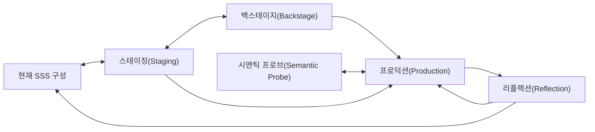

# 프로덕션(Production)

프로덕션(Production)은 현재 이해하고 의도한 Scenario-Semantic Synthesis(SSS) 구성을 실제로 작동하거나 경험할 수 있는 결과로 만드는 **결정·실현·관찰의 작업 공간**이다.

코드 작성과 배포만을 뜻하지 않는다. 작품 제작, 구체 설계, UI와 상호작용, 데이터·규칙·AI 구현, 프로토타입(Prototype), 테스트 환경, 운영 규칙, 문서와 계약처럼 실제 결과와 새로운 근거(Evidence)를 만드는 활동을 넓게 포함한다.

> 프로덕션(Production)은 완성된 관념(Notion)을 복사하는 마지막 단계가 아니라, 잠정 관념(Notion)과 구성이 재료·기술·배우·환경·제약과 만나 실제 형태로 변하고 다시 관찰되는 과정이다.

프로덕션(Production)은 SSS의 **실현 종합(Realization Synthesis)**이 일어나는 곳이다. 여기서 종합(Synthesis)은 모든 차이를 구현 편의에 맞춰 하나로 결정하는 일이 아니라, 필요한 작업 결정(Working Decision)을 내리면서도 대안·제약·미확인(Unknown)·텐션(Tension)·결정 출처를 결과와 함께 남기는 일이다.

## 0. 프로덕션(Production)은 고정하는 단계다

SSS의 다른 작업공간은 고정을 늦추고 차이를 보존한다. 프로덕션(Production)은 반대로, 코딩·제작에 앞서 현재 범위(Scope)의 결정을 **반드시 고정**한다.

코드와 실제 산출물은 애매함을 담을 수 없다. 모든 분기·기본값·실패 처리가 하나로 결정된다. 프로덕션(Production)에서 고정하지 않으면 고정이 사라지는 것이 아니라, 구현자·에이전트·도구 기본값이 보이지 않게 고정한다. 기록되지 않은 고정은 나중에 원래부터 있던 사실로 소급되고, 현재 구현이 다음 의도를 지배한다. 그러므로 명시적 고정은 관념(Notion)을 고정하지 않기 위한 장치다. 고정된 결정이 있어야 [리플렉션(Reflection)](11-reflection.md)도 무엇이 달라졌는지 읽을 수 있다.

| 고정한다 | 고정하지 않는다 |
|---|---|
| 이번 범위(Scope)의 작업 결정(Working Decision) | 관념(Notion)과 관념 스트림(Notion stream) |
| 구현할 상태·비트(Beat)·엣지(edge)·완결(Closure) 종료 조건 | SSS 정본의 의미 |
| 미확인(Unknown)을 코드에서 다룰 Assumption | 다음 프로덕션(Production)의 의도 |
| 참조한 관념(Notion)의 이름과 판본 | 다른 관점 스트림(stream)의 해석 |

고정된 결정은 범위 안에서 구속력을 가진다. 구현자는 이를 임의로 바꾸지 않으며, 바꿔야 할 근거가 생기면 새 작업 결정(Working Decision)으로 기록하거나 리플렉션(Reflection)으로 다시 연다.

> 이 문서의 `~하지 않는다`는 고정을 피하라는 뜻이 아니라, **무엇을 고정하는지 혼동하지 말라**는 뜻이다.

## 1. 현재 SSS에서의 위치

프로덕션(Production)은 새로운 코어(Core)나 고정 워크플로(Workflow)가 아니다. [핵심 모델](02-core-model.md)의 요소와 [근거 체계](03-evidence-and-epistemics.md)를 실제 결과로 가져갈 때 사용하는 작업 관점이다.

다음과 같은 진행은 가능하지만 필수 순서가 아니다.



프로덕션(Production) 중에도 스테이징(Staging)을 다시 수행하거나 백스테이지(Backstage)를 탐색하고, 프로브(Probe)를 만들며, SSS 정본을 수정할 수 있다. 의미를 모두 확정한 뒤에만 프로덕션(Production)할 수 있는 것은 아니다.

## 2. 무엇이 프로덕션(Production)인가

상황에 따라 다음이 프로덕션(Production)이 될 수 있다.

- Concrete 설계(Design)와 Architecture
- UI·Interaction·Graphic·Sound·Performance 제작
- API·Data Model·Rule·AI·Source Code
- Configuration·Infrastructure·Deployment Definition
- Test harness와 관찰 가능한 프로토타입(Prototype)
- 운영 절차와 조직적 실행 규칙
- 외부 Specification·Contract·Schema
- 촬영·편집·무대 구성·연기와 같은 작품 실현
- 실제 결정을 포함하는 작업 산출물(Working Artifact)

문서나 Diagram도 실제 작업에서 선택을 고정하고 다른 결과를 만들기 시작하면 프로덕션(Production) 산출물(artifact)이 될 수 있다. 반대로 설명만을 위한 임시 표현은 [시맨틱 프로브(Semantic Probe)](09-semantic-probes.md)로 남을 수 있다.

프로덕션(Production) 여부는 파일 형식이 아니라 다음 질문으로 본다.

> 이 활동이나 산출물이 실제 구성·행동·경험·판단 가능성을 만들거나 제한하는가?

## 3. 관념(Notion)을 다루는 방식

제작자는 프로덕션(Production) 전에 관념(Notion)을 가질 수 있다. 하지만 프로덕션(Production)은 그 관념(Notion)을 그대로 전달하는 통로가 아니다.

- 재료와 기술이 일부 표현을 가능하게 하거나 막는다.
- 배우와 제작 참여자가 각자의 관념(Notion)으로 결정을 내린다.
- 구현의 기본값과 구조가 의도하지 않은 방향을 강화한다.
- 편집·배치·성능·실패·운영 조건이 같은 장면을 다르게 경험하게 한다.
- 소비자는 만들어진 결과를 통해 별도의 관념(Notion)을 창조한다.

따라서 프로덕션(Production)에서는 적어도 다음을 구분한다.

```text
의도하거나 추론한 관념(Notion)
→ 프로덕션(Production)에서 선택한 구체 결정
→ 실제 결과에 형성된 관념(Notion)
→ 참여자·소비자가 수용하며 만든 관념(Notion)
```

이들은 같을 수도 있지만 같다고 전제하지 않는다. 프로덕션(Production) 결과가 초기 관념(Notion)과 다르다는 이유만으로 실패라고 판단하지 않으며, 반대로 의도와 일치한다고 의미가 증명된 것도 아니다.

## 4. 프로덕션(Production) 범위(Scope)와 후보(Candidate)

프로덕션(Production) 전체를 하나의 거대한 작업으로 다루지 않는다. 현재 선택하고 실현할 수 있는 범위를 편의상 `프로덕션(Production) 범위(Scope)`라고 부른다.

아직 수행 여부나 방법을 선택하지 않은 단위는 `프로덕션 후보(Production Candidate)`라고 부를 수 있다.

예:

- 특정 완결(Closure)의 실패 종료를 실제로 구현한다.
- 자동화된 액터(Actor)의 판단 근거를 참여자에게 일부 노출한다.
- 저장 완료 의미를 영속 반영 기준으로 바꾼다.
- 장면의 조명과 편집을 바꾸어 다른 관념(Notion) 방향을 시험한다.
- 고위험 변경 전에 프로토타입(Prototype)과 근거(Evidence) 수집을 수행한다.

범위(Scope)와 후보(Candidate)는 새 코어(Core)가 아니다. 프로덕션(Production)을 비교·계획·기록하기 위한 작업 어휘(Working Vocabulary)다.

하나의 후보(Candidate)가 너무 크면 서로 다른 Exposure, 개입 위험(Intervention Risk), 완결(Closure)과 근거(Evidence)를 가진 하위 후보(Candidate)로 나눌 수 있다. 단지 점수를 높이거나 낮추기 위해 의미 없는 분할을 만들지는 않는다.

## 5. 프로덕션(Production)을 시작할 때 읽는 것

현재 범위(Scope)에 필요한 것만 읽는다.

### SSS 정본에서

- 관련 액터(Actor)와 씬(Scene)별 역할(Role)
- 변화시킬 소품(Prop)과 상태 호
- 세팅(Setting)·장소(Location)의 가능성과 제약
- 씬(Scene)·비트(Beat)·시퀀스(Sequence)
- 인과성(Causality)·개연성(Plausibility)·핍진성(Verisimilitude)
- 관련 완결 단위(Closure Unit)와 정상·대안 종료·잔여물
- 주제(Subject)와 관념 스트림(Notion stream)
- 텐션(Tension), 관찰(Observation), 추론(Inference), 의도(Intent), 미확인(Unknown), 충돌(Conflict)

### 스테이징(Staging)에서

- 관점별로 리허설된 경험과 변화
- 다른 관점에서 사라지기 쉬운 요소
- 실제 구성에서 새로 드러난 관념(Notion)
- 정본에 아직 환류되지 않은 발견

### 백스테이지(Backstage)에서

- 숨은 판단 액터(Actor)와 상태
- 실제 Capability·Constraint·Failure·운영 현실
- 프로덕션(Production)에서 선택해야 할 해결 후보
- 실제 결과에서 다시 확인할 가정

### 시맨틱 프로브(Semantic Probe)에서

- 프로브(Probe)가 새로 보여준 관찰(Observation)과 추론(Inference)
- 프로토타입(Prototype)·반례·실험에서 생긴 결정
- 프로브(Probe)의 blind spot과 아직 확인하지 않은 범위
- 프로덕션(Production) 또는 탐색(Exploration) 후보(Candidate)

이 자료들을 기계적으로 합치지 않는다. 현재 범위(Scope)와 관련 없는 내용은 가져오지 않아도 된다.

## 6. 의도(Intent)-first, Reality-second

후속 프로덕션(Production)에서는 현재 코드·문서·운영 상태를 먼저 정답으로 놓으면 기존 구현의 관념(Notion)이 다음 의도를 지배하기 쉽다.

먼저 이번 프로덕션(Production)에서 무엇을 실제로 만들려는지 읽는다.

### 의도(Intent) pass

- 현재 SSS 정본과 설계 의도
- 현재 범위(Scope)와 관련 완결(Closure)
- 명시적으로 이어가기로 한 이전 프로덕션(Production)의 결정
- 리플렉션(Reflection)에서 명시적으로 수용된 의미 변화
- 아직 열어 둘 미확인(Unknown)과 텐션(Tension)

그다음 현재 현실과 비교한다.

### 현실 패스(Reality pass)

- Source, Test, Runtime, 실제 작품과 운영 상태
- 기존 프로덕션(Production) 산출물(artifact)
- 백스테이지(Backstage) Capability와 Constraint
- 편입 구성(Imported Configuration)의 실제 성립 조건(Constitutive Condition)·환경 전제(Environmental Premise)·관념적 선택(Notional Choice)과 결합 과정에서 생긴 어댑터·예외·우회
- 사용자·소비자·운영자 관찰(Observation)
- 이전 리플렉션(Reflection)의 근거(Evidence)와 미해결 차이

```text
현재 Reality = 중요한 근거(Evidence)
현재 Reality ≠ 다음 프로덕션(Production)의 자동 의미 기준
```

새 프로덕션(Production)이 기존 현실을 유지하기로 선택할 수는 있다. 다만 존재한다는 이유가 아니라 현재 이유(Reason)와 근거(Evidence)로 다시 선택한다.

## 7. 결정의 출처를 구분한다

프로덕션(Production)은 실제 결정을 내려야 한다. 미확인(Unknown)이나 텐션(Tension)이 있다는 이유만으로 모든 선택을 미루지 않는다.

결정은 필요에 따라 다음처럼 구분한다.

- **상속된 의도(Inherited Intent):** 현재 SSS와 명시적으로 이어받은 의도에서 나온 결정
- **수용된 변경(Accepted Change):** 이전 리플렉션(Reflection)이나 합의에서 명시적으로 수용된 의미 변화
- **작업 결정(Working Decision):** 현재 프로덕션(Production)을 진행하기 위해 범위(Scope) 안에서 새로 내린 결정
- **구현 국소 선택(Implementation-local Choice):** 의미를 바꾸지 않는 국소적 실현 선택
- **Assumption:** 근거가 부족하지만 현재 진행을 위해 잠정 사용한 가정
- **미확인(Unknown)/텐션(Tension) preserved:** 지금 결정하지 않고 그대로 남긴 것

이 분류는 고정 분류체계(taxonomy)가 아니다. 중요한 것은 새 결정이 원래부터 존재한 사실처럼 소급되지 않는 것이다.

프로덕션(Production)에서 가장 중요한 질문 중 하나는 다음이다.

> 이 선택은 국소적 실현 방식인가, 액터(Actor)·씬(Scene)·인과·완결(Closure)·관념(Notion)을 바꾸는 의미 결정인가?

판단이 어렵다면 작업 결정(Working Decision)으로 기록하고 실제 결과에서 다시 본다.

## 8. 완결(Closure)과 프로덕션(Production) 종료

프로덕션(Production)을 끝내기 위한 별도의 Completeness 체계를 만들지 않는다.

프로덕션(Production) 작업 자체가 시작과 끝을 가진 중요한 미결 상태라면 하나의 완결 단위(Closure Unit)로 기록할 수 있다. 또한 프로덕션(Production)이 기존 씬(Scene)의 완결(Closure)을 열거나 닫거나 변형할 수 있다.

구분할 수 있는 질문:

- 프로덕션(Production) 작업 완결(Closure)은 언제 시작되고 어떤 결과로 닫히는가?
- 이 프로덕션(Production)이 사용자·작품·시스템의 어떤 완결(Closure)에 영향을 주는가?
- 프로덕션(Production) 산출물(artifact)이 완성돼도 관련 의미 완결(Closure)은 열려 있는가?
- 정상·실패·취소·중단·부분 완료는 무엇인가?
- 종료 뒤 어떤 소품(Prop)·상태·부채·근거(Evidence)·새 후보(Candidate)가 남는가?

```text
프로덕션(Production) 종료 ≠ 모든 텐션(Tension) 해소
프로덕션(Production) 종료 ≠ 관련 의미 완결(Closure) 전체 종료
프로덕션(Production) 종료 ≠ 관념(Notion)의 이름 고정
```

## 9. EIFS — 프로덕션(Production) 우선순위 모델

EIFS는 프로덕션 후보(Production Candidate)에 실제로 개입하는 일을 얼마나 앞당길지 판단하기 위한 우선순위 모델이다.

EIFS는 확정 불변의 법칙이 아니다. **현재 후보와 범위에 적용하고, 프로덕션(Production)의 실제 결과와 반례를 통해 축 정의·계수·적용 조건을 다시 검토하는 판단 도구**다.

EIFS는 관념(Notion), 텐션(Tension), 씬(Scene), 액터(Actor), 주제(Subject), 완결(Closure) 자체의 중요도를 평가하지 않는다. 관찰이나 질문이 실제 프로덕션 후보(Production Candidate)로 전환됐을 때 그 후보(Candidate)를 평가한다.

### 9.1 네 좌표

#### E — 노출 위험(Exposure Risk)

이 프로덕션(Production)을 수행하지 않거나 늦출 때 현재 무엇에 계속 노출되는가?

- 실패와 손실
- 의미 왜곡과 신뢰 저하
- 안전·보안·운영 위험
- 기회 상실
- 시간이 지날수록 커지는 변경 비용

E가 높을수록 현재 상태를 방치하기 어렵다.

#### I — 개입 위험(Intervention Risk)

이 프로덕션(Production)을 직접 수행하는 행위 자체가 얼마나 위험한가?

- 실패 결과와 영향 범위
- 되돌리기 어려움
- Migration과 호환성 위험
- 다른 씬(Scene)·완결(Closure)·관념(Notion)에 미치는 부작용
- 근거(Evidence) 부족과 불확실성

I가 높을수록 직접 개입을 서두르기 어렵다.

#### F — 기능성(Functionality)

이 프로덕션(Production)이 대상이 해야 하거나 할 수 있는 일에 얼마나 중요한가?

F는 현재 기능 품질 점수가 아니라 **후보(Candidate)의 functional significance**다. 소프트웨어가 아닌 작품·서비스에서도 가능한 행동, 진행, 판단, 표현, 제작 capability에 대한 중요도로 읽을 수 있다.

#### S — 만족도(Satisfaction)

이 프로덕션(Production)이 relevant 액터(Actor)와 소비자의 경험·납득·만족에 얼마나 중요한가?

S는 현재 만족도 조사 점수가 아니라 **후보(Candidate)의 satisfaction significance**다. 감정, 이해, 신뢰, 사용감, 미적·극적 경험을 포함할 수 있다.

네 좌표는 Priority 자체가 아니라 서로 다른 이유(Reason)를 분리해 보는 평가(assessment) coordinates다. 각 값에는 현재 범위(Scope), 관점, 이유(Reason)와 근거(Evidence)를 붙인다.

### 9.2 Software/프로덕션(Production) Value

EIFS는 F와 S를 다음처럼 결합한다.

$$
v = \frac{\max(f,s) + 0.5\min(f,s)}{1.5}
$$

- $f,s$: 0~1로 정규화한 F와 S
- $v$: 0~1 범위의 Value Projection

0~10 점수를 사용하면 먼저 10으로 나누고, 결과를 표시할 때 다시 10을 곱할 수 있다.

현재 수식은 한 축만 높아도 상당한 Value를 인정하고, 두 축이 함께 높으면 추가로 보강한다.

```text
F10 S0  → V ≈ 6.67
F0  S10 → V ≈ 6.67
F10 S5  → V ≈ 8.33
F10 S10 → V = 10
```

이 V는 Business Value, Revenue, Strategy, Market Value, Cost Saving 전체를 대표하지 않는다. 현재 프로덕션(Production)의 기능성(Functionality)과 만족도(Satisfaction)를 비교하기 위한 제한된 Projection이다.

### 9.3 개입 우선순위(Intervention Priority)

EIFS의 Priority 수식은 다음과 같다.

$$
p = e + (1-e)v(1-i)
$$

- $e,i,v$: 0~1 범위
- $p$: 0~1 범위의 개입 우선순위(Intervention Priority)

다음처럼 읽는다.

$$
p
=
\underbrace{e}_{\text{하지 않을 때의 노출 압력}}
+
\underbrace{(1-e)v(1-i)}_{\text{상대적으로 안전하게 취할 수 있는 추가 가치}}
$$

```text
E0  I0  V10 → P10
E0  I10 V10 → P0

E10 I0  V0  → P10
E10 I10 V0  → P10

E5  I0  V10 → P10
E5  I10 V10 → P5
```

높은 E와 높은 I가 함께 나왔을 때 P가 높다는 것은 위험한 변경을 즉시 강행하라는 뜻이 아니다. 현재 Exposure를 방치할 수 없다는 뜻이다. 다음과 같은 별도 프로덕션 후보(Production Candidate)로 분해할 수 있다.

- Exposure 격리와 임시 완화
- 근거(Evidence) 수집
- 프로토타입(Prototype)과 Simulation
- Rollback·Backup·관찰 수단 마련
- 영향 범위 축소
- 개입 위험(Intervention Risk)을 낮추는 선행 프로덕션(Production)

### 9.4 Intervention과 탐색(Exploration)을 구분한다

```text
개입 우선순위(Intervention Priority) ≠ 탐색 우선순위(Exploration Priority)
```

E가 낮고 I와 V가 높으면 직접 개입 Priority는 낮을 수 있다. 그러나 성공 가치가 크고 불확실성이 높으므로 프로브(Probe)·프로토타입(Prototype)·근거(Evidence) 수집의 탐색 우선순위(Exploration Priority)는 높을 수 있다.

EIFS의 $p$는 우선적으로 **실제 Intervention을 얼마나 앞당길 것인가**를 읽는다. 탐색 우선순위(Exploration Priority), Learning Value, 근거(Evidence) Need를 같은 점수에 합치지 않는다.

탐색(Exploration)이 필요하면 독립 후보(Candidate)로 만들고 그 목적·비용·위험을 별도로 판단한다.

### 9.5 현재 평가와 예측을 구분한다

EIFS 값은 현재 확인된 후보(Candidate)와 근거(Evidence)에 대한 평가(assessment)다.

```text
Observed current 평가(assessment)
≠
Predicted future delta
```

개입 후 생길 가능성이 있는 위험은 Hypothesis나 후보(Candidate)로 따로 기록한다. 근거(Evidence)가 생기면 다음 평가(assessment)에서 E·I·F·S를 다시 평가한다.

### 9.6 비교 범위

EIFS는 아무 프로덕션(Production)이나 전역 순위로 비교하지 않는다.

- 같은 결정 범위(Scope)에서 경쟁하는 후보(Candidate)인가?
- 평가 관점과 시간 범위가 같은가?
- E·I·F·S 점수의 기준이 같은가?
- 필수 의무나 선행 완결(Closure) 때문에 이미 순서가 정해진 것은 아닌가?

를 확인한다.

법적·안전상 의무, 물리적 선행 조건, 이미 열린 긴급 완결(Closure)이 EIFS 점수보다 먼저 행동을 요구할 수도 있다. 그 경우에도 EIFS는 이유를 분리해 보는 보조 모델로 사용할 수 있다.

### 9.7 평가 기록과 재검토

각 평가(assessment)에는 다음을 남긴다.

```text
평가 기준·적용 조건:
Assessment date:
프로덕션 후보(Production Candidate):
범위(Scope)/관점(Perspective):
E / I / F / S:
V / P:
이유(Reason)/근거(Evidence):
결정(Decision):
Observed Result:
반례(Counterexample)/Anomaly:
```

평가 기준이나 해석을 고치더라도 과거 프로덕션(Production)의 점수를 조용히 덮어쓰지 않는다. 당시 입력·근거(Evidence)·계산·판단을 보존하고, 달라진 기준을 적용할 때는 별도의 재평가(assessment)로 기록한다.

EIFS를 적용할 때는 다음 사항도 함께 검토한다.

- F10/S0과 F0/S10의 대칭성이 항상 타당한가?
- 한 축만 높을 때의 0.5 보강 계수가 적절한가?
- 높은 E가 I 감쇠를 압도하는 방식이 실제 판단과 맞는가?
- I=1일 때 Value contribution이 0이 되는 것이 타당한가?
- 탐색 우선순위(Exploration Priority)를 별도 모델로 얼마나 구체화해야 하는가?
- 비소프트웨어 프로덕션(Production)에서도 F와 S 정의가 충분한가?

반례가 실제로 축적되면 축 정의, 계수, 결합 방식 또는 별도 모델의 필요성을 재검토한다.

## 10. 기본 프로덕션(Production) 흐름

다음은 유용한 진행 예이지 필수 워크플로(Workflow)가 아니다.

### 10.1 후보(Candidate)와 범위(Scope)를 정한다

- 무엇을 실제로 만들거나 바꾸려는가?
- 어떤 액터(Actor)·씬(Scene)·완결(Closure)·관념(Notion)에 영향을 주는가?
- Intervention인가, 탐색(Exploration)인가?
- 다른 후보(Candidate)와 비교할 필요가 있으면 EIFS를 평가한다.

### 10.2 의도와 현재 현실을 분리해 읽는다

의도(Intent) pass 뒤 현실 패스(Reality pass)를 수행하고, 둘 사이의 차이를 자동으로 결함이나 수정 명령으로 만들지 않는다.

### 10.3 결정을 내리고 출처를 남긴다

상속된 의도(Inherited Intent), 수용된 변경(Accepted Change), 작업 결정(Working Decision), 구현 국소 선택(Implementation-local Choice), Assumption, 미확인(Unknown)/텐션(Tension) preserved를 필요한 만큼 구분한다.

### 10.4 코딩 진입 조건을 확인한다

코딩·제작을 시작하기 전에 다음이 기록되어 있어야 한다.

- 프로덕션(Production) 범위(Scope)와 포함하지 않는 경로
- 구현할 결정과 각 결정의 출처(상속된 의도(Inherited Intent)/수용된 변경(Accepted Change)/작업 결정(Working Decision)/구현 국소 선택(Implementation-local Choice))
- 미확인(Unknown)을 코드에서 다루기 위한 Assumption
- 정상·실패·취소·중단 종료 조건
- 참조한 관념(Notion)의 현재 이름과 판본

프로덕션(Production)은 SSS 전체의 관문이 아니다. 그러나 프로덕션(Production) 안에서 코딩은 이 고정 기록 뒤에 시작한다. 구현 도중 기록에 없는 의미 결정이 필요해지면 코드에서 조용히 정하지 않고 작업 결정(Working Decision)으로 먼저 추가한다.

### 10.5 실제 결과를 만든다

더 명확한 모델링 방법, 기술, 재료, 전문 지식을 적극적으로 사용한다. SSS 요소와 구현 요소를 일대일로 강제하지 않는다.

```text
씬(Scene) ≠ Screen/Component
액터(Actor) ≠ Runtime Object
소품(Prop) ≠ Table/Variable
비트(Beat) ≠ 기능(Function) Call
완결 단위(Closure Unit) ≠ 단일 상태기계 종료
관념 스트림(Notion stream) ≠ 요구사항(Requirement) tag
```

### 10.6 관찰 가능하게 만든다

- 어떤 결과가 만들어졌는가?
- 어떤 액터(Actor)와 소비자가 무엇을 관찰할 수 있는가?
- 정상·실패·취소·중단 경로의 근거(Evidence)를 얻을 수 있는가?
- 원래 질문과 EIFS 가정을 평가할 자료가 생기는가?

### 10.7 프로덕션(Production) 중 발견을 환류한다

새 액터(Actor), 소품(Prop), 씬(Scene), 엣지(edge), 완결(Closure), 관념(Notion), 텐션(Tension)과 근거(Evidence)를 해당 정본으로 되돌린다. 구현에만 필요한 상세는 프로덕션(Production) 산출물(artifact)에 남겨도 된다.

### 10.8 결과를 리플렉션(Reflection)으로 넘긴다

의도와 실제 결과, 새 결정, 관찰(Observation), 소비자 수용, 남은 미확인(Unknown)과 텐션(Tension), EIFS 예상과 실제 결과를 다시 볼 수 있게 한다.

## 11. 시맨틱 프로브(Semantic Probe)와 프로덕션(Production)

여러 오케스트레이션 기능(Orchestration Function)·기능 배정(Function Assignment)·후보(Candidate)·프로브(Probe)·구현 경로와 동반 변경(Co-change)을 함께 조율해야 한다면 [오케스트레이션(Orchestration)](12-orchestration.md)으로 작업 패킷(Work Packet)·권한(Authority)·의존·인계(Handoff)·통합 지점을 외부화할 수 있다. 오케스트레이션(Orchestration)은 프로덕션(Production) 결정이나 EIFS 우선순위를 대신하지 않는다.

프로덕션(Production)에서 프로브(Probe)는 다음에 사용할 수 있다.

- 후보(Candidate)와 대안 비교
- 고위험 Intervention 전 프로토타입(Prototype)
- 구현 가능성과 경험 검토
- 실패·복구·성능 실험
- 실제 Runtime 관찰(Observation)
- EIFS 이유(Reason)와 근거(Evidence) 수집
- 프로덕션(Production) 결과의 반례 검사

프로브(Probe) 산출물은 자동으로 프로덕션(Production) 결정이나 정본이 되지 않는다. 반대로 실제 결정을 포함한 프로토타입(Prototype)은 그 범위(Scope)에서 프로덕션(Production) 산출물(artifact)이 될 수 있다.

## 12. AI와 프로덕션(Production)

AI는 현재 범위(Scope) 안에서 실제 프로덕션(Production)을 수행할 수 있다.

- 관련 SSS와 작업 뷰(Working View) 읽기
- 후보(Candidate)와 EIFS 평가(assessment) 초안 작성
- Concrete 설계(Design)와 구현 산출물(artifact) 생성
- 작업 결정(Working Decision)과 Assumption 외부화
- Test·Log·Trace를 통한 근거(Evidence) 수집
- 암묵적 의미 결정과 정본 영향 후보 발견
- 결과와 이전 의도의 차이 정리

AI는 질문만 발견하고 결정을 회피해서도 안 되며, 구현 가능성을 이유로 의미를 임의 확정해서도 안 된다.

특히 다음을 구분한다.

- 사용자 또는 정본이 이미 결정한 것
- 현재 범위(Scope)에서 AI가 새로 결정한 것
- 일반적인 패턴에서 제안한 후보
- 실제로 관찰한 결과
- 아직 확인하지 못한 것

EIFS 점수도 AI의 직관만으로 채우지 않는다. 각 좌표의 관점, 이유(Reason), 근거(Evidence), 불확실성을 제시한다.

## 13. 정본과 프로덕션(Production) 기록

프로덕션(Production) 문서는 현재 작업을 위한 작업 뷰(Working View)다. 자주 참조되더라도 의미 권위(semantic authority)가 되지 않는다.

프로덕션(Production)에서 발견한 의미는 [정본 원칙](15-project-structure.md#정본-원칙)에 따라 각 요소의 정본으로 환류한다. 프로덕션(Production) 기록에는 현재 구현 선택과 상세만 남기고, 같은 설명을 복제하지 않고 관련 정본을 연결한다.

## 14. 리플렉션(Reflection)으로 넘길 내용

[리플렉션(Reflection)](11-reflection.md)에서 실제 결과를 다시 읽을 수 있도록 최소한 다음을 넘긴다.

- 이번 프로덕션(Production)이 의도한 씬(Scene)·비트(Beat)·완결(Closure)·관념(Notion)
- 실제로 만든 결과와 판본
- 새 작업 결정(Working Decision)·Assumption·구현 국소 선택(Implementation-local Choice)
- 직접 관찰(Observation)과 프로브(Probe) 결과
- 의도와 다르게 나타난 의미
- 소비자와 다른 참여자가 형성한 해석
- 새 텐션(Tension)과 남은 미확인(Unknown)
- EIFS 평가 기준·적용 조건·입력값, 예상과 실제 결과
- 유지·수정·폐기 또는 재평가가 필요한 후보(Candidate)

리플렉션(Reflection)은 프로덕션(Production)을 채점하는 마지막 게이트(Gate)가 아니라, 실제 결과에서 의도·실현·경험·운영의 관념 스트림(Notion stream)과 새 근거(Evidence)를 다시 발견하는 과정이다.

## 15. 가드레일(Guardrail)

- **코딩·제작 전에 범위(Scope)의 작업 결정(Working Decision)을 고정하고 기록한다.** 아래 항목은 무엇을 고정하는지 혼동하지 않기 위한 경계다.
- 프로덕션(Production)을 SSS의 마지막 단계나 필수 게이트(Gate)로 만들지 않는다.
- SSS 문서를 코드·화면·모듈로 일대일 번역하지 않는다.
- 초기 관념(Notion)을 모든 구현 선택의 승인 기준으로 만들지 않는다.
- 프로덕션(Production) 결과가 초기 관념(Notion)과 다르다는 이유만으로 제거하지 않는다.
- 현재 구현을 존재한다는 이유만으로 다음 프로덕션(Production)의 의미 기준으로 삼지 않는다.
- 미확인(Unknown)과 텐션(Tension)을 구현 편의를 위해 원래부터 결정된 사실로 바꾸지 않는다.
- 반대로 미확인(Unknown)이 있다는 이유만으로 필요한 작업 결정(Working Decision)을 회피하지 않는다.
- 모든 구현 선택을 semantic decision으로 승격하지 않는다.
- 프로덕션(Production) 문서와 산출물(artifact)을 새 정본으로 만들지 않는다.
- 프로토타입(Prototype)·Test·모델의 명확성을 전체 현실의 확실성으로 오인하지 않는다.
- 완결(Closure) 종료, 텐션(Tension) 해소, 프로덕션(Production) 종료를 동일시하지 않는다.
- EIFS로 관념(Notion)·텐션(Tension)·액터(Actor)·씬(Scene)·완결(Closure)의 중요도를 평가하지 않는다.
- EIFS 점수를 이유(Reason)와 근거(Evidence) 없는 객관적 사실로 사용하지 않는다.
- 비교 범위(Scope)가 다른 후보(Candidate)를 같은 EIFS 순위표에 섞지 않는다.
- 높은 EIFS 점수를 위험한 Intervention의 무조건 즉시 실행 명령으로 해석하지 않는다.
- 개입 우선순위(Intervention Priority)와 탐색 우선순위(Exploration Priority)를 합치지 않는다.
- EIFS 평가 기준이나 해석이 달라져도 과거 평가(assessment)를 소급 수정하지 않는다.
- 실제 프로덕션(Production)의 반례와 예상 밖 결과를 공식에 맞추어 삭제하지 않는다.
- 하나의 정상 실행 경로나 산출물을 SSS 전체의 대표 Scenario로 만들지 않는다.
- 구현을 위해 내린 국소 결정을 종합(Synthesis)의 최종 결론이나 모든 관점의 합의로 승격하지 않는다.

## 16. 최소 기록

작은 프로덕션(Production)에서는 다음만 남겨도 된다.

```text
프로덕션 후보(Production Candidate)와 범위(Scope):
Intervention/탐색(Exploration):
관련 액터(Actor)/씬(Scene)/완결(Closure)/관념(Notion)/텐션(Tension):
의도(Intent) pass:
현실 패스(Reality pass):
Inherited/Accepted/Working/Local 결정(Decision)과 Assumption:
실제 결과와 판본:
관찰(Observation)과 미확인(Unknown):
정본 환류:
리플렉션(Reflection) 인계(Handoff):

EIFS를 사용한 경우:
평가 기준·적용 조건 / E / I / F / S / V / P / 이유(Reason) / 근거(Evidence):
```

프로덕션(Production)의 성공은 SSS를 그대로 구현하는 것이 아니다. 현재 의미를 실제 결과로 만들고, 새로 내린 결정과 변형을 설명할 수 있으며, 그 결과가 다시 관찰과 리플렉션(Reflection)의 근거가 되게 하는 것이다.
