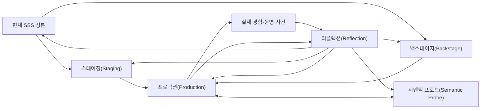

# 리플렉션(Reflection)

리플렉션(Reflection)은 실제로 만들어지고 경험되고 운영된 결과를 다시 바라보며, 이전에는 보이지 않았던 관념(Notion), 텐션(Tension), 액터(Actor), 씬(Scene), 완결(Closure)과 근거(Evidence)를 발견하는 **관찰–해석–환류 작업공간**이다.

리플렉션(Reflection)은 프로덕션(Production)을 채점하는 최종 심사도, 일정마다 반드시 수행하는 회고식도 아니다. 실제 결과는 처음의 이해를 증명하는 답안이 아니라 그 이해 자체를 다시 볼 수 있게 하는 새로운 현실이다.

> 리플렉션(Reflection)의 목적은 차이를 없애는 것이 아니라, 실제 결과가 어떤 관념(Notion)을 형성했고 그것이 의도·구성·경험·운영의 다른 스트림(stream)과 어떤 관계를 이루는지 다시 볼 수 있게 하는 것이다.

리플렉션(Reflection)은 Scenario-Semantic Synthesis(SSS)의 **재종합(Resynthesis)**이다. 이전 종합을 정답으로 두고 결과를 채점하지 않으며, 실제 경험·운영·수용에서 생긴 새 의미와 반례를 포함해 관계를 다시 구성한다. 재종합(Resynthesis)도 복수 관점을 하나의 사후 이야기로 봉합하지 않는다.

함께 읽을 문서: [관념(Notion)](00-notion.md), [텐션(Tension) 코어](01-tension.md), [텐션 가이드북(Tension Guidebook)](13-tension-guidebook.md), [오케스트레이션(Orchestration)](12-orchestration.md), [스테이징(Staging)](07-staging.md), [백스테이지(Backstage)](08-backstage.md), [시맨틱 프로브(Semantic Probe)](09-semantic-probes.md), [프로덕션(Production)](10-production.md), [근거와 인식론](03-evidence-and-epistemics.md).

## 1. SSS 안에서의 위치



이 그림은 필수 순서를 뜻하지 않는다.

- 프로덕션(Production) 전에도 기존 작품, 운영 시스템, 프로토타입(Prototype), 사건을 대상으로 리플렉션(Reflection)할 수 있다.
- 프로덕션(Production) 도중 한 비트(Beat)나 결정만 다시 볼 수 있다.
- 리플렉션(Reflection)에서 아무 변경도 만들지 않을 수 있다.
- 발견이 충분하지 않으면 시맨틱 프로브(Semantic Probe)나 백스테이지(Backstage) 탐색으로 돌아갈 수 있다.
- 새로운 의도나 개입이 필요하면 새 프로덕션 후보(Production Candidate)를 열 수 있다.

리플렉션(Reflection)은 닫힌 개발 순환의 마지막 칸이 아니라, 현실에서 얻은 근거(Evidence)가 의미 있는 곳으로 돌아가게 하는 열린 연결점이다.

## 2. 리플렉션(Reflection)이 보는 것

리플렉션(Reflection)은 적어도 다음 네 가지를 분리해서 볼 수 있다.

| 구분 | 질문 |
|---|---|
| Intended 관념(Notion) | 제작자나 현재 정본은 어떤 방향의 의미를 기대했는가? |
| Realized 관념(Notion) | 실제 구성·규칙·표현·동작은 어떤 방향을 만들었는가? |
| Experienced 관념(Notion) | 소비자와 참여자는 무엇을 보고 어떤 의미 흐름을 만들었는가? |
| Operational 관념(Notion) | 운영자·조직·런타임은 무엇을 실제 완료·실패·권한·책임으로 다루었는가? |

이 네 스트림(stream)은 서로 같을 필요가 없다. 차이는 다음 중 무엇이든 될 수 있다.

- 의도된 다성성
- 관점과 역할(Role)의 자연스러운 차이
- 맥락에 따른 다른 해석
- 아직 설명되지 않은 텐션(Tension)
- 구현 또는 운영상의 결함
- 기존 SSS의 불충분한 설명
- 새로운 창작적 가능성
- 현재 범위에서는 중요하지 않은 차이

그러므로 리플렉션(Reflection)은 정렬도를 하나의 점수로 환원하거나 모든 스트림(stream)을 하나로 맞추지 않는다. 서로 매우 일치할 수도 있고, 다른 내용을 유지하면서 더 큰 방향에 정렬될 수도 있으며, 국소적으로 어긋난 채 가치 있는 와류를 만들 수도 있다.

## 3. 관념(Notion)은 중심이지만 판정 기준이 아니다

리플렉션(Reflection)에서 관념(Notion)은 다음을 다시 묻게 한다.

- 왜 이 씬(Scene)이 이런 방식으로 구성되었는가?
- 액터(Actor)는 왜 이 역할(Role)로 이 비트(Beat)를 수행했는가?
- 왜 이 소품(Prop)·세팅(Setting)·장소(Location)가 선택되었는가?
- 왜 이 연결이 인과적·개연적·핍진적으로 받아들여졌거나 거부되었는가?
- 어떤 완결(Closure)이 누구에게 종료로 느껴졌는가?
- 결과 전체에서 어떤 방향이 반복·대비·충돌·전환되었는가?

하지만 처음 기록한 관념(Notion)을 정답표로 사용해서는 안 된다. 실제 결과가 초기 관념(Notion)과 다르다는 이유만으로 실패라고 판정하면, 프로덕션(Production)과 소비자가 만든 새로운 의미를 보지 못한다.

반대로 실제로 나타난 패턴을 곧바로 제작자의 원래 의도로 소급해서도 안 된다. 리플렉션(Reflection)은 의도, 실제 구성, 수용, 운영 현실의 출처를 분리한다.

## 4. 텐션(Tension)을 다시 보기

리플렉션(Reflection)은 텐션(Tension)을 가장 풍부하게 발견할 수 있는 자리 중 하나다. 실제 경험은 문서와 모형에서는 생기지 않았던 저항과 와류를 만든다.

다만 다음을 동일시하지 않는다.

```text
차이 ≠ 텐션(Tension)
텐션(Tension) ≠ 결함
결함 ≠ 반드시 즉시 수정할 대상
해소 ≠ 개선
보존 ≠ 방치
```

리플렉션(Reflection)에서 할 일은 텐션(Tension)을 억지로 찾거나 해소하는 것이 아니라 다음을 분리해 남기는 것이다.

1. 무엇이 감지되었는가?
2. 누구의 관점에서 감지되었는가?
3. 직접 관찰(Observation)인가, Interpretation인가?
4. 어떤 관념 스트림(Notion stream)과 요소 사이에서 나타나는가?
5. 현재 중요도·원인·가치를 판단할 근거(Evidence)가 있는가?
6. 보존, 추가 관찰, 프로덕션 후보(Production Candidate)화 중 무엇이 필요한가?

가치 있는 낯섦이나 창작적 마찰을 정상화라는 이름으로 제거하지 않는다. 반대로 “창의적 텐션(Tension)”이라는 이름으로 실제 피해나 장애를 미화하지 않는다.

## 5. 리플렉션(Reflection)의 세 가지 렌즈

다음 구분은 고정 단계가 아니라 서로 겹칠 수 있는 관찰 렌즈다.

### 5.1 Review

현재 SSS, 스테이징(Staging), 백스테이지(Backstage), 프로덕션(Production)의 기대와 실제 결과를 비교한다.

- 의도한 씬(Scene)과 비트(Beat)가 실제로 구분되는가?
- 예상한 액터(Actor)·역할(Role)·권한이 실제로 작동하는가?
- 백스테이지(Backstage)에서 예상한 상태·책임·실패 조건이 맞았는가?
- 완결(Closure)의 시작·종료·잔여물이 실제 경험과 일치하는가?
- 프로덕션(Production)의 작업 결정(Working Decision)이 결과에 어떤 관념(Notion)을 만들었는가?

### 5.2 Feedback

소비자, 참여자, 운영 환경과 외부 변화에서 새 근거(Evidence)를 읽는다.

- 사용자·관객·참여자 반응
- 운영자와 지원 담당자의 관찰
- 인터뷰, 리뷰, 문의, 불만
- 로그, Trace, Analytics, Replay
- Incident와 복구 과정
- 정책·시장·조직·환경 변화

Feedback은 요구사항 자체가 아니다. 누가 어떤 맥락에서 무엇을 경험했는지 해석해야 하는 근거(Evidence)다.

### 5.3 Retrospective

우리가 이해하고 결정하고 제작한 방식을 되돌아본다.

- 어떤 미확인(Unknown)을 너무 일찍 닫았는가?
- 어떤 텐션(Tension)을 보았지만 설명 가능한 사실처럼 바꾸었는가?
- 무엇을 관찰(Observation)보다 강한 주장으로 기록했는가?
- 어떤 작업 결정(Working Decision)이 정본의 원래 의도로 오해되었는가?
- 어떤 프로브(Probe)·모형·지표의 blind spot을 놓쳤는가?
- EIFS 판단과 실제 결과 사이에는 어떤 차이가 있었는가?

Retrospective는 사람의 잘못을 찾는 절차가 아니다. 당시의 관점·제약·근거와 추론 구조를 다시 볼 수 있게 하는 렌즈다.

## 6. 의미 차이(Semantic Delta)라는 작업 표현

예상하거나 기록한 의미와 실제로 관찰된 의미 사이의 차이를 잠시 가리킬 때 `의미 차이(Semantic Delta)`라는 표현을 사용할 수 있다.

예:

- 예상하지 못한 액터(Actor)가 실제 책임 주체가 되었다.
- 같은 소품(Prop)이라고 보았던 것이 서로 다른 생애와 Identity를 가졌다.
- 액터(Actor)가 의도한 비트(Beat)와 다른 지점에서 변화를 느꼈다.
- 인과는 작동하지만 개연성(Plausibility)이나 핍진성(Verisimilitude)이 무너졌다.
- UI 완결(Closure)은 닫혔지만 경험·운영 완결(Closure)은 계속 열려 있었다.
- 구현의 임시 선택이 조직의 실제 규칙이 되었다.
- 소비자가 제작자의 관념(Notion)과 다른 스트림(stream)을 만들었지만 작품 전체와 강하게 정렬되었다.

의미 차이(Semantic Delta)는 SSS 코어(Core)가 아니라 리플렉션(Reflection)을 위한 작업 표현(Working Expression)이다. Delta는 결함, 텐션(Tension), 변경 명령을 뜻하지 않는다.

## 7. 리플렉션 범위(Reflection Scope)와 관찰 구간(Observation Window)

리플렉션(Reflection)은 무엇을, 누구의 관점에서, 어느 기간과 판본까지 보았는지 한정해야 한다.

작업상 다음 표현을 사용할 수 있다.

- **리플렉션 범위(Reflection Scope):** 이번에 다시 보는 씬(Scene), 완결(Closure), 프로덕션(Production) 결과, 사건 또는 경험의 범위
- **관찰 구간(Observation Window):** 관찰한 판본·기간·상황·표본의 범위
- **리플렉션(Reflection) 계기(Trigger):** 다시 보게 된 계기
- **리플렉션(Reflection) 레코드(Record):** 관찰, 해석, 미확인, 환류 결정을 보존한 작업 뷰(Working View)

이 표현들은 SSS 코어(Core) 요소가 아니다. 기록의 경계를 설명하기 위한 작업 어휘(Working Vocabulary)다.

범위(Scope)와 Window를 적는 이유는 관찰되지 않은 것을 존재하지 않는 것으로 오해하지 않기 위해서다. 특정 사용자군, 정상 경로, 짧은 기간, 한 Incident에서 얻은 결과를 전체 의미로 일반화하지 않는다.

## 8. 완결 단위(Closure Unit)와 리플렉션(Reflection)

리플렉션(Reflection) 자체도 의미 있는 시작과 끝이 있다면 하나의 완결 단위(Closure Unit)가 될 수 있다.

예:

```text
Incident 감지
→ 범위와 관점 설정
→ 근거(Evidence) 수집
→ 차이와 텐션(Tension) 해석
→ 환류·보존·무조치 결정
→ 리플렉션(Reflection) 기록 종료
```

하지만 리플렉션(Reflection) 기록의 종료가 다음을 뜻하지는 않는다.

- 대상 경험의 완결(Closure)이 모두 종료됨
- Incident의 모든 결과가 소멸함
- 텐션(Tension)이 해소됨
- 미확인(Unknown)이 확정됨
- 프로덕션 후보(Production Candidate)가 완료됨
- 관념(Notion)의 이름이 고정됨

또한 리플렉션(Reflection)은 과거 액터(Actor)가 실제로 경험한 완결(Closure)을 문서상으로 소급 변경할 수 없다. 대신 서로 다른 관점에서 어떤 완결(Closure)이 언제 닫혔고 어떤 잔여물이 남았는지 기록한다.

## 9. 씬(Scene)과 구성 요소를 다시 읽기

### 9.1 액터(Actor)와 역할(Role)

- 예상한 액터(Actor)가 실제로 판단하고 상태를 바꾸었는가?
- 문서에 없던 액터(Actor)나 Observer가 나타났는가?
- 액터(Actor)의 실제 역할(Role)은 의도한 권한·책임·제약과 같았는가?
- 같은 액터(Actor)가 관점에 따라 다른 관념(Notion)을 만들었는가?

### 9.2 소품(Prop), 세팅(Setting), 장소(Location)

- 소품(Prop)은 의도한 정보를 전달하고 상태 변화를 견뎠는가?
- 배경과 환경이 단순 장식이 아니라 행동과 해석을 바꾸었는가?
- 물리적·논리적 장소(Location)의 경계가 실제 경험과 맞았는가?
- 도구나 표현의 제약이 새로운 의미를 만들었는가?

### 9.3 씬(Scene)과 비트(Beat)

- 실제 참여자는 어디에서 씬(Scene)의 목적이 바뀌었다고 느꼈는가?
- 클릭·대사·함수 호출이 아니라 어떤 지점이 의미 있는 변화였는가?
- 예상하지 못한 반복·우회·중단·병행 경로가 있었는가?
- 하나로 본 씬(Scene)이 실제로는 여러 목적 단위였는가, 또는 그 반대인가?

### 9.4 인과성(Causality)·개연성(Plausibility)·핍진성(Verisimilitude)

- 앞 씬(Scene)의 변화가 뒤 씬(Scene)을 실제로 가능하게 했는가?
- 참여자 관점에서 연결을 납득할 수 있었는가?
- 세계의 규칙·시대·장르·조직 현실 안에서 그럴듯했는가?
- 같은 연결이 관점에 따라 다르게 평가되었는가?

### 9.5 주제(Subject)

- 반복되는 질문이 예상한 여러 씬(Scene)을 실제로 관통했는가?
- 새로운 사례가 기존 주제(Subject)의 범위를 넓히거나 갈라놓는가?
- 배타적 분류 때문에 겹치는 주제(Subject)가 사라지지는 않았는가?

## 10. 백스테이지(Backstage)와 운영 현실을 다시 읽기

Runtime과 운영은 보이지 않던 백스테이지(Backstage)에 강한 근거(Evidence)를 제공한다.

- 실제 State와 Identity는 어디에 존재하는가?
- 누가 권한(Authority)을 행사하고 누가 책임을 떠안는가?
- Failure·Retry·Rollback은 같은 의미를 반복하는가?
- Concurrency·Latency·대상 판본·호환 상태의 차이가 액터(Actor)의 경험을 바꾸는가?
- 보안·개인정보·접근성·비용·조직 제약은 어떤 씬(Scene)을 바꾸는가?
- 편입 구성(Imported Configuration)이 예상한 기능 외에 어떤 환경 전제(Environmental Premise)·행동 규칙·관념적 선택(Notional Choice)을 실제 경험에 만들었는가?
- 관측 장치가 필요한 근거(Evidence)를 보여주는가, 아니면 특정 현실만 보이게 하는가?

정상 동작도 근거(Evidence)다. Incident가 없다는 사실만으로 의도한 의미가 실현되었다고 결론 내리지는 않는다.

## 11. 프로덕션(Production) 결정과 EIFS를 되돌아보기

리플렉션(Reflection)은 프로덕션(Production)의 결정을 당시 출처와 함께 읽는다.

- 상속된 의도(Inherited Intent)는 실제로 어떻게 나타났는가?
- 수용된 변경(Accepted Change)은 기대한 변화를 만들었는가?
- 작업 결정(Working Decision)과 구현 국소 선택(Implementation-local Choice)이 의미 현실(semantic reality)이 되었는가?
- Assumption은 확인·반박·미확인 중 무엇인가?
- 보존한 미확인(Unknown)과 텐션(Tension)은 어떻게 변했는가?

EIFS를 사용했다면 다음을 비교할 수 있다.

- 당시 E·I·F·S의 이유(Reason)와 근거(Evidence)
- 예상한 Exposure와 실제 노출
- 예상한 개입 위험(Intervention Risk)과 실제 부작용·복구 가능성
- 기능적·경험적 결과
- 개입 우선순위(Intervention Priority)와 탐색 우선순위(Exploration Priority)를 잘 구분했는가?
- 공식이나 평가 방식에 대한 반례가 생겼는가?

리플렉션(Reflection)은 과거 EIFS 점수를 사후 결과에 맞게 고쳐 쓰지 않는다. 당시 평가(assessment)는 그대로 보존하고, 달라진 기준에 따른 판단은 별도의 재평가로 기록한다. 반복되는 반례는 EIFS의 축 정의·계수·적용 조건을 재검토하는 근거(Evidence)가 될 수 있다.

## 12. 근거(Evidence)와 해석

리플렉션(Reflection) 기록에서도 [주장 상태](03-evidence-and-epistemics.md#주장-상태)를 분리하고, 다음 둘을 따로 구분한다.

| 상태 | 의미 |
|---|---|
| Reported Experience | 참여자가 자신의 경험을 진술한 내용 |
| 텐션(Tension) Detected | 설명 전의 걸림·저항·관점 차이를 감지한 것 |

`Reported Experience`는 그 사람이 그렇게 진술했다는 관찰(Observation)이지만, 전체 소비자의 경험이나 시스템의 원인을 직접 증명하지는 않는다.

로그와 지표도 중립적인 현실 전체가 아니다. 무엇을 기록하도록 설계했는지에 따라 보이는 것이 달라진다. 부재 데이터와 침묵하는 액터(Actor)를 함께 고려한다.

## 13. 시맨틱 프로브(Semantic Probe)와 리플렉션(Reflection)

리플렉션(Reflection)에서 유용한 프로브(Probe)에는 다음이 있다.

- 인터뷰와 관찰: 액터(Actor)가 실제로 무엇을 의미 있게 구분하는지 보기
- Replay·화면 기록: 씬(Scene)과 비트(Beat)의 실제 진행 보기
- 로그·Trace·Timeline: Runtime 순서와 숨은 액터(Actor) 보기
- 지표와 Analytics: 반복 패턴과 분포 보기
- Incident reconstruction: 실패·복구·잔여물의 생애 보기
- Example·반례(Counterexample): 기존 경계와 해석 시험하기
- 역할극(Role-play)과 재연: 관점별 개연성(Plausibility) 차이 보기
- 프로토타입(Prototype)과 A/B 비교: 대안적 프로덕션(Production)의 가능성 보기
- Source·Test·Configuration: 실제 실현과 계약 확인하기

프로브(Probe)가 만든 표현과 실제 관찰(Observation)을 구분한다. 측정 가능한 것만 중요하다고 보거나, 한 프로브(Probe)가 보여주지 못한 것을 존재하지 않는다고 판단하지 않는다.

## 14. 기본 수행 흐름

이 흐름은 권장 경로이며 필수 순서가 아니다.

### 14.1 계기(Trigger)와 범위(Scope)를 적는다

왜 지금 다시 보는지, 무엇을 어디까지 볼지, 제외한 범위는 무엇인지 적는다.

### 14.2 비교 기준의 출처를 모은다

현재 SSS, 당시 판본, 스테이징(Staging)·백스테이지(Backstage)·프로브(Probe)·프로덕션(Production) 기록을 구분해서 읽는다. 최신 정본으로 과거 의도를 소급하지 않는다.

### 14.3 실제 결과와 경험을 관찰한다

판본, 기간, 액터(Actor), 정상·실패·중단 경로를 가능한 만큼 명시한다.

### 14.4 관념 스트림(Notion stream)과 의미 차이(Semantic Delta)를 읽는다

의도·실현·경험·운영의 방향을 비교하되, 차이를 곧바로 오류로 판정하지 않는다.

### 14.5 텐션(Tension)·미확인(Unknown)·근거(Evidence)를 갱신한다

감지와 해석, 현재 판단과 미확인을 분리한다.

### 14.6 환류 경로를 정한다

발견을 정본, 스테이징(Staging), 백스테이지(Backstage), 프로브(Probe), 프로덕션(Production) 또는 보존 기록 중 의미 있는 곳으로 보낸다. 아무것도 바꾸지 않아도 된다.

### 14.7 리플렉션(Reflection) 완결(Closure)을 닫는다

이번 관찰에서 무엇을 보았고 무엇을 남겼는지 기록한다. 대상 전체가 끝났다고 선언하지 않는다.

## 15. 가능한 결과와 환류

리플렉션(Reflection)의 정상적인 결과는 다양하다.

- 기존 해석이 새 근거(Evidence)로 강화됨
- 차이가 있으나 현재는 중요하지 않다고 판단함
- 관찰 구간(Observation Window)이 좁아 판단을 보류함
- 새 텐션(Tension)이나 미확인(Unknown)을 보존함
- 액터(Actor)·소품(Prop)·씬(Scene)·엣지(edge)·완결(Closure)·주제(Subject)·관념(Notion) 정본을 수정함
- 스테이징(Staging)을 다시 열어 관점별 구성을 시험함
- 백스테이지(Backstage) 질문을 열어 숨은 조건을 조사함
- 시맨틱 프로브(Semantic Probe)를 설계해 추가 근거(Evidence)를 얻음
- 프로덕션 후보(Production Candidate)를 새로 만들거나 기존 후보(Candidate)를 재평가함
- EIFS 적용에서 드러난 반례를 기록함
- 구현만 수정하고 의미 정본은 유지함
- 아무것도 변경하지 않음

의미 발견은 [정본 원칙](15-project-structure.md#정본-원칙)에 따라 각 요소의 정본으로, 새 개입·실현 필요는 프로덕션 후보(Production Candidate)로 보낸다. 리플렉션(Reflection) 기록(record) 자체는 정본들을 대신하지 않는 작업 뷰(Working View)다.

## 16. AI와 리플렉션(Reflection)

AI는 다음을 도울 수 있다.

- 당시 SSS와 현재 결과 비교
- 여러 액터(Actor)·관점의 관념 스트림(Notion stream) 후보 분리
- 로그·Trace·Feedback에서 반복 패턴 찾기
- 의미 차이(Semantic Delta), 텐션(Tension), 미확인(Unknown) 후보 제시
- 프로덕션(Production) 결정과 결과 연결
- 기존 완결(Closure)과 실제 종료 시점 비교
- 환류 대상과 추가 프로브(Probe) 후보 정리
- 여러 리플렉션(Reflection)에서 반복되는 EIFS 반례 탐색

AI는 특히 다음을 해서는 안 된다.

- 모든 차이를 결함이나 텐션(Tension)으로 선언하기
- Feedback 빈도를 의미적 중요도와 동일시하기
- 한 액터(Actor)의 해석을 전체 소비자의 관념(Notion)으로 일반화하기
- 제작자의 사후 설명을 원래 의도(Intent)로 소급하기
- 현재 구현을 실제라는 이유로 정답화하기
- 기존 SSS를 문서라는 이유로 정답화하기
- 리플렉션(Reflection) 결과를 근거 없이 자동 수정 작업으로 전환하기
- 책임 소재를 추정해 사람을 평가하기

AI가 내린 해석과 환류 제안도 추론(Inference)으로 표시한다.

## 17. 리플렉션(Reflection)을 여는 계기

다음은 가능한 계기(Trigger)일 뿐 필수 일정이 아니다.

- 프로덕션(Production) 결과나 프로토타입(Prototype)을 처음 경험했을 때
- 사용자·관객·참여자 반응이 들어왔을 때
- Incident, 실패, 복구, 예상 밖 정상 동작이 나타났을 때
- 운영 방식이나 정책·시장·조직 맥락이 변했을 때
- 새로운 액터(Actor)·역할(Role)·관점이 등장했을 때
- 기존 설명이 더 이상 자연스럽지 않을 때
- 완결(Closure)이 반복해서 다시 열릴 때
- EIFS 예상과 실제 결과가 크게 달랐을 때
- 단순히 현재 의미를 다시 보고 싶을 때

모든 Test Failure와 작은 수정에 리플렉션(Reflection) 문서를 만들 필요는 없다. 반대로 일정이 되었다는 이유만으로 리플렉션(Reflection)을 강제하지 않는다.

## 18. 가드레일(Guardrail)

- 리플렉션(Reflection)을 프로덕션(Production) 이후의 필수 게이트(Gate)로 만들지 않는다.
- 문제나 개선안을 반드시 찾아내지 않는다.
- 초기 관념(Notion)과의 일치율로 작품이나 시스템을 평가하지 않는다.
- 서로 다른 관념 스트림(Notion stream)을 하나로 합치거나 서열화하지 않는다.
- 모든 의미 차이(Semantic Delta)를 텐션(Tension), 결함 또는 변경 명령으로 바꾸지 않는다.
- 텐션(Tension)을 해소 실적이나 품질 점수로 사용하지 않는다.
- 프로덕션(Production)과 현재 SSS 중 어느 쪽도 자동 정답으로 삼지 않는다.
- Feedback을 그대로 요구사항(Requirement)으로 바꾸지 않는다.
- 정량 지표를 경험의 전체 의미로 일반화하지 않는다.
- 관찰 구간(Observation Window) 밖의 부재를 존재하지 않음으로 기록하지 않는다.
- 리플렉션(Reflection) 완결(Closure)과 대상 완결(Closure), 프로덕션(Production) 종료를 동일시하지 않는다.
- Retrospective를 책임 추궁으로 바꾸지 않는다.
- 작업 뷰(Working View)인 리플렉션(Reflection) 기록을 정본으로 만들지 않는다.
- 과거 EIFS 평가(assessment)를 사후 결과에 맞춰 덮어쓰지 않는다.
- 아무 변화가 없다는 결론을 실패로 취급하지 않는다.
- 실제 결과를 설명하기 쉬운 하나의 회고 Scenario로 편집해 다른 경로와 관점을 지우지 않는다.
- 재종합(Resynthesis)을 최종 해석·사후 합의·과거 판단의 소급 정당화로 만들지 않는다.

## 19. 최소 기록

작은 리플렉션(Reflection)에서는 다음만 남겨도 된다.

```text
계기(Trigger) / 범위(Scope) / 관찰 구간(Observation Window):
관련 판본과 근거(Evidence):
Intended / Realized / Experienced / Operational 관념(Notion):
확인된 관찰(Observation):
Interpretation과 의미 차이(Semantic Delta):
텐션(Tension) / 미확인(Unknown):
완결(Closure) 상태와 잔여물:
프로덕션(Production) 결정·EIFS 예상과 실제 결과:
정본 환류 / 추가 프로브(Probe) / 새 프로덕션 후보(Production Candidate) / 무조치:
리플렉션(Reflection) 자체의 종료 조건:
```

리플렉션(Reflection)의 성공은 수정 건수를 늘리거나 초기 의도를 입증하는 데 있지 않다. 실제 결과가 만든 의미를 출처와 한계가 보이는 근거(Evidence)로 다시 읽고, 필요한 발견만 적절한 곳으로 돌려보내며, 설명되지 않은 차이는 성급히 제거하지 않고 보존하는 데 있다.
