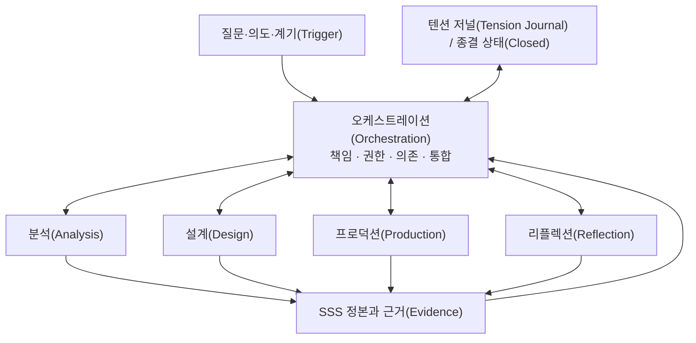

# 오케스트레이션(Orchestration)

오케스트레이션(Orchestration)은 여러 참여자·기능(Function)·배정(Assignment)·질문·근거(Evidence)·작업공간·산출물이 Scenario-Semantic Synthesis(SSS)를 함께 수행할 때, **책임·권한·의존·인계(Handoff)·통합·환류를 조율하는 조율 뷰(Coordination View)**다.

특정 조직 구조나 고정 워크플로(Workflow)를 정의하지 않는다. 누가 먼저 일하는지를 일렬로 정하는 것보다, 현재 무엇을 알아야 하고 어떤 작업이 서로 의존하며 어디에서 의미가 결정·변형·유실될 수 있는지를 외부화한다.

> 오케스트레이션(Orchestration)의 목적은 작업을 많이 분할하는 것이 아니라, 여러 작업과 관점 사이를 지나며 의미·근거·미확인·텐션(Tension)·결정이 사라지지 않고 다시 합쳐질 수 있게 하는 것이다.

함께 읽을 문서: [분석 절차](05-analysis-workflow.md), [기획·설계 절차](06-design-workflow.md), [근거와 인식론](03-evidence-and-epistemics.md), [후속 작업자 실행 규약](17-agent-and-human-handoff.md), [스테이징(Staging)](07-staging.md), [백스테이지(Backstage)](08-backstage.md), [시맨틱 프로브(Semantic Probe)](09-semantic-probes.md), [프로덕션(Production)](10-production.md), [리플렉션(Reflection)](11-reflection.md), [텐션 가이드북(Tension Guidebook)](13-tension-guidebook.md).

## 1. SSS 전체에서의 위치

오케스트레이션(Orchestration)은 SSS 코어(Core)의 새로운 세계 객체가 아니다. 액터(Actor)·씬(Scene)·완결(Closure)·관념(Notion)을 설명하는 층이 아니라, 그것을 탐색하고 만드는 여러 작업 사이의 관계를 보는 프랙티스(Practice)다.



오케스트레이션(Orchestration)은 분석(Analysis)·설계(Design)·프로덕션(Production)·리플렉션(Reflection)을 수행하지 않는다. 각 프랙티스(Practice)가 어떤 질문과 책임으로 열리고, 무엇을 입력받고, 어떤 결과를 어디에 합칠지 조율한다.

## 2. 워크플로(Workflow)가 아니라 조율 그래프다

다음은 전형적인 진행일 수 있지만 필수 순서가 아니다.

```text
탐색 → 종합 → 설계 → 실현 → 검증 → 문서화
```

실제 작업은 다음처럼 움직일 수 있다.

```text
검증 → 새 탐색
실현 → 설계 질문 재개방
문서화 → 용어 충돌 발견
종합 → 추가 근거(Evidence) 경로 분기
리플렉션(Reflection) → 프로덕션 후보(Production Candidate) 생성
```

오케스트레이션(Orchestration)은 순서표보다 다음 관계를 본다.

- 무엇이 다른 작업보다 먼저 알려져야 하는가?
- 어떤 작업은 서로 독립적으로 병렬 수행할 수 있는가?
- 어떤 결과는 함께 비교해야만 의미가 생기는가?
- 무엇은 정본 변경 전에 검증돼야 하는가?
- 어떤 기록은 현재 상태에 맞춰 수정하지 않고 보존해야 하는가?
- 어느 발견이 앞 작업의 범위(Scope)나 질문을 다시 열어야 하는가?

이를 **조율 그래프(Coordination Graph)**라는 작업 표현으로 부를 수 있다. 이는 SSS 코어(Core)나 필수 형식이 아니다.

## 3. 오케스트레이션(Orchestration)의 범위

오케스트레이션(Orchestration)은 다음을 조율할 수 있다.

- 기존 대상이나 현상의 분석
- 새로운 작품·소프트웨어·규칙·경험의 기획과 설계
- 실제 결과를 만드는 프로덕션(Production)
- 검증, 리플렉션(Reflection), 운영 관찰
- 문서와 정본 환류
- 여러 사람·AI·도구 사이의 협업
- 같은 사람이 다른 시점에 수행하는 서로 다른 책임

오케스트레이션(Orchestration)의 범위를 벗어나는 것:

- 대상 자체의 액터(Actor)·역할(Role)·씬(Scene)을 대신 정의하기
- 가장 좋은 조직도나 개발 방법론 결정하기
- 모든 분석에 동일한 조사 기법 강제하기
- 모든 프로덕션 후보(Production Candidate)의 우선순위를 대신 산출하기
- 의미적 논쟁의 정답을 기능(Function)이나 조직 계층(hierarchy)으로 결정하기
- 단순 일정·자원 관리 전체를 SSS 개념으로 대체하기

일정과 자원은 조율(Coordination)에 영향을 줄 수 있지만, 오케스트레이션(Orchestration)의 중심은 의미와 근거(Evidence)의 보존·결정·통합 관계다.

## 4. 액터(Actor) 역할(Role)·관점(Perspective)·오케스트레이션 기능(Orchestration Function)을 구분한다

### 4.1 세계 안의 역할(Role)

SSS 코어(Core)에서 액터(Actor)가 특정 씬(Scene)에서 갖는 목표·권한·책임이다.

### 4.2 스테이징 관점(Staging Perspective)

기획자·개발자·디자이너·테스터·운영자·소비자 등의 위치에서 현재 SSS를 다시 구성해 보는 관점이다.

### 4.3 오케스트레이션 기능(Orchestration Function)

현재 작업에서 어떤 종류의 탐색·종합·설계·실현·검증·문서화·조율이 필요한지를 나타내는 수행 기능이다. 특정 참여자에게 기능(Function)이 배정된 관계는 `기능 배정(Function Assignment)`라고 한다.

```text
세계 안의 역할(Role)
≠ 스테이징 관점(Staging Perspective)
≠ 오케스트레이션 기능(Orchestration Function)
≠ 실제 사람의 직책
```

한 사람이나 하나의 AI에게 여러 오케스트레이션 기능(Orchestration Function)을 배정할 수 있다. 여러 참여자가 하나의 기능(Function)을 함께 수행할 수도 있다. 기능(Function) 분리는 사람을 늘리기 위한 것이 아니라 현재 어떤 종류의 작업과 판단이 이루어지는지 알기 위한 것이다.

## 5. 작업 기능 어휘(Working Function Vocabulary)

다음 기능(Function)은 선택적 작업 어휘(Working Vocabulary)다. 모든 작업에 전부 필요하지 않으며 서로 겹칠 수 있다.

### 5.1 탐색 기능(Exploration Function)

현재 질문과 관련된 대상·자료·관점·근거(Evidence)·제약·미확인을 찾는다.

- 조사할 범위와 자료 후보 식별
- 기존 용어·ID·정본 확인
- 관련 액터(Actor)·씬(Scene)·주제(Subject)·완결(Closure)·관념(Notion)·텐션(Tension) 찾기
- 보이지 않는 조건과 외부 맥락(Context) 발견
- 추가 추적이 필요한 진입점 제시

탐색 기능(Exploration Function)은 많이 수집하는 사람을 가리키는 직책명이 아니다. 현재 질문을 이해하기 위해 무엇을 더 보아야 하는지를 찾는 수행 기능이다.

### 5.2 매핑 기능(Mapping Function)

넓게 발견한 자료를 중복·공백·연결이 보이는 지도로 만든다.

- 대상과 근거(Evidence) 인벤토리(inventory)
- 이름과 Identity의 잠정 대응
- 질문별 진입점과 커버리지(Coverage)
- 작업 의존·병렬 가능성
- 아직 배정되지 않은 영역

매핑 기능(Mapping Function)이 만든 지도는 현실의 온톨로지(ontology)나 최종 씬(Scene) 구조가 아니다. 탐색을 조율하기 위한 작업 뷰(Working View)다.

### 5.3 추적 기능(Tracing Function)

특정 질문이나 진입점에서 상태·정보·권한·행동·결과·잔여물을 끝까지 따라간다.

- 앞뒤 맥락(Context)과 조건 추적
- 액터(Actor) 판단과 비트(Beat) 변화 추적
- 정상·실패·취소·중단 경로 구분
- 근거(Evidence)가 끊기는 지점 표시
- 상류 원인 후보와 하류 영향 후보 분리

추적 기능(Tracing Function)은 명칭이나 한 장면만으로 전체 행동을 확정하지 않는다.

### 5.4 종합 기능(Synthesis Function)

여러 조사 경로의 결과를 같은 의미 좌표에서 비교하고 합친다.

- 같은 대상을 가리키는 다른 명칭 조정
- 관찰(Observation)·추론(Inference)·의도(Intent)·미확인(Unknown) 분리
- 서로 보완하는 근거(Evidence)와 충돌하는 근거(Evidence) 구분
- 국소 결과를 씬(Scene)·완결(Closure)·주제(Subject)·관념(Notion)의 전체 구조에 배치
- 합칠 수 없는 관점과 텐션(Tension) 보존

종합(Synthesis)은 여러 결론의 평균이나 다수결이 아니다. 출처와 차이를 보존한 채 함께 읽을 수 있게 하는 일이다.

여기서 종합 기능(Synthesis Function)은 방법론 전체 이름의 Synthesis와 동일한 층이 아니다. 전자는 현재 범위(Scope)의 결과를 비교·연결하는 오케스트레이션 기능(Orchestration Function)이고, 후자는 분석·설계·실현·수용 전체를 관통하는 비환원적 종합(Non-reductive Synthesis)의 원칙이다. 종합 기능 담당자에게 전체 의미를 확정할 권한이 자동으로 생기지 않는다.

### 5.5 설계 기능(Design Function)

현재 이해와 의도를 실현 가능한 구성으로 조직한다.

- 범위(Scope)와 경계 정리
- 대안과 Constraint 연결
- 결정된 것과 열린 미확인(Unknown) 구분
- 필요한 스테이징(Staging)·백스테이지(Backstage)·프로브(Probe) 준비
- 다음 기능 배정(Function Assignment)에서 암묵적으로 결정하면 안 되는 것 표시

### 5.6 실현 기능(Realization Function)

현재 결정을 실제 결과로 만든다.

- 구현·제작·구성·운영 규칙 생성
- 프로덕션(Production) 중 발견한 새 현실 외부화
- 상속된 의도(Inherited Intent)와 작업 결정(Working Decision) 구분
- 구현 편의로 미확인(Unknown)과 텐션(Tension)을 소급 확정하지 않음

### 5.7 검증 기능(Verification Function)

질문·기대·결정과 실제 근거(Evidence)의 관계를 다시 본다.

- 주장과 근거 대응 확인
- 결과와 의도 비교
- 주변 관계와 동반 변경(Co-change) 누락 확인
- 차이, 결함, 텐션(Tension)을 구분
- 부정적 결론의 조사 범위 확인

검증 기능(Verification Function)의 목적은 반드시 문제를 찾는 것이 아니다.

### 5.8 문서화 기능(Documentation Function)

현재 받아들여진 이해·결정·근거(Evidence)·미확인을 다음 사람이 다시 읽을 수 있게 정리한다.

- 정본과 작업 뷰(Working View) 구분
- 관련 문서·그래프·색인 갱신
- 이유(Reason)와 판본 보존
- 낡은 설명 표시
- 링크와 명칭 일관성 유지

문서화 기능(Documentation Function)을 배정받은 참여자는 문서를 쓴다는 이유로 의미 권위(semantic authority)가 되지 않는다.

### 5.9 조율 기능(Coordination Function)

질문을 작업 가능한 단위로 나누고 의존·인계(Handoff)·통합·재개방을 관리한다.

- 작업 묶음과 범위(Scope) 설정
- 순차·병렬 관계 판단
- 권한(Authority)과 중지 조건(Stop Condition) 외부화
- 충돌하는 결과의 통합 지점 마련
- 누락·중복·고립 작업 발견
- 완결(Closure)과 재개방 조건 관리

조율 기능(Coordination Function)은 다른 기능(Function)보다 높은 의미 결정권이 아니다. 조율 책임(Responsibility)과 의미 권위(semantic authority)를 구분한다.

## 6. 기능(Function)은 프랙티스(Practice)를 독점하지 않는다

탐색 기능(Exploration Function)만 분석(Analysis)을 수행하거나 실현 기능(Realization Function)만 프로덕션(Production)을 보는 것이 아니다. 하나의 프랙티스(Practice)에서 여러 기능(Function)이 필요할 수 있고, 하나의 기능(Function)이 여러 프랙티스(Practice)에서 수행될 수 있다.

```text
Primary 책임(Responsibility) ≠ Exclusive Ownership
조율(Coordination) 권한(Authority) ≠ Semantic 권한(Authority)
Participant ≠ 기능(Function) ≠ 배정(Assignment) ≠ 권한(Authority)
```

예를 들어 추적 기능(Tracing Function)에서 시맨틱 프로브(Semantic Probe)를 사용할 수 있고, 실현 기능(Realization Function)에서 백스테이지(Backstage)의 새 조건을 발견할 수 있으며, 문서화 기능(Documentation Function)에서 감지한 텐션(Tension)을 탐색 기능(Exploration Function)으로 되돌릴 수 있다.

## 7. 책임(Responsibility)과 권한(Authority)

책임(Responsibility)은 무엇을 보거나 남겨야 하는지를 말한다.

권한(Authority)은 무엇을 결정·변경할 수 있고 무엇을 임의로 확정해서는 안 되는지를 말한다.

작업마다 필요하면 다음을 적는다.

```text
책임(Responsibility):
  놓치지 않아야 할 질문과 산출물

May Decide:
  현재 범위(Scope)에서 새로 결정할 수 있는 것

May Change:
  수정할 수 있는 정본·작업 뷰(Working View)·산출물(artifact)

Must Preserve:
  소급 수정하면 안 되는 근거(Evidence)와 역사

Must Escalate or Return:
  현재 권한(Authority)으로 닫을 수 없는 질문
```

권한(Authority)을 계급으로 만들지 않는다. 암묵적 결정이 어디서 생겼는지 추적하기 위한 경계다.

## 8. 질문 중심의 작업 패킷(Work Packet)

분석과 설계 작업은 파일 수나 화면 수가 아니라 질문과 의미 경계를 기준으로 나눈다. 이를 `작업 패킷(Work Packet)`이라는 작업 표현으로 부를 수 있다.

권장 구성:

- Packet ID와 질문
- 범위(Scope)와 제외 범위
- 관련 판본·맥락(Context)·관점
- 필요한 근거(Evidence) 종류와 출처 후보
- 기존 정본·작업 뷰(Working View) 링크
- 담당 기능(Function), 배정(Assignment)과 권한(Authority)
- 선행·병렬·후속 Packet
- 기대하는 출력 형식
- 인계(Handoff) 대상과 통합 지점
- 중지 조건(Stop Condition)
- 열린 미확인(Unknown)·텐션(Tension)

작업 패킷(Work Packet)은 이슈(Issue)나 Ticket과 같을 수 있지만 반드시 같지는 않다. 의미 있는 질문 단위를 외부화하기 위한 표현이다.

나쁜 분할 예:

```text
사람 A: 파일 1~100
사람 B: 파일 101~200
```

자료의 물리적 분할만 있고 질문·상태 흐름·통합 지점이 없다면 결과를 합치기 어렵다.

더 나은 분할 예:

```text
Packet A: 액터(Actor)의 권한이 형성되는 경로
Packet B: 소품(Prop)의 생성부터 소비와 잔여까지
Packet C: 실패 시 완결(Closure)이 닫히는 방식
Packet D: 세 경로의 교차 씬(Scene)과 관점 차이 종합
```

물리적 자료 범위는 각 Packet 안에서 근거(Evidence) 범위(Scope)로 사용한다.

## 9. 분석 오케스트레이션(Orchestration)

분석의 구체 절차는 [분석 절차](05-analysis-workflow.md)에 있다. 여기서는 여러 분석 활동을 어떻게 조율하는지만 다룬다.

### 9.1 질문과 판정 기준을 먼저 둔다

분석 전에 무엇을 답하려는지와 어떤 근거(Evidence)가 있어야 어느 수준까지 말할 수 있는지를 적는다. “전체를 분석한다”는 말만으로 Packet을 열지 않는다.

### 9.2 넓은 Survey와 깊은 Trace를 분리한다

넓은 Survey는 인벤토리(inventory), 명칭, 진입점, 커버리지(Coverage)를 찾는다. 깊은 Trace는 특정 질문을 상태 변화와 결과까지 따라간다.

```text
Survey가 Trace의 후보를 만든다.
Trace가 Survey의 지도를 수정한다.
```

둘을 섞으면 넓게 보지 못한 채 한 경로에 매몰되거나, 목록만 많고 실제 동작과 의미를 모르는 상태가 된다.

### 9.3 독립 근거(Evidence) 경로는 병렬화한다

다음과 같은 경우 병렬 Packet이 유용하다.

- 서로 다른 액터(Actor) 관점
- 서로 다른 근거(Evidence) 종류
- 독립된 상태 흐름
- 정상 경로와 실패·취소 경로
- 서로 다른 판본이나 사례
- 같은 질문에 대한 구성·경험·운영 관점

그러나 다음은 먼저 공통 기준이 필요할 수 있다.

- 같은 이름과 Identity를 공유해야 하는 조사
- 한 Packet의 결과가 다른 Packet의 진입점을 결정함
- 같은 근거(Evidence)를 서로 다르게 수정할 위험이 있음
- 통합 전에 판본과 범위(Scope)가 맞아야 함

### 9.4 중간 산출물을 정답이 아니라 Navigation으로 사용한다

인덱스, 목록, Diagram, 검색 결과, 요약은 다음 조사를 안내하는 지도다. 정교한 형식이라고 직접 근거(Evidence)나 의미 정본이 되지 않는다.

### 9.5 질문별로 끝까지 추적한다

진입점을 찾았다는 것으로 Packet을 닫지 않는다. 현재 질문에 필요한 만큼 조건, 액터(Actor) 판단, 상태 변화, 결과, 실패·취소·잔여까지 따라간다.

모든 세부를 끝까지 조사하라는 뜻은 아니다. 중지 조건(Stop Condition)은 질문에 비례해야 한다.

### 9.6 발견을 즉시 전체 문서로 확정하지 않는다

개별 Packet의 결과는 다음 통합 단계에서 명칭·관점·근거(Evidence) 상태·반례와 비교한다. 새 씬(Scene)이나 액터(Actor) 후보를 곧바로 전역 정본으로 만들지 않는다.

### 9.7 커버리지(Coverage)를 역으로 검사한다

종합 뒤 원래 인벤토리(inventory)와 질문으로 돌아간다.

- 배정되지 않은 영역은 무엇인가?
- 이름만 알고 행동을 모르는 것은 무엇인가?
- 정상 경로만 있고 실패·중단이 빠졌는가?
- 보이는 경험만 있고 백스테이지(Backstage) 판단이 빠졌는가?
- 분석되지 않은 것과 존재하지 않는 것을 구분했는가?

### 9.8 완결(Closure)은 질문 단위로 닫는다

분석 종료는 대상을 완전히 이해했다는 뜻이 아니다.

```text
질문에 대한 현재 답변
+ 근거(Evidence)와 한계
+ 남은 미확인(Unknown)과 텐션(Tension)
+ 다음 재개방 조건
→ 이번 분석 Packet 또는 오케스트레이션(Orchestration) 완결(Closure) 종료
```

## 10. 분석 결과의 통합

병렬 조사의 가치는 결과를 함께 읽을 때 생긴다. 통합은 파일을 한곳에 모으는 일이 아니다.

### 10.1 범위(Scope)와 판본을 맞춘다

서로 다른 맥락(Context)을 같은 결과처럼 합치지 않는다.

### 10.2 명칭과 Identity를 조정한다

같은 대상을 다른 이름으로 기록했는지, 같은 이름이 다른 대상을 가리키는지 확인한다. 성급한 병합은 피한다.

### 10.3 근거(Evidence) 상태를 보존한다

관찰(Observation), 추론(Inference), 의도(Intent), 미확인(Unknown), 충돌(Conflict)을 통합 과정에서 평탄화하지 않는다.

### 10.4 보완·충돌·독립을 구분한다

- 보완: 서로 다른 부분을 함께 설명함
- 충돌: 같은 범위(Scope)에서 양립하기 어려움
- 관점 차이: 같은 대상을 다른 위치(Position)·관점(Perspective)·관념(Notion)에서 읽음
- 독립: 우연히 유사하지만 서로 영향을 주지 않음
- 미확인: 관계를 판단할 근거(Evidence)가 없음

### 10.5 정본과 작업 뷰(Working View)로 환류한다

지속적 의미는 관련 SSS 정본에, 조사 경로와 임시 비교는 오케스트레이션(Orchestration)·프로브(Probe)·리플렉션(Reflection) 등의 작업 뷰(Working View)에 남긴다.

### 10.6 통합되지 않은 차이를 보존한다

합의가 없거나 관계를 설명하지 못한 결과를 강제로 하나로 만들지 않는다. 충돌(Conflict), 미확인(Unknown) 또는 텐션(Tension)으로 출처와 함께 남긴다.

## 11. 설계와 프로덕션(Production) 오케스트레이션(Orchestration)

설계와 프로덕션(Production)에서도 같은 조율(Coordination) 원칙을 사용한다.

- 의도와 Reality를 읽는 Packet 분리
- 대안 탐색과 실제 결정의 권한(Authority) 분리
- 작업 결정(Working Decision)의 출처 기록
- 고위험 개입 전 프로브(Probe)와 관찰 준비
- 실현(Realization) 중 새 발견의 반환 경로
- 검증(Verification)과 리플렉션(Reflection)의 질문 분리
- 결과가 영향을 주는 정본과 문서의 동반 변경(Co-change) 관리

프로덕션 후보(Production Candidate) 우선순위가 필요하면 [프로덕션(Production)](10-production.md)의 EIFS를 사용할 수 있다. EIFS는 오케스트레이션(Orchestration) 전체의 기능(Function)·질문·텐션(Tension) 중요도를 평가하는 전역 스케줄러가 아니다.

## 12. 의존과 병렬성

작업 사이의 관계를 필요할 때 다음처럼 구분할 수 있다.

| 관계 | 의미 |
|---|---|
| `blocks` | 앞 결과가 없으면 뒤 질문을 의미 있게 시작할 수 없음 |
| `informs` | 앞 결과가 뒤 작업에 도움을 주지만 시작을 막지는 않음 |
| `can_parallel` | 현재 범위(Scope)에서 독립적으로 진행 가능 |
| `must_compare` | 별도 수행할 수 있으나 결론 전 함께 비교해야 함 |
| `must_merge` | 하나의 정본 변경이나 결정으로 통합해야 함 |
| `may_reopen` | 새 발견이 앞 질문이나 완결(Closure)을 다시 열 수 있음 |
| `preserve` | 현재 결과에 맞춰 소급 수정하면 안 됨 |

이 표는 프로젝트 관리 도구의 의존성(dependency) type을 대체하지 않는다. 의미와 근거(Evidence)의 관계를 설명하기 위한 선택적 표현이다.

병렬화는 참여자 수를 채우기 위한 것이 아니다. 다음 조건이 있을 때 유용하다.

- 질문 경계가 독립적임
- 공통 입력과 판본이 명확함
- 쓰기 대상이 충돌하지 않음
- 출력 형식과 통합 지점이 있음
- 결과가 다를 때 보존할 방법이 있음

## 13. 인계(Handoff)는 근거(Evidence) Packet이다

인계(Handoff)는 결과만 넘기는 Truth Transfer가 아니다.

```text
현재 이해(Current Understanding)
+ 관찰(Observation) / 추론(Inference) / 의도(Intent)
+ 이유(Reason)와 근거(Evidence)
+ 범위(Scope)와 조사하지 않은 범위
+ 결정(Decision)과 권한(Authority)
+ 미확인(Unknown) / 충돌(Conflict) / 텐션(Tension)
+ 다음 질문과 동반 변경(Co-change)
→ 다음 기능(Function) 담당자 또는 통합 지점
```

좋은 인계(Handoff)는 다음 사람이 모든 조사를 반복하지 않아도 출처를 확인하고, 필요하면 결론을 다시 질문할 수 있게 한다.

인계(Handoff)에서 피할 것:

- 결론만 전달하고 근거 위치를 숨김
- 추론을 확인된 사실처럼 평탄화함
- 조사하지 않은 범위를 생략함
- 작업 결정(Working Decision)을 원래 의도(Intent)로 소급함
- 다음 기능 배정(Function Assignment)에서 바꿀 수 없는 것과 바꿀 수 있는 것을 구분하지 않음
- 텐션(Tension)을 해결 과제로 자동 변환함

## 14. 동반 변경(Co-change)

`동반 변경(Co-change)`는 하나의 발견·결정·변경이 다른 자료(material)의 의미나 설명을 다시 확인하게 만드는 관계다.

파일 import나 직접 참조 같은 기계적 의존만을 뜻하지 않는다. 액터(Actor)의 권한(Authority) 변경이 씬(Scene), 완결(Closure), 사용자 설명, 테스트, 운영 절차에 동시에 영향을 줄 수 있다.

필요하면 자료(material)를 다음처럼 구분한다.

### Inspect

영향 가능성이 있어 다시 읽을 대상.

### Update When Affected

실제 의미가 달라졌다면 갱신할 대상.

### Must Update

이번 작업에서 영향이 확인되어 반드시 갱신할 대상.

### Preserve

과거 관찰(Observation), 결정(Decision), Incident, 판본별 평가(assessment)처럼 현재 상태에 맞춰 소급 수정하면 안 되는 대상.

동반 변경(Co-change)은 모든 관련 문서를 수정하라는 명령이 아니다. 실제 영향 여부를 판정하고 무변경도 기록할 수 있다.

## 15. 검증(Verification)과 리플렉션(Reflection)

검증(Verification)과 리플렉션(Reflection)은 함께 수행될 수 있지만 질문이 다르다.

검증(Verification):

- 현재 주장과 근거(Evidence)가 맞는가?
- 합의된 조건과 결정이 결과에서 성립하는가?
- 커버리지(Coverage)와 동반 변경(Co-change)이 누락되지 않았는가?
- 출력이 Packet의 중지 조건(Stop Condition)을 만족하는가?

리플렉션(Reflection):

- 실제 결과를 보니 이전 Meaning과 관념(Notion)을 다르게 이해해야 하는가?
- 예상하지 못한 액터(Actor)·씬(Scene)·완결(Closure)·텐션(Tension)이 드러났는가?
- 분석·설계·프로덕션(Production) 방식 자체에서 무엇을 배웠는가?

```text
검증(Verification) ≠ 리플렉션(Reflection)
통합 검사 ≠ 의미 합의 강제
```

검증(Verification)을 승인 게이트(Gate)로 사용할 수는 있지만 리플렉션(Reflection) 자체를 필수 게이트(Gate)로 만들지 않는다.

## 16. 관념(Notion)과 오케스트레이션(Orchestration)

서로 다른 기능 배정(Function Assignment)과 Packet은 같은 대상을 다른 관념 스트림(Notion stream)에서 읽을 수 있다. 오케스트레이션(Orchestration)은 이를 처음부터 하나로 맞추지 않는다.

- 초기 관념(Notion)을 모든 Packet의 승인 기준으로 만들지 않음
- 각 기능 배정(Function Assignment)이 어떤 위치(Position)·관점(Perspective)·맥락(Context)에서 판단했는지 보존
- 서로 겹치지 않는 결과도 큰 방향에 정렬될 가능성 검토
- 국소 논리와 반례를 통합 과정에서 삭제하지 않음
- 결과를 충분히 본 뒤 관념(Notion)의 정렬·변형·단절을 다시 읽음

조율 기능(Coordination Function)에서 일관성을 관리한다는 이유로 하나의 관념(Notion)을 전체 작업의 정답으로 강제해서는 안 된다.

### 16.1 품질 관심사 프로필(Quality Concern Profile)

여러 분야·직책·소비자 관점이 같은 품질 질문을 다르게 읽을 때에는 [품질 관심사 프로필(Quality Concern Profile)](14-quality-concern-profile.md)을 선택적으로 사용할 수 있다. 분야 비종속 질문(Domain-uncommitted Question)은 이름을 붙이기 전 `무엇을 묻는가`, 참조 렌즈(Reference Lens)는 `어떤 분야 어휘로 다시 보는가`, 품질 관심사(Quality Concern)는 `현재 어떤 말로 중요성을 표현하는가`, 위치(Position)는 `누가 어떤 맥락에서 보는가`, 오케스트레이션 기능(Orchestration Function)은 `어떤 수행이 필요한가`, 관념 스트림(Notion stream)은 `그 관점이 어느 의미 방향을 형성하는가`를 설명한다.

오케스트레이션(Orchestration)에서는 품질 특성을 직책별로 고정 배정하지 않고 다음을 외부화한다.

- 이름 붙기 전의 질문과 분야별 참조 렌즈(Reference Lens)의 가시성·사각지대
- 위치(Position)별 품질 관점 진술(Quality Perspective Statement)
- 품질 관심사 조율 매트릭스(Quality Concern Coordination Matrix)
- 근거(Evidence)·프로브(Probe)·측정값(Measure)과 blind spot
- 트레이드오프(Trade-off)·충돌(Conflict)·텐션(Tension)의 구분
- 결정 권한(Decision Authority)과 영향 위치(Impact Position)
- 인계(Handoff)·동반 변경(Co-change)·리플렉션(Reflection) 조건

범용 질문이나 품질 관심사(Concern) 자체는 오케스트레이션 기능(Orchestration Function), 관념(Notion), 요구사항(Requirement) 또는 측정값(Measure)이 아니다. 소프트웨어·극작 등 분야별 정밀 어휘는 제거하지 않되, 어느 하나도 전체 대상을 지배하는 정의로 만들지 않는다.

## 17. 텐션(Tension)과 오케스트레이션(Orchestration)

오케스트레이션(Orchestration) 과정 자체에서도 텐션(Tension)이 감지될 수 있다.

- 기능(Function) 담당자마다 같은 근거(Evidence)를 다르게 읽음
- 분석 범위(Scope)와 실제 파급 범위가 맞지 않음
- 설계 의도와 프로덕션(Production) Constraint가 함께 있기 어려움
- 여러 Packet의 결과가 같은 Identity를 다르게 구성함
- 인계(Handoff)를 거치며 미묘한 감각이나 반례가 사라짐
- 조율(Coordination) 방식 자체가 특정 관점을 반복해서 누락함

이 차이를 계층(hierarchy)이나 다수결로 바로 없애지 않는다. 감지와 Interpretation을 분리하고 필요하면 [텐션 저널(Tension Journal)](13-tension-guidebook.md)에 연결한다.

반대로 모든 기능 배정(Function Assignment)의 차이와 통합 충돌을 텐션(Tension)으로 만들지 않는다. 책임(Responsibility)·범위(Scope)·판본 차이만으로 설명되면 그렇게 기록한다.

## 18. 오케스트레이션(Orchestration) 완결(Closure)

질문을 열고 작업을 배치하고 결과를 통합하여 다음 상태를 남기는 과정은 하나의 완결 단위(Closure Unit)가 될 수 있다.

전형적 생애:

```text
질문·계기(Trigger) 발생
→ 범위(Scope)와 작업 패킷(Work Packet) 구성
→ Survey·Trace·설계·프로덕션(Production) 등 수행
→ 인계(Handoff)와 통합
→ 정본·작업 뷰(Working View) 환류
→ 현재 답변·한계·재개방 조건 기록
→ 이번 오케스트레이션(Orchestration) 종료
```

오케스트레이션(Orchestration) 종료는 다음과 다르다.

```text
오케스트레이션(Orchestration) 완결(Closure) 종료
≠ 대상 전체 분석 완료
≠ 모든 작업 패킷(Work Packet)의 영구 종료
≠ 관련 프로덕션(Production)·경험 완결(Closure) 종료
≠ 텐션(Tension) 해소
≠ 관념(Notion)의 이름 고정
```

종료할 때 최소한 다음을 남긴다.

- 답한 질문과 답하지 못한 질문
- 통합된 결과와 환류 위치
- Preserve해야 할 역사
- 열린 미확인(Unknown)·충돌(Conflict)·텐션(Tension)
- 닫히지 않은 또는 취소된 Packet
- 다시 열 수 있는 계기(Trigger)

## 19. 오케스트레이션(Orchestration) 레코드(Record)

복수 기능(Function)·배정(Assignment)·Packet·인계(Handoff)를 조율할 필요가 있을 때 선택적으로 오케스트레이션(Orchestration) 레코드(Record)를 사용한다.

최소 구성:

```text
계기(Trigger)와 질문:
범위(Scope) / 판본 / 관점:
기능(Function)과 배정(Assignment) / 책임(Responsibility) / 권한(Authority):
작업 패킷(Work Packet)과 의존 관계:
공통 근거(Evidence) 기준과 용어:
인계(Handoff)와 통합 지점:
동반 변경(Co-change): Inspect / Update When Affected / Must Update / Preserve
미확인(Unknown) / 충돌(Conflict) / 텐션(Tension):
현재 결과와 정본 환류:
중지 조건(Stop Condition) / 종료 / 재개방 계기(Trigger):
```

작은 작업에서는 대화나 기존 이슈(Issue)로 충분할 수 있다. 레코드(Record)가 없어도 조율은 가능하며, 모든 작업에 문서를 추가하지 않는다.

## 20. 사람과 AI의 협업

여러 사람, 여러 AI, 또는 사람과 AI를 함께 조율할 때도 같은 원칙을 적용한다.

### 20.1 맥락(Context) Packet을 명시한다

- 질문과 목적
- 읽어야 할 정본과 근거(Evidence)
- 범위(Scope)와 제외 범위
- 허용된 변경과 금지된 결정
- 기대 출력과 근거 표기
- 중지 조건(Stop Condition)과 인계(Handoff) 대상

### 20.2 독립 작업만 병렬화한다

같은 파일을 동시에 수정하거나 한 결과가 다른 작업의 전제인 경우 순차화 또는 명시적 통합이 필요하다.

### 20.3 산출물을 서로 검증 가능한 형태로 만든다

요약만 받지 않고 근거 위치, 검색 범위, 반례, 미확인을 함께 받는다.

### 20.4 통합 책임을 남긴다

병렬 산출물이 자동으로 하나의 결론이 되지 않는다. 명칭·판본·근거(Evidence) 상태·충돌을 비교할 종합 기능(Synthesis Function)과 통합을 배정받은 참여자가 필요하다.

### 20.5 AI 출력의 권위를 제한한다

AI가 조사·설계·구현·검증·문서화를 수행할 수 있지만, 출력은 맡은 범위(Scope)와 근거(Evidence) 안의 결과다. 자신감, 분량, 형식적 완성도가 의미 권위(semantic authority)를 만들지 않는다.

## 21. 실패 양상

### 21.1 순서만 관리하고 의미를 잃음

작업 상태는 보이지만 무엇이 왜 결정됐는지 알 수 없다.

### 21.2 자료 단위로만 분할함

파일·화면·페이지를 나눴지만 상태 흐름과 질문이 끊겨 통합할 수 없다.

### 21.3 병렬 결과를 나열만 함

각 결과는 맞을 수 있으나 명칭·판본·관점·근거(Evidence) 상태가 조정되지 않는다.

### 21.4 한 기능 배정(Function Assignment)의 Interpretation이 Truth가 됨

탐색(Exploration)의 발견, 설계(Design)의 의도, 실현(Realization)의 현실, 검증(Verification)의 판정, 문서화(Documentation)의 표현 중 하나가 전체 권위를 독점한다.

### 21.5 현재 Reality가 과거 의도(Intent)가 됨

존재하는 구현·관행·문서를 원래부터 의도된 것으로 소급한다.

### 21.6 미확인(Unknown)과 텐션(Tension)이 인계(Handoff)에서 사라짐

다음 기능(Function) 담당자가 열린 질문을 이미 결정된 것으로 받아들인다.

### 21.7 통합이 단순 다수결이나 평균이 됨

관점의 차이와 소수 근거(Evidence)가 삭제된다.

### 21.8 끝없이 조사함

질문별 중지 조건(Stop Condition)이 없어 대상을 완전히 이해할 때까지 작업이 닫히지 않는다.

## 22. 가드레일(Guardrail)

- 오케스트레이션(Orchestration)을 고정 워크플로(Workflow)나 승인 사슬로 만들지 않는다.
- 모든 작업에 모든 기능(Function)과 레코드(Record)를 요구하지 않는다.
- 기능(Function)이나 기능 배정(Function Assignment)을 사람의 정체성·직책·조직 계급과 동일시하지 않는다.
- 조율 기능(Coordination Function) 또는 그 담당자를 의미 권위(semantic authority)로 만들지 않는다.
- 책임(Responsibility)을 형식적 Checklist나 작업량 할당으로 만들지 않는다.
- 질문과 통합 지점 없이 자료를 기계적으로 분할하지 않는다.
- 병렬화를 목표로 삼거나 독립적이지 않은 작업을 억지로 병렬화하지 않는다.
- 인계(Handoff)를 Truth Transfer로 만들지 않는다.
- Existing Reality를 의도(Intent)나 정답으로 자동 승격하지 않는다.
- 미확인(Unknown)을 구현·문서화·일정 편의를 위해 닫지 않는다.
- 한 기능(Function) 담당자의 관념(Notion)을 전체 조율 기준으로 강제하지 않는다.
- 기능 배정(Function Assignment)의 차이와 결과 충돌을 모두 텐션(Tension)으로 만들지 않는다.
- 동반 변경(Co-change)을 기계적 의존성(dependency)이나 전부 수정 명령으로 만들지 않는다.
- Historical 근거(Evidence)를 현재 상태에 맞춰 소급 수정하지 않는다.
- 검증(Verification)이 문제를 발명하거나 리플렉션(Reflection)이 승인 게이트(Gate)가 되게 하지 않는다.
- 작업 패킷(Work Packet)과 오케스트레이션(Orchestration) 종료를 대상 전체의 완결로 오해하지 않는다.
- 문서 수·Packet 수·인계(Handoff) 수를 조율 품질로 평가하지 않는다.

## 23. 최소 운용 형태

작은 작업에서는 다음만 있어도 충분하다.

```text
질문과 범위(Scope):
누가 어떤 위치(Position)·관점(Perspective)에서 보며 어떤 기능(Function)을 배정받았는가:
어떤 근거(Evidence)를 확인하는가:
무엇을 결정하거나 변경할 수 있는가:
다음 작업이 알아야 할 미확인(Unknown)·텐션(Tension):
영향받을 수 있는 정본과 자료(material):
현재 종료 조건과 재개방 계기(Trigger):
```

오케스트레이션(Orchestration)의 성공은 모든 기능(Function)을 배정하거나 작업을 계획대로 끝내는 데 있지 않다. 서로 다른 질문과 관점이 독립성을 유지하면서도 필요한 지점에서 만나고, 의미와 근거(Evidence)의 출처가 보존되며, 새 발견이 앞 단계와 정본을 다시 열 수 있고, 현재 질문에 충분한 완결(Closure)을 설명 가능하게 만드는 데 있다.
