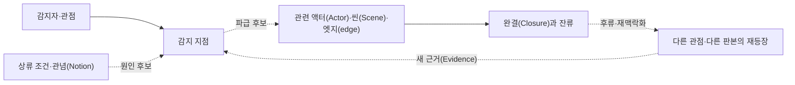
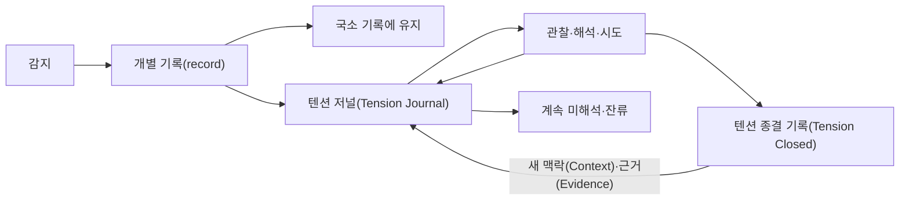

# 텐션 가이드북(Tension Guidebook)

이 Guidebook은 [텐션(Tension) 코어 정의](01-tension.md)를 실제 Scenario-Semantic Synthesis(SSS) 작업 전체에서 운용하기 위한 지침이다. 코어가 텐션(Tension)의 성질과 인식론적 경계를 정의한다면, 이 문서는 텐션(Tension)이 관념 스트림(Notion stream)과 모든 SSS 요소·작업공간을 가로질러 어떻게 나타나고 변하며 다시 보이는지를 다룬다.

텐션(Tension)은 SSS의 주변적인 이상 징후 목록이 아니다. 관념(Notion)의 큰 설명, 구체적인 세계와 행위, 연결의 설득력, 완결(Closure)의 생애, 제작과 수용 사이에서 아직 설명되지 않은 무언가를 잃지 않게 하는 **필수적인 횡단 관찰층**이다.

> 텐션(Tension) Guide의 목적은 텐션(Tension)을 많이 찾거나 해결하는 것이 아니라, 전체 의미 흐름 속에서 무엇이 어디에 걸리고 퍼지고 변형되고 잔류하는지를 다시 볼 수 있게 하는 것이다.

비환원적 종합(Non-reductive Synthesis)은 텐션(Tension)을 모두 설명하거나 해소한 뒤에만 가능해지는 상태가 아니다. 미해석·보류·잔류하는 텐션(Tension)의 위치와 궤적을 전체 관계 안에서 잃지 않는 것 자체가 종합의 일부다.

함께 읽을 문서: [관념(Notion)](00-notion.md), [핵심 모델](02-core-model.md), [근거와 인식론](03-evidence-and-epistemics.md), [스테이징(Staging)](07-staging.md), [백스테이지(Backstage)](08-backstage.md), [시맨틱 프로브(Semantic Probe)](09-semantic-probes.md), [프로덕션(Production)](10-production.md), [리플렉션(Reflection)](11-reflection.md), [오케스트레이션(Orchestration)](12-orchestration.md).

## 1. 전체 그림에서 텐션(Tension)의 위치

SSS에서 관념(Notion)은 방향성 있는 복수의 의미 스트림(stream)이고, 텐션(Tension)은 그 스트림(stream)과 구체 구조가 만나며 감지될 수 있는 와류다. 텐션(Tension)은 관념(Notion)에 종속되지 않지만, 관념(Notion)이 모든 것을 매끈하게 설명했다고 착각하지 않도록 한다.

```mermaid
flowchart TB
  N["복수 관념 스트림(Notion stream)"]
  W["액터(Actor) · 소품(Prop) · 세팅(Setting) · 장소(Location) · 주제(Subject)"]
  S["씬(Scene) · 역할(Role) · 비트(Beat) · 시퀀스(Sequence)"]
  E["인과성(Causality) · 개연성(Plausibility) · 핍진성(Verisimilitude)"]
  C["완결 단위(Closure Unit)"]
  P["스테이징(Staging) · 백스테이지(Backstage) · 프로브(Probe) · 프로덕션(Production) · 리플렉션(Reflection)"]
  T((텐션(Tension) 관찰층))

  N -. 방향·정렬·충돌 .-> W
  W --> S --> E --> C
  P <--> W
  P <--> S
  P <--> E
  P <--> C
  T -. 감지·궤적·잔류 .-> N
  T -.-> W
  T -.-> S
  T -.-> E
  T -.-> C
  T -.-> P
```

텐션(Tension)은 이 도식의 별도 단계나 마지막 검사가 아니다. 어느 곳에서든 감지될 수 있고 여러 곳에 동시에 걸칠 수 있다.

- 액터(Actor)의 목표와 실제 역할(Role) 사이
- 소품(Prop)이 표시하는 상태와 백스테이지(Backstage)의 실제 상태 사이
- 씬(Scene)의 행동과 다음 씬(Scene)의 변화 사이
- 작동하는 인과와 납득되지 않는 개연성(Plausibility) 사이
- 형식적 종료와 경험된 완결(Closure) 사이
- 제작자·개발자·디자이너·테스터·소비자의 관념 스트림(Notion stream) 사이
- 의도, 실제 구성, 경험, 운영 현실 사이
- 직접 관찰(Observation)과 기존 설명 사이

한 지점의 문제처럼 보여도 텐션(Tension)의 의미는 전체 구성과 관계 속에서 달라질 수 있다.

## 2. 가장 중요한 세 가지 역설

### 2.1 중요하지만 개별 중요도를 보장하지 않는다

텐션(Tension)을 보존하는 통로는 SSS에 필수다. 그러나 감지된 텐션(Tension) 하나가 중요한 문제라는 뜻은 아니다. 사소하거나 일시적일 수 있고, 특정 관점의 낯섦이거나, 작품의 생명력을 만드는 감각일 수 있다.

### 2.2 전체를 가로지르지만 모든 것을 지배하지 않는다

텐션(Tension)은 모든 SSS 요소와 작업공간에 부착될 수 있다. 그렇다고 모든 문서를 텐션(Tension) 중심으로 재분류하거나 모든 결정을 텐션(Tension) 해소에 종속하지 않는다.

### 2.3 반드시 기록할 수 있어야 하지만 반드시 해석·해소할 필요는 없다

필수인 것은 감지된 것을 버리지 않을 가능성이다. 모든 씬(Scene)에서 텐션(Tension)을 발굴하거나 모든 기록(record)을 해결 상태로 만드는 것은 필수가 아니다.

```text
필수: 관찰 통로 · 출처 · 관점 · 재방문 가능성
선택: 해석 · 평가 · 활용 · 장기 추적 · 닫힘 · 재열림
금지: 감지를 곧바로 결함·가치·우선순위·수정 명령으로 바꾸기
```

## 3. 점이 아니라 궤적과 관계로 보기

텐션(Tension)은 보통 한 지점에서 감지되지만 그 지점만의 속성이라고 단정할 수 없다.

```text
상류의 작은 정보 누락
→ 액터(Actor)의 판단 변화
→ 다른 비트(Beat) 선택
→ 인과 연결은 성립하지만 개연성(Plausibility) 약화
→ 뒤 씬(Scene)에서 소비자가 위화감 감지
→ 완결(Closure) 이후에도 잔류
```

따라서 다음을 구분한다.

- **감지 지점:** 관찰자가 실제로 무언가를 느끼거나 차이를 발견한 곳
- **관련 지점:** 같은 감각과 연결될 가능성이 있는 액터(Actor)·씬(Scene)·엣지(edge)·완결(Closure)·관념(Notion)
- **원인 후보:** 현재 근거(Evidence)로 추정하는 상류·하류 또는 관계적 조건
- **영향 후보:** 이후 구성·행동·경험에 나타날 가능성이 있는 변화
- **잔류 지점:** 씬(Scene)이나 완결(Closure)이 끝난 뒤에도 감각이 남거나 다시 나타나는 곳

이 구분은 인과관계를 미리 확정하지 않는다. 저널(Journal)은 점들을 연결할 수 있지만, 연결되지 않은 감지를 억지로 하나의 근원적 텐션(Tension)으로 합치지 않는다.

## 4. 텐션(Tension)의 전체적 읽기 축

다음 축은 고정 분류체계(taxonomy)가 아니라 전체 그림을 놓치지 않기 위한 질문이다.

### 4.1 관점 횡단

- 누가 직접 감지했는가?
- 누가 감지하지 않았는가, 아니면 아직 관찰하지 않았는가?
- 같은 대상이 액터(Actor)의 역할(Role)과 관념 스트림(Notion stream)에 따라 어떻게 달라지는가?
- 여러 관점의 차이 자체를 누가 관계적으로 감지했는가?

### 4.2 구조 횡단

- 텐션(Tension)이 액터(Actor)·소품(Prop)·세팅(Setting)·장소(Location) 중 어디에 부착되는가?
- 씬(Scene)과 비트(Beat)의 목적·권한·정보 변화와 어떻게 연결되는가?
- 인과성(Causality)·개연성(Plausibility)·핍진성(Verisimilitude) 중 어느 평가와 관계되는가?
- 주제(Subject)를 따라 다른 씬(Scene)에서도 되풀이되는가?

### 4.3 시간 횡단

- 언제 처음 감지되었는가?
- 증가·감소·축적·변형·이동·해소·잔류 중 무엇이 관찰되었는가?
- 같은 이름 아래 실제로 다른 감각이 이어진 것은 아닌가?
- 닫힌 뒤 어떤 새 맥락(Context)과 근거(Evidence)로 다시 열렸는가?

### 4.4 완결(Closure) 횡단

- 텐션(Tension)은 어떤 완결(Closure)이 열릴 때 생기고 닫힐 때 어떻게 변하는가?
- 형식상 완료됐는데도 왜 감각이 후류처럼 남는가?
- 텐션(Tension)은 사라졌지만 관련 과업이나 책임은 여전히 열려 있는가?
- 여러 중첩 완결(Closure) 중 누구의 종료를 보고 있는가?

### 4.5 제작–수용 횡단

- 스테이징(Staging)에서 예상한 감각과 실제 경험이 어떻게 다른가?
- 백스테이지(Backstage) 현실이 보이는 씬(Scene)을 어떤 방식으로 압박하는가?
- 프로덕션(Production)의 결정이 텐션(Tension)을 약화·강화·이동·변형했는가?
- 리플렉션(Reflection)에서 이전에는 보이지 않던 스트림(stream)과 잔류가 드러났는가?

### 4.6 근거(Evidence) 횡단

- 감지 자체를 뒷받침하는 관찰(Observation)은 무엇인가?
- 원인·가치·중요도에 대한 해석은 어떤 별도 근거(Evidence)를 갖는가?
- 서로 다른 근거(Evidence)가 같은 텐션(Tension)을 다르게 보이게 하는가?
- 관찰 장치의 blind spot이 텐션(Tension)의 부재처럼 보이게 하지는 않는가?

## 5. 텐션(Tension)을 전체 지도에 놓는 방법

개별 기록(record)을 작성한 뒤 필요하다면 다음 관계를 따라본다.



이 지도는 Root Cause Diagram이 아니다. 확정된 연결과 후보 연결을 구분한다. 목적은 한 원인으로 환원하는 것이 아니라 텐션(Tension)이 전체 구성에서 차지하는 위치와 움직임을 볼 수 있게 하는 것이다.

작업상 여러 기록(record) 사이의 관계를 `텐션(Tension) constellation` 또는 `텐션(Tension) field`라고 부를 수 있다. 이는 코어(Core) 요소나 별도 정본이 아니라 다음을 잠시 보기 위한 작업 표현(Working Expression)이다.

- 서로 다른 감지가 같은 구조를 둘러싸고 있는가?
- 하나의 감지가 여러 씬(Scene)과 관점에 다른 형태로 나타나는가?
- 독립된 텐션(Tension)들이 같은 완결(Closure)이나 관념 스트림(Notion stream)에서 서로 영향을 주는가?
- 특정 지점의 수정이 다른 텐션(Tension)을 없애지 않고 이동시킨 것은 아닌가?

## 6. 관념(Notion)과 텐션(Tension)의 상호 견제

관념(Notion)은 왜 구성이 그 방향을 가지는지 설명한다. 텐션(Tension)은 그 설명으로 아직 환원되지 않는 감각과 차이를 보존한다.

```text
관념(Notion) 없는 구성
→ 방향과 정렬을 잃을 위험

텐션(Tension)을 듣지 않는 관념(Notion)
→ 모든 차이를 큰 설명에 흡수할 위험

관념(Notion) 없는 텐션(Tension) 수집
→ 맥락 없는 이상 징후 목록이 될 위험

텐션(Tension) 없는 관념(Notion) 정렬
→ 다양성과 반례를 제거한 사후 합리화가 될 위험
```

텐션(Tension)이 반복된다고 곧바로 관념(Notion)이 틀렸다고 판단하지 않는다. 다음 가능성을 함께 둔다.

- 현재 관념(Notion)의 다른 축이 드러남
- 여러 관념 스트림(Notion stream)이 같은 구성에서 다르게 작동함
- 스트림(stream)의 생산적 충돌이나 반전
- 관념(Notion)과 무관한 국소 감각·조작성·리듬 문제
- 기존 관념(Notion) 해석의 범위가 너무 넓거나 좁음
- 현재 근거(Evidence)로는 관계를 설명할 수 없음

반대로 관념(Notion)과 연결되지 않는다는 이유로 텐션(Tension)을 사소하게 만들지 않는다. 아직 연결을 발견하지 못했을 수 있다.

## 7. SSS 구성 전체와의 관계

| 영역 | 전체 그림에서 볼 질문 |
|---|---|
| 액터(Actor)/역할(Role) | 목표·정보·권한·책임의 차이가 다른 액터(Actor)와 씬(Scene)에 어떻게 이어지는가? |
| 소품(Prop) | 기능·상징·표시 상태·실제 상태의 차이가 생애 전체에서 어떻게 변하는가? |
| 세팅(Setting)/장소(Location) | 환경과 장소(Location)가 행동 가능성·분위기·해석을 어떻게 굴절시키는가? |
| 씬(Scene)/비트(Beat) | 국소 변화가 앞뒤 목적과 시퀀스(Sequence)의 리듬에 어떤 후류를 남기는가? |
| C/P/V | 작동·납득·그럴듯함의 차이가 어느 관점과 연결에서 발생하는가? |
| 완결 단위(Closure Unit) | 시작·종료·잔여물이 서로 다른 관점에서 어떻게 어긋나거나 겹치는가? |
| 주제(Subject) | 같은 질문이 여러 씬(Scene)에서 어떤 다른 텐션(Tension) 형태로 재등장하는가? |
| 관념(Notion) | 스트림(stream)의 정렬·대비·충돌·단절에서 무엇이 설명되지 않고 남는가? |
| 근거(Evidence) | 감지와 설명, 관찰과 부재, 서로 다른 자료 사이에 무엇이 걸리는가? |

텐션(Tension)은 이 요소들을 대체하는 독립 온톨로지(ontology)가 아니다. 관련 요소의 정본을 링크하고, 저널(Journal)에는 텐션(Tension)의 감지와 이해 변화만 남긴다.

## 8. 작업공간 전체와의 관계

### 8.1 스테이징(Staging)

서로 다른 관점에서 같은 구성을 리허설하며 직접·관계적 텐션(Tension)을 감지할 수 있다. 스테이징(Staging)의 표현 차이를 자동으로 텐션(Tension)으로 만들지 않는다.

### 8.2 백스테이지(Backstage)

보이는 씬(Scene)과 실제 상태·책임·권한 사이의 감각을 추적한다. 기술 제약이 존재한다는 사실 자체는 텐션(Tension)이 아니며 특정 관점에서 감지된 것이 있어야 한다.

### 8.3 시맨틱 프로브(Semantic Probe)

표현·반례·실험을 바꾸어 텐션(Tension)의 경계와 궤적을 볼 수 있다. 프로브(Probe)가 만든 충돌을 현실의 텐션(Tension)으로 오인하지 않는다.

### 8.4 프로덕션(Production)

결정을 실현하며 텐션(Tension)을 유지·강화·약화·이동·해소하거나 새로 만들 수 있다. 프로덕션 후보(Production Candidate)와 EIFS는 개입 우선순위를 다룰 수 있지만 텐션(Tension) 자체의 가치나 중요도를 점수화하지 않는다.

### 8.5 리플렉션(Reflection)

Intended·Realized·Experienced·Operational 관념(Notion)을 비교하며 과거 기록(record)에 새 근거(Evidence)를 더한다. 의미 차이(Semantic Delta)가 있다고 자동으로 텐션(Tension)이 되는 것은 아니다.

## 9. 텐션 저널(Tension Journal)

여러 씬(Scene)·완결(Closure)·프로덕션(Production)·리플렉션(Reflection)·판본을 가로질러 텐션(Tension)을 따라갈 필요가 있을 때 사용하는 작업 뷰(Working View)를 **텐션 저널(Tension Journal)**이라고 한다.

기본 파일명:

```text
tension-journal.md
```

저널(Journal)은 다음이 아니다.

- 이슈(Issue) Tracker
- Bug List
- Risk Register
- 해결 Backlog
- 모든 텐션(Tension)의 완전한 목록
- 텐션(Tension) 중요도 순위표
- SSS의 새로운 Source of Truth

저널(Journal)은 개별 기록(record)을 단순히 모으는 목록보다 넓다. 다음을 함께 볼 수 있게 한다.

- 어디서 처음 감지되었는가?
- 어떤 액터(Actor)·씬(Scene)·완결(Closure)·주제(Subject)·관념(Notion)과 연결되는가?
- 다른 관점에서는 어떻게 감지되거나 감지되지 않았는가?
- 감지·해석·평가·활용이 어떻게 달라졌는가?
- 프로덕션(Production)의 선택 뒤에 텐션(Tension)은 사라졌는가, 이동했는가, 변형되었는가?
- 여러 기록(record)이 constellation을 이루는가, 아니면 우연히 비슷해 보이는가?
- 현재 적극적으로 보는 이유는 무엇인가?

> 텐션 저널(Tension Journal)은 해결 상태를 관리하는 문서가 아니라, 전체 구성 속에서 텐션(Tension)과 그 이해가 어떻게 움직였는지를 보존하는 문서다.

## 10. 무엇을 저널(Journal)에 올릴 것인가

모든 텐션(Tension)을 저널(Journal)에 넣지 않는다. 개별 씬(Scene)·프로덕션(Production)·리플렉션(Reflection) 기록 안에서 충분히 보존되는 감지도 있다.

저널(Journal)이 특히 유용한 경우:

- 여러 씬(Scene)·액터(Actor)·역할(Role)·주제(Subject)에서 반복됨
- 하나 이상의 완결(Closure)을 지나도 잔류하거나 다시 나타남
- 서로 다른 관념 스트림(Notion stream)의 정렬·충돌과 연결됨
- 프로덕션(Production)의 선택 뒤 다른 위치나 형태로 이동함
- 판본과 맥락(Context)에 따라 Interpretation이 변함
- 같은 감지를 다음 작업자가 처음부터 다시 발견할 가능성이 큼
- 해법보다 감각과 그 형성 경로를 기억하는 것이 중요함
- 아직 해석하지 않는 것이 더 정확함

저널(Journal)에 올리는 행위가 중요도나 Cross-cutting 성질을 확정하지 않는다. Local/Cross-cutting은 현재 관찰 범위를 설명하는 Working Classification일 뿐이다.

다음 질문이면 충분하다.

> 이 국소 작업이 끝난 뒤에도 이 감각의 궤적이나 관계를 다시 볼 가치가 있는가?

## 11. 저널(Journal)의 기본 구조

저널(Journal)은 프로젝트에 맞게 구성할 수 있지만 다음 네 뷰를 함께 가지면 전체 그림을 잃기 어렵다.

### 11.1 활성 저널(Active Journal)

현재 적극적으로 관찰하는 텐션(Tension)과 그 이유를 찾는 색인이다. 우선순위 backlog가 아니다.

### 11.2 관점(Perspective) and Structure Map

감지자·관점과 액터(Actor)·씬(Scene)·엣지(edge)·완결(Closure)·관념(Notion) 연결을 보여준다. 감지하지 않음과 관찰하지 않음을 구분한다.

### 11.3 이력(History) and Constellation

시간에 따른 Interpretation, 근거(Evidence), Attempt, 결과와 기록(record) 사이의 후보 관계를 보존한다.

### 11.4 Closing Queue

현재 적극적인 관찰에서 내려놓을지 검토하는 기록(record)과 닫힘 이유(Reason)·잔여 미확인(Unknown)·재열림 조건을 준비한다. 닫힘을 강제하는 만료 목록이 아니다.

기존 [텐션(Tension) ledger](templates/tension-ledger-template.md)는 전체 기록(record)을 찾기 위한 색인으로 유지할 수 있다. 저널(Journal)은 그중 장기적으로 궤적과 관계를 볼 필요가 있는 텐션(Tension)의 작업 뷰(Working View)다.

## 12. 저널(Journal)과 텐션 종결 기록(Tension Closed)

장기 추적을 사용한다면 현재 적극적으로 보는 텐션(Tension)과 현재는 내려놓은 텐션(Tension)을 두 작업 뷰(Working View)로 구분한다.

```text
텐션 저널(Tension Journal)
    │
    │ close: 현재 맥락(Context)에서 적극 관찰을 내려놓음
    ▼
텐션 종결 기록(Tension Closed)
    │
    │ reopen: 새 맥락(Context) · 근거(Evidence) · 관점 · 판본
    ▼
텐션 저널(Tension Journal)
```

기본 파일명:

```text
tension-journal.md
tension-closed.md
```

물리적으로 한 파일이나 데이터베이스에 저장해도 되지만, Active와 종결 상태(Closed)를 같은 의미 상태로 섞지 않는다.

## 13. 닫힘의 정확한 의미

`종결 상태(Closed)`는 다음을 뜻한다.

> 현재 맥락(Context)과 근거(Evidence)에서는 이 텐션(Tension)을 적극적인 관찰 대상으로 계속 유지하지 않기로 했다.

`종결 상태(Closed)`는 다음을 뜻하지 않는다.

- 텐션(Tension)이 영구적으로 사라짐
- Root Cause와 정답이 확정됨
- 관련 이슈(Issue)나 프로덕션(Production)이 완료됨
- 관련 완결 단위(Closure Unit)가 모두 닫힘
- 관련 관념 스트림(Notion stream)이 합의됨
- 같은 감각이 다시 나타날 수 없음
- 기록을 삭제하거나 Archive하여 잊어도 됨

```text
종결 상태(Closed) ≠ Completed
종결 상태(Closed) ≠ Resolved
종결 상태(Closed) ≠ Deleted
종결 상태(Closed) ≠ Unimportant
종결 상태(Closed) ≠ 완결 단위(Closure Unit) 전체 종료
```

닫힘은 텐션(Tension)의 본질 상태라기보다 **관찰 관계의 현재 상태**다. 누가 어떤 범위(Scope)와 이유로 적극 관찰을 내려놓았는지를 기록한다.

## 14. 닫힘 구조

텐션(Tension)을 닫을 때 최소한 다음 구조를 보존한다.

1. **종결 맥락(Closing Context):** 어떤 판본·상황·관점에서 닫는가?
2. **종결 이유(Closing Reason):** 왜 지금 적극 관찰에서 내려놓는가?
3. **마지막 뷰(Last View):** 마지막 감지·Interpretation·평가는 무엇인가?
4. **근거(Evidence):** 닫힘 판단에 사용한 근거(Evidence)와 한계는 무엇인가?
5. **잔여(Residual):** 남은 감각·미확인(Unknown)·반례·관련 열린 완결(Closure)은 무엇인가?
6. **Related 결정(Decision):** 유지·강화·약화·이동·해소·무조치 중 무엇을 선택했는가?
7. **재개방 신호(Reopen Signal):** 어떤 새 맥락(Context)·근거(Evidence)·관점·판본에서 다시 볼 수 있는가?
8. **Links:** 원 기록(record), 저널(Journal) history, 관련 SSS 정본·프로덕션(Production)·리플렉션(Reflection)은 어디에 있는가?

닫힘 이유(Reason)는 다음처럼 다양할 수 있다.

- 현재 범위(Scope)에서는 더 이상 두드러지지 않음
- 충분히 이해했지만 의도적으로 유지함
- 트레이드오프(Trade-off)로 받아들임
- 다른 텐션(Tension)으로 Reframe함
- 별도 Error·Warning·이슈(Issue)·프로덕션 후보(Production Candidate)로 전환함
- 관련 판본이나 맥락(Context)이 종료됨
- 추가 근거(Evidence)를 얻기 어렵고 현재 행동 가치가 없음
- 감지 자체가 다른 기록(record)과 중복되었음을 확인함
- 해소된 것으로 관찰했으나 재발 가능성은 남음

이유(Reason)를 `해결됨` 한 단어로 축약하지 않는다.

## 15. 닫힘과 완결 단위(Closure Unit)

텐션(Tension) 관찰을 닫는 행위가 의미 있는 시작과 끝을 가진다면 그 추적 세션 자체는 완결 단위(Closure Unit)로 볼 수 있다. 그러나 대상 텐션(Tension), 관련 씬(Scene), 프로덕션(Production), 경험의 완결(Closure)과 동일하지 않다.

```text
텐션(Tension) tracking 완결(Closure):
감지 → 기록 → 관찰·해석 → 현재 관찰 종료

대상 의미의 완결(Closure):
별도의 액터(Actor)·씬(Scene)·과업·경험 생애
```

닫힌 뒤에도 후류와 잔여물이 남을 수 있다. `tension-closed.md`는 바로 이 잔여와 역사, 재열림 가능성을 보존한다.

## 16. 재열림

새 맥락(Context)·근거(Evidence)·관점·판본이 생기면 종결 상태(Closed) 기록(record)을 저널(Journal)로 되돌릴 수 있다.

재열림 때 기존 기록을 덮어쓰지 않는다.

- 무엇이 새로 생겼는가?
- 이전 종결 이유(Closing Reason)는 당시에도 유효했는가?
- 같은 텐션(Tension)이 다시 나타난 것인가, 비슷한 새 감지인가?
- 기존 Interpretation이 강화·약화·변형되었는가?
- 어떤 SSS 관계가 새로 보이는가?

재열림은 과거 닫힘이 실패였다는 뜻이 아니다. 관찰 맥락(Context)이 달라졌다는 뜻일 수 있다.

## 17. 감지부터 저널(Journal)·종결 상태(Closed)까지

전형적 경로는 다음과 같지만 필수 lifecycle은 아니다.



건너뛰기, 병행, 분기, 병합 후보, Reframe이 가능하다. 모든 기록(record)을 저널(Journal)이나 종결 상태(Closed)로 이동시킬 필요는 없다.

## 18. 선택과 실제 결과

텐션(Tension)을 다루며 다음을 선택할 수 있다.

- 계속 관찰
- 의도적으로 유지 또는 강화
- 약화 또는 위치 이동
- 한쪽 Interpretation 선택
- 여러 관점을 함께 유지
- 맥락(Context)별로 나눔
- 트레이드오프(Trade-off) 수용
- 추가 프로브(Probe)
- 프로덕션(Production)에서 임시 결정
- Error·Warning·이슈(Issue)로 별도 전환
- 미확인(Unknown) 또는 무조치
- 다른 텐션(Tension)으로 Reframe
- 현재 관찰 닫기

선택 자체와 텐션(Tension)의 변화는 다르다. 예를 들어 해소를 의도했지만 다른 씬(Scene)으로 이동했을 수 있고, 유지하려 했지만 소비자에게는 사라졌을 수 있다.

저널(Journal)에는 필요할 때 다음을 연결한다.

```text
선택의 이유(Reason)
→ 프로덕션(Production)에서 실제 결정
→ 관찰된 결과
→ 텐션(Tension)의 변화
→ 현재 Interpretation
```

Accepted Semantic Change가 생기면 관련 SSS 정본으로 환류한다. 저널(Journal)은 그 변화가 필요해진 역사와 남은 텐션(Tension)을 설명하며 정본을 대신하지 않는다.

## 19. 근거(Evidence)와 저널(Journal)의 권위

텐션(Tension) 기록(record)이 직접 증명하는 것은 제한적이다.

> 특정 관찰자가 특정 맥락(Context)에서 무엇인가를 감지했거나, 분석자가 여러 관점 사이의 차이를 관계적으로 감지했다.

이 사실만으로 원인·가치·중요도·대표성·수정 필요성을 증명하지 않는다.

Source, Test, Runtime, Feedback, Incident, 프로덕션(Production), 리플렉션(Reflection)은 근거(Evidence)일 수 있지만 의미 권위(semantic authority)는 아니다. 저널(Journal)에 오래 기록되거나 여러 번 언급되었다는 이유로 중요하거나 참인 것도 아니다.

저널(Journal)에는 다음을 분리한다.

- 최초 감지 원문
- 직접 관찰(Observation)과 Reported Experience
- Interpretation과 원인 후보
- 평가 관점과 목적
- 선택과 실제 결과
- 아직 모르는 것
- 연결 후보와 확정된 관계

## 20. 시맨틱 프로브(Semantic Probe)

텐션(Tension)의 전체 궤적을 보기 위한 프로브(Probe) 예:

- 관점(Perspective) Map: 관점별 감지·비감지·미관찰 구분
- Timeline: 판본과 맥락(Context)에 따른 변화
- 씬(Scene)/완결(Closure) Map: 감지·파급·잔류 위치
- Argument Map: Interpretation과 근거(Evidence) 비교
- Example/반례(Counterexample): 감지가 생기는 경계 시험
- Rich Picture: 여러 액터(Actor)·환경·제약의 관계
- Replay/Trace: 실제 비트(Beat)와 Runtime 순서
- 프로토타입(Prototype)/역할극(Role-play): 선택 뒤 경험 변화 관찰
- Source/Test inspection: 현재 실현과 계약 확인

프로브(Probe) 온톨로지(ontology)를 텐션(Tension)의 실제 구조로 승격하지 않는다. 프로브(Probe)가 새 텐션(Tension)을 만들어 보이게 할 수도 있으므로 입력·표현·blind spot을 기록한다.

## 21. AI와 텐션(Tension)

AI는 다음을 도울 수 있다.

- 여러 문서와 판본의 반복 감지 후보 찾기
- 텐션(Tension)과 관련된 액터(Actor)·씬(Scene)·엣지(edge)·완결(Closure)·관념(Notion) 연결 제안
- 감지 위치와 원인 후보 위치 분리
- 저널(Journal) history와 constellation 후보 요약
- 선택 전후의 프로덕션(Production)·리플렉션(Reflection) 근거(Evidence) 비교
- 닫힘 이유(Reason)·잔여(Residual)·재개방 신호(Reopen Signal) 누락 확인
- 종결 상태(Closed) 기록(record)과 새 근거(Evidence)의 재열림 후보 탐색

AI는 다음을 해서는 안 된다.

- 모든 차이와 모순을 텐션(Tension)으로 대량 생성하기
- 텐션(Tension) 수·빈도·강도를 객관적 중요도나 품질 점수로 쓰기
- 비슷한 단어를 가진 기록(record)을 하나의 근원으로 자동 병합하기
- Best 프랙티스(Practice)로 텐션(Tension)을 자동 해결하고 닫기
- 저널(Journal)을 backlog로 바꾸고 Owner·Deadline을 강제하기
- 종결 상태(Closed)를 Completed로 해석하거나 오래된 기록(record)을 자동 삭제하기
- 하나의 관념(Notion)으로 모든 텐션(Tension)을 설명하기
- 텐션(Tension)을 근거로 사용자의 의도나 소비자 전체의 반응을 단정하기

AI가 제안한 연결·원인·닫힘·재열림도 추론(Inference)으로 기록한다.

## 22. 텐션 저널(Tension Journal) 예시

```markdown
## TEN-participant-003 — 저장됐는데 끝난 것 같지 않음

### 최초 감지
- 감지자·관점: 사용자 / 편집 작업
- 위치: 저장 표시 직후
- 감각 원문: "저장됐다고 나오는데 아직 끝난 것 같지 않다."
- 당시에는 원인·가치 미확정

### 전체 연결
- 씬(Scene): 저장 요청 → 완료 표시 → 종료
- 백스테이지(Backstage): 비동기 persistence와 실패 복구
- 완결(Closure): UI 저장 완결(Closure) / durable persistence 완결(Closure)
- 관념(Notion): 사용자 통제 / 운영 신뢰성
- 다른 관점: 운영자는 완료가 아니라 접수로 읽음

### 이력
- M1: UI와 Runtime 완료 차이 후보로 해석
- M2 프로덕션(Production): Saving/Saved 표현 분리 시도
- M2 리플렉션(Reflection): 정상 경로에서는 감소, 실패 경로에서는 잔류
- 현재: 단일 UI 문제보다 중첩 완결(Closure)과 관점 차이로 Reframe

### 근거(Evidence)와 한계
- Runtime trace, 사용자 관찰 3건, 실패 replay 1건
- 장기 사용과 접근성 관점은 미관찰

### 현재 뷰(View)
- 저널(Journal)에서 계속 관찰
- 실패 복구 프로덕션(Production) 뒤 재검토
```

## 23. 텐션 종결 기록(Tension Closed) 예시

```markdown
## TEN-participant-003 — 저장됐는데 끝난 것 같지 않음

### 종결 맥락(Closing Context)
- M3, 편집기 정상/실패 저장 경로

### 종결 이유(Closing Reason)
- 완료 단계를 분리했고 관찰 범위에서는 감각이 더 이상 두드러지지 않음
- 영구 해소를 주장하지 않고 현재 적극 관찰에서 내려놓음

### 마지막 뷰(Last View)
- UI 표현만의 문제가 아니라 중첩 완결(Closure)을 구분하지 못한 데서 감지된 것으로 해석

### 잔여(Residual)
- 장기 오프라인 복구와 접근성 사용자는 미관찰
- 운영자의 durable completion 책임은 별도 완결(Closure)에서 열려 있음

### 재개방 신호(Reopen Signal)
- persistence 실패 뒤 Saved 표시 재발
- 새 플랫폼 또는 동기화 방식 도입
- 다른 액터(Actor)가 완료 차이를 다시 감지

### Related
- 원 기록(record), M2/M3 프로덕션(Production), M3 리플렉션(Reflection), 완결(Closure) 문서
```

## 24. 가드레일(Guardrail)

- 텐션(Tension)을 지엽적인 오류 후보 목록으로 축소하지 않는다.
- 반대로 모든 SSS 관계를 텐션(Tension)으로 다시 기술하지 않는다.
- 감지 지점, 원인 후보, 영향 후보를 구분한다.
- 직접 감지와 관점 차이에 대한 관계적 감지를 구분한다.
- 감지하지 않음과 아직 관찰하지 않음을 구분한다.
- 전체 지도를 단일 Root Cause Diagram으로 환원하지 않는다.
- 관념(Notion)으로 텐션(Tension)을 전부 설명하거나 텐션(Tension)으로 관념(Notion)을 판정하지 않는다.
- 저널(Journal)을 이슈(Issue) backlog·위험 목록·품질 점수·정본으로 만들지 않는다.
- 모든 텐션(Tension)을 저널(Journal)에 올리거나 종결 상태(Closed)로 보내지 않는다.
- 저널(Journal) entry 수와 종결 상태(Closed) 수를 성과 지표로 사용하지 않는다.
- 닫힘을 강제하는 기한이나 완결률을 두지 않는다.
- 종결 상태(Closed)를 Completed·Resolved·Deleted와 동일시하지 않는다.
- 종결 이유(Closing Reason)·잔여(Residual)·재개방 신호(Reopen Signal) 없이 기록을 폐기하지 않는다.
- 재열림이 과거 닫힘의 실패라고 단정하지 않는다.
- 생산적 텐션(Tension)을 자동 제거하지 않고 실제 피해를 창의성으로 미화하지 않는다.
- 미해석·보류·무조치·잔류를 유효한 상태로 허용한다.

## 25. 최소 운용 형태

작은 프로젝트는 [개별 텐션(Tension) 기록(record)](templates/tension-record-template.md)과 [ledger](templates/tension-ledger-template.md)만으로 충분할 수 있다.

여러 작업과 판본을 가로지르는 텐션(Tension)이 생기면 다음을 추가한다.

```text
tension-journal.md
  현재 적극 관찰하는 기록(record)
  관점·구조·시간·완결(Closure) 연결
  Interpretation·근거(Evidence)·선택·결과의 변화

tension-closed.md
  현재 적극 관찰에서 내려놓은 기록(record)
  종결 맥락(Closing Context)과 이유(Reason)
  마지막 뷰(Last View)와 잔여(Residual)
  재개방 신호(Reopen Signal)와 관련 링크
```

텐션(Tension) 운용의 성공은 저널(Journal)을 비우거나 종결 상태(Closed) 수를 늘리는 것이 아니다. 관념(Notion)과 전체 구성의 큰 흐름을 보면서도, 아직 설명되지 않은 감각과 관점 차이, 이동과 후류를 잃지 않고 필요할 때 다시 열 수 있게 하는 데 있다.
