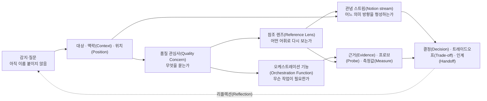
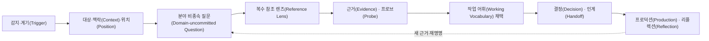

# 품질 관심사 프로필(Quality Concern Profile)

이 문서는 소프트웨어·극작·서비스·조직·제품을 비롯한 서로 다른 분야에서 품질을 바라보는 질문을 Scenario-Semantic Synthesis(SSS)와 [오케스트레이션(Orchestration)](12-orchestration.md)에 연결하는 선택적 프로필(Profile)이다. 어느 한 분야의 분류를 범용 정의로 승격하거나, 서로 다른 분야의 정밀한 어휘를 흐릿하게 합치지 않는다.

> 품질 관심사 프로필(Quality Concern Profile)은 **이름이 붙기 전의 질문을 열어 둔 채**, 여러 분야의 어휘를 시맨틱 프로브(Semantic Probe)로 사용하고, 현재 판단에 필요한 말을 임시로 채택하며, 그 말이 드러내는 것과 가리는 것을 함께 기록하기 위한 조율 장치다.

소프트웨어 품질 용어는 제거하지 않는다. 구현·운영·검증을 구체적으로 말할 수 있는 강한 참조 렌즈(Reference Lens)로 보존한다. 극작과 다른 분야의 용어도 같은 방식으로 사용한다. 다만 어느 렌즈도 처음부터 대상의 의미를 지배하는 정의가 되지 않는다.

함께 읽을 문서: [관념(Notion)](00-notion.md), [텐션(Tension)](01-tension.md), [핵심 모델](02-core-model.md), [근거와 인식론](03-evidence-and-epistemics.md), [스테이징(Staging)](07-staging.md), [시맨틱 프로브(Semantic Probe)](09-semantic-probes.md), [프로덕션(Production)](10-production.md), [리플렉션(Reflection)](11-reflection.md), [텐션 가이드북(Tension Guidebook)](13-tension-guidebook.md), [오케스트레이션(Orchestration)](12-orchestration.md).

## 1. 왜 범용화하는가

전문 용어는 대상을 선명하게 하지만, 너무 먼저 제시되면 관찰을 그 분야의 익숙한 문제로 고정할 수 있다.

```text
소프트웨어 용어로 먼저 명명
→ 구현·운영·측정에 강한 질문을 얻음
→ 서사·경험·사회적 의미를 부차적인 것으로 읽을 위험

극작 용어로 먼저 명명
→ 행동·갈등·리듬·수용에 강한 질문을 얻음
→ 상태·권한·복구·검증 조건을 은유로만 읽을 위험
```

범용화는 두 분류를 섞어 느슨한 상위 분류를 만드는 일이 아니다. 질문과 분야 어휘 사이에 **의미적 완충층(Semantic Buffer)**을 두는 일이다.

```text
아직 이름 붙이지 않은 감지·질문
→ 대상·맥락(Context)·위치(Position) 기술
→ 분야 비종속 질문(Domain-uncommitted Question)
→ 여러 분야 렌즈로 다시 보기
→ 각 렌즈의 가시성·사각지대 비교
→ 현재 작업 어휘(Working Vocabulary) 임시 채택
→ 프로덕션(Production)·리플렉션(Reflection)에서 재개방
```

범용 어휘도 완전히 중립적이지 않다. 그것 역시 질문을 계속 열어 두기 위한 작업 뷰(Working View)이며, 충분한 근거(Evidence)가 생기면 더 정밀한 분야 어휘로 교체할 수 있다.

## 2. 프로필(Profile)의 위치



```text
품질 관심사(Quality Concern) = 지금 무엇을 좋음·위험·결핍으로 묻는가
위치(Position)/관점(Perspective) = 누가 어떤 관계와 맥락(Context)에서 묻는가
참조 렌즈(Reference Lens) = 질문을 더 잘 보기 위해 어떤 분야 어휘를 통과시키는가
관념 스트림(Notion stream) = 그 읽기가 어떤 의미 방향을 형성하는가
오케스트레이션 기능(Orchestration Function) = 조사·설계·검증·조율 중 무엇이 필요한가
근거(Evidence)/측정값(Measure) = 무엇을 확인했고 무엇을 아직 모르는가
오케스트레이션(Orchestration) = 판단을 어디에서 비교·결정·전달·재검토하는가
```

## 3. 품질 관심사(Quality Concern)는 관념(Notion) 자체가 아니다

`신뢰성(Reliability)`, `구조적 응집성(Structural Coherence)`, `접근성(Accessibility)` 같은 이름은 질문의 축이다. 그 이름만으로 하나의 관념(Notion), 요구사항(Requirement), 합격 기준 또는 해결책이 결정되지 않는다.

예를 들어 `계속 이어질 수 있는가?`라는 질문은 다음처럼 읽힐 수 있다.

| 위치(Position)·렌즈 | 읽는 방식 | 형성될 수 있는 관념(Notion) 방향 |
|---|---|---|
| 소비자·사용자 | 필요할 때 경험이나 작업을 계속할 수 있는가 | 지속성·신뢰·예측 가능성 |
| 운영 | 실패를 감지하고 상태를 회복할 수 있는가 | 관측·통제·회복 |
| 제작·개발 | 변경과 실패를 국소화할 수 있는가 | 경계·변경 안전성 |
| 극작 | 중단과 재개가 행동·긴장·리듬을 보존하는가 | 기대·연속·변형 |
| 사업·사회 | 중단이 약속·관계·비용에 어떤 영향을 주는가 | 책임·연속성·신뢰 |

같은 관심사(Concern)는 여러 관념 스트림(Notion stream)을 통과할 수 있고, 하나의 관념 스트림(Notion stream)은 여러 관심사(Concern)를 묶을 수 있다.

## 4. 품질 관심사(Quality Concern)와 주제(Subject)

품질 관심사(Quality Concern)는 [주제(Subject)](02-core-model.md)와 가까울 수 있지만 자동으로 같지 않다.

- 관심사 라이브러리(Concern Library)는 질문 후보를 제공한다.
- 여러 씬(Scene)·액터(Actor)·소품(Prop)·완결(Closure)을 반복해서 가로지르는 질문이라면 주제(Subject)로 승격할 수 있다.
- 한 번의 국소 판단에 쓰인 속성을 형식적으로 주제(Subject)로 만들 필요는 없다.
- 분야 분류의 상하위 구조를 SSS의 주제(Subject) 구조로 그대로 복제하지 않는다.

```text
관심사 라이브러리(Concern Library):
  회복·재개할 수 있는가?

프로젝트의 주제(Subject) 후보:
  실패 뒤 사용자의 작업 연속성
  관계 단절 뒤 인물의 재접속
  운영 복구와 책임 인계
```

## 5. 위치(Position)·기능(Function)·액터(Actor) 역할(Role)을 구분한다

```text
직책·지속 위치(Position)
= 사람이 조직이나 제작 과정에서 지속적으로 놓인 관계와 책임

세계 안의 액터(Actor)/역할(Role)
= 대상 시스템이나 작품 안에서 판단하고 행동하는 주체와 씬(Scene)별 역할(Role)

스테이징 관점(Staging Perspective)
= 현재 구성을 특정 참여 위치에서 다시 읽는 관점

오케스트레이션 기능(Orchestration Function)
= 이번 작업에 필요한 탐색·추적·설계·검증·조율 등의 수행 기능

기능 배정(Function Assignment)
= 특정 기능과 책임(Responsibility)·권한(Authority)을 현재 참여자에게 배정한 관계
```

한 사람에게 여러 기능(Function)을 배정할 수 있고, 한 기능(Function)을 여러 사람이 다른 관점에서 수행할 수 있다. 직책만으로 관념(Notion)을 정하거나 품질 관심사(Quality Concern)를 독점하게 하지 않는다.

## 6. 분야에 앞서는 공통 질문 렌즈(Common Inquiry Lens)

다음 관심사군(Concern Family)은 완전하거나 배타적인 온톨로지(ontology)가 아니다. 처음부터 소프트웨어나 극작의 정답으로 이름 붙이지 않고 질문을 펼치기 위한 선택적 작업 어휘(Working Vocabulary)다.

| 관심사군(Concern Family) | 분야 비종속 질문(Domain-uncommitted Question) | 살펴볼 변화 |
|---|---|---|
| 구조(Structure) | 부분과 전체가 어떤 경계·의존·응집으로 구성되는가? | 결합·분리·누락·중복 |
| 행위와 역량(Agency & Capability) | 누가 무엇을 할 수 있고 무엇을 할 수 없는가? | 권한·행동 가능성·제약 |
| 인과와 전이(Causality & Transition) | 무엇이 무엇을 일으키며 상태나 의미가 어떻게 바뀌는가? | 원인·결과·분기·되돌림 |
| 일관성과 무결성(Consistency & Integrity) | 서로 다른 표현·상태·기대가 함께 성립하는가? | 모순·정합·보존·훼손 |
| 정보와 가시성(Information & Visibility) | 누가 무엇을 알고 보며 무엇을 추적할 수 있는가? | 공개·은폐·설명·관측 |
| 시간과 리듬(Time & Rhythm) | 순서·속도·지연·반복·중단이 어떤 경험과 결과를 만드는가? | 타이밍·페이싱·대기·회복 |
| 상호작용과 관계(Interaction & Relation) | 참여자와 요소가 어떻게 만나고 영향을 교환하는가? | 접촉·피드백·갈등·협력 |
| 변화와 적응(Change & Adaptation) | 새 조건·규모·해석에 어떻게 대응하고 무엇을 보존하는가? | 변경·확장·대체·진화 |
| 실현과 수용(Realization & Reception) | 의도한 것이 실제 결과와 경험에서 어떻게 나타나는가? | 구현·공연·운영·해석·수용 |
| 위험과 회복(Risk & Recovery) | 실패·위해·단절을 어떻게 예방·제한·감지·회복하는가? | 안전한 실패·복구·잔여 영향 |

이 렌즈의 질문은 답이 아니다. 실제 맥락(Context)에서 더 정밀한 분야 어휘가 필요해지면 해당 어휘를 사용한다.

## 7. 참조 렌즈(Reference Lens)를 사용하는 방법

참조 렌즈(Reference Lens)는 대상을 분야 용어에 종속시키는 분류기가 아니라, 다른 질문을 만들어 내는 시맨틱 프로브(Semantic Probe)다.

| 분야 비종속 질문(Domain-uncommitted Question) | 소프트웨어 유사 표현 | 극작 유사 표현 | SSS에서 함께 볼 것 | 비동일성 경계 |
|---|---|---|---|---|
| 부분이 전체와 함께 작동하는가? | cohesion, coupling, modularity | structural coherence, scene composition | 씬(Scene), 주제(Subject), 인과 엣지(edge) | 모듈(Module)은 씬(Scene)이 아님 |
| 주체가 의도에 따라 행동할 수 있는가? | permission, capability, operability | agency, character motivation | 액터(Actor), 역할(Role), 비트(Beat) | 권한 모델은 동기와 같지 않음 |
| 변화의 이유와 결과가 납득되는가? | state transition, causal trace | causal coherence, plausibility | 인과성(Causality), 개연성(Plausibility) | 실행 가능성은 개연성 전체가 아님 |
| 정보가 필요한 때 필요한 곳에 있는가? | observability, discoverability, provenance | information design, revelation | 소품(Prop), 세팅(Setting), 백스테이지(Backstage) | 로그는 관객의 앎과 같지 않음 |
| 중단 뒤 다시 이어질 수 있는가? | reliability, recoverability, rollback | continuity, dramatic recovery | 완결 단위(Closure Unit), 상태, 인계(Handoff) | 복구 완료는 서사적 완결이 아님 |
| 변화해도 정체성과 약속이 보존되는가? | maintainability, compatibility, evolvability | character integrity, thematic coherence, adaptability | 관념 스트림(Notion stream), 주제(Subject), 동반 변경(Co-change) | 테마 정렬은 호환성 판정이 아님 |

사용 순서:

1. 먼저 관찰한 대상·맥락(Context)·위치(Position)를 분야 용어 없이 기술한다.
2. 현재 질문을 공통 질문 렌즈(Common Inquiry Lens)로 펼친다.
3. 필요한 분야의 정밀 어휘를 하나 이상 참조 렌즈(Reference Lens)로 통과시킨다.
4. 각 렌즈가 새로 드러낸 것과 가린 것을 기록한다.
5. 현재 작업에 가장 유용한 말을 작업 결정(Working Decision)으로 채택한다.
6. 프로덕션(Production)·리플렉션(Reflection)에서 다시 열 조건을 남긴다.

## 8. 소프트웨어 품질 참조 렌즈(Software Quality Reference Lens)

다음은 소프트웨어를 구체적으로 분석·설계·운영할 때 사용할 수 있는 정밀 어휘다. 특정 표준의 공식 분류를 재현하지 않으며, SSS 코어(Core)나 모든 대상의 보편 분류가 아니다.

| 소프트웨어 관심사군(Concern Family) | 중심 질문 | 대표 관심사(Concern) 예시 | 자주 만나는 관념(Notion) 방향 후보 |
|---|---|---|---|
| 기능 적합성(Functional Suitability) | 필요한 목적을 올바르고 적절하게 지원하는가? | completeness, correctness, appropriateness | 목적 달성·정확성·과업 집중 |
| 성능 효율성(Performance Efficiency) | 시간·용량·자원을 어떤 약속 안에서 사용하는가? | time behaviour, resource utilization, capacity | 즉시성·절제·확장 여유 |
| 호환성(Compatibility) | 다른 대상과 공존하고 의미 있게 교환할 수 있는가? | coexistence, interoperability | 연결·상호 인정·경계 유지 |
| 상호작용 역량(Interaction Capability) | 참여자가 발견·학습·조작·이해·접근할 수 있는가? | learnability, operability, error protection, inclusivity, assistance, self-descriptiveness | 이해·통제·포용·자기 설명 |
| 신뢰성(Reliability) | 지정 조건에서 지속하고 실패를 견디며 회복하는가? | availability, fault tolerance, recoverability | 신뢰·연속성·회복 |
| 보안성(Security) | 정보·권한·행위·출처를 어떻게 보호하고 증명하는가? | confidentiality, integrity, accountability, authenticity, resistance | 통제·검증·책임·신뢰 |
| 유지보수성(Maintainability) | 이해·분석·변경·검증의 영향과 비용을 통제할 수 있는가? | modularity, analysability, modifiability, testability | 국소성·설명 가능성·변경 안전성 |
| 유연성(Flexibility) | 환경·규모·구성·대체 요구에 적응할 수 있는가? | adaptability, scalability, installability, replaceability | 적응·선택 가능성·비종속 |
| 안전성(Safety) | 위해 가능성을 식별·제약·경고하고 안전하게 실패하는가? | risk identification, operational constraint, fail safe, hazard warning | 보호·예방·제한·책임 |
| 아키텍처 품질(Architectural Quality) | 책임과 의존을 어떤 구조로 조직하는가? | cohesion, coupling, separation, encapsulation, composability | 경계·자율성·조합·단순성 |
| 운영 품질(Operational Quality) | 실제 상태를 관찰·진단·통제·복구할 수 있는가? | observability, diagnosability, deployability, rollback, resilience | 가시성·통제·회복·운영 신뢰 |
| 데이터 품질(Data Quality) | 정보가 정확하고 일관되며 출처와 생애를 추적할 수 있는가? | accuracy, completeness, consistency, timeliness, provenance, durability | 진실성·기억·추적·완료 |
| 진화 가능성 및 지속 가능성(Evolvability & Sustainability) | 장기 변화와 자원·기술 종속을 감당할 수 있는가? | evolvability, extensibility, configurability, reversibility, sustainability | 지속·가역성·독립·미래 여지 |

## 9. 극작·서사 품질 참조 렌즈(Dramatic & Narrative Quality Reference Lens)

다음은 극작·서사·공연을 구체적으로 읽을 때 사용할 수 있는 질문 어휘다. 소프트웨어 속성의 감성적 번역이 아니며, SSS 요소와도 일대일 대응하지 않는다.

| 극작·서사 관심사군(Concern Family) | 중심 질문 | 대표 관심사(Concern) 예시 | 자주 만나는 관념(Notion) 방향 후보 |
|---|---|---|---|
| 구조적 응집성(Structural Coherence) | 장면·행동·전환이 전체 구성 안에서 기능하는가? | unity, progression, proportion, payoff | 응집·진행·귀결 |
| 인과적 응집성(Causal Coherence) | 사건과 선택의 원인·결과가 납득되는가? | motivation, consequence, setup/payoff | 필연·우연·책임 |
| 인물 무결성(Character Integrity) | 인물의 욕망·역량·변화가 맥락 안에서 성립하는가? | motivation, agency, arc, consistency | 욕망·선택·변형 |
| 갈등과 극적 텐션(Conflict & Dramatic Tension) | 상충하는 힘과 기대가 어떻게 지속·변형·해소되는가? | stakes, suspense, opposition, reversal | 압력·기대·전환 |
| 주제적 응집성(Thematic Coherence) | 반복되는 의미와 변주가 작품 전체에서 어떻게 작동하는가? | motif, theme, contrast, resonance | 반복·대조·공명 |
| 정보 설계(Information Design) | 누가 언제 무엇을 알고 관객은 어떻게 알게 되는가? | exposition, concealment, revelation, dramatic irony | 앎·은폐·폭로 |
| 페이싱과 리듬(Pacing & Rhythm) | 시간·강도·중단·반복이 어떤 경험을 만드는가? | tempo, duration, pause, escalation | 호흡·압축·축적 |
| 대화와 표현(Dialogue & Expression) | 말·행동·이미지가 인물·관계·주제를 어떻게 실현하는가? | voice, subtext, action, image | 표현·간극·함축 |
| 관객 관여(Audience Engagement) | 관객의 주의·기대·정서·해석이 어떻게 움직이는가? | curiosity, empathy, surprise, participation | 몰입·거리·재해석 |
| 무대화와 감각적 실현(Staging & Audiovisual Realization) | 공간·소리·이미지·몸이 의미를 어떻게 구체화하는가? | mise-en-scène, performance, sound, visual composition | 현존·분위기·강조 |
| 극적 적응 가능성(Dramatic Adaptability) | 매체·공연·해석이 달라져도 무엇을 보존하고 바꿀 수 있는가? | adaptability, performability, reinterpretability | 지속·변주·재맥락화 |

여기의 `극적 텐션(Dramatic Tension)`은 SSS의 `텐션(Tension)`과 다르다. 전자는 작품 안에서 기대와 갈등을 조직하는 품질 질문이고, 후자는 특정 관점에서 아직 설명되지 않은 감각을 보존하는 횡단 관찰 장치다.

## 10. 분야 렌즈의 비동일성 경계(Non-equivalence Boundary)

유사성은 번역의 출발점이지 동일성의 증명이 아니다.

| 가까워 보이는 표현 | 같지 않은 이유 |
|---|---|
| 극적 텐션(Dramatic Tension) ↔ 텐션(Tension) | 하나는 구성된 기대·갈등의 효과이고, 다른 하나는 설명 전의 감지다. |
| completeness ↔ 완결 단위(Closure Unit) | 하나는 필요한 기능·정보의 충족을 물을 수 있고, 다른 하나는 시작과 끝을 가진 생애 단위다. |
| thematic coherence ↔ 관념(Notion) 정렬 | 주제적 반복의 응집과 복수 의미 스트림의 방향 정렬은 범위가 다르다. |
| character ↔ 액터(Actor) | 인물은 한 종류의 행위 주체지만 액터(Actor)는 사람·조직·시스템 등도 포함할 수 있다. |
| agency ↔ 액터(Actor)의 존재 | 행위 주체가 존재해도 실제 선택권·역량·권한이 없을 수 있다. |
| modularity ↔ 씬(Scene) 분할 | 구현 경계와 목적을 공유하는 경험·판단 단위의 경계는 일치하지 않을 수 있다. |
| state transition ↔ 비트(Beat) | 상태 변화는 실행 의미를, 비트(Beat)는 액터(Actor)의 행동과 의미 변화를 함께 다룬다. |
| recoverability ↔ 완결(Closure) | 복원 가능한 상태와 의미 있게 닫힌 상태는 서로 보장하지 않는다. |
| conflict ↔ 충돌(Conflict) | 극작의 갈등은 구성 자원이 될 수 있고, 인식론적 충돌은 근거·주장의 양립 문제다. |

분야 간 대응을 기록할 때에는 `동일하다`보다 `이 질문을 비추는 데 유용하다`, `이 조건에서는 유사하다`, `여기부터 대응이 깨진다`라고 쓴다.

## 11. 품질 관점 진술(Quality Perspective Statement)

```text
대상과 현재 맥락(Context):
관점(Perspective) / 위치(Position):
분야 비종속 질문(Domain-uncommitted Question):
사용한 참조 렌즈(Reference Lens):
렌즈가 드러낸 것 / 가린 것:
현재 채택한 품질 관심사(Quality Concern)와 용어:
좋음·위험·결핍으로 보는 것:
관념(Notion) 방향 후보:
영향받는 액터(Actor) / 씬(Scene) / 완결(Closure):
책임(Responsibility) / 권한(Authority)과 한계:
근거(Evidence) / 프로브(Probe) / 측정값(Measure):
미확인(Unknown) / 텐션(Tension):
트레이드오프(Trade-off) 상대:
인계(Handoff) / 리플렉션(Reflection) / 재명명 조건:
```

이 진술은 직책의 영구적 관념(Notion)이나 보편 분류를 선언하지 않는다. 현재 맥락(Context)의 읽기와 어휘 선택을 임시로 외부화한다.

## 12. 품질 관심사 조율 매트릭스(Quality Concern Coordination Matrix)

| 품질 질문·관심사(Quality Concern) | 관점 주체 | 참조 렌즈(Reference Lens) | 배정 기능(Assigned Function) | 책임(Responsibility) | 권한(Authority) | 근거(Evidence) | 다음 인계(Handoff) |
|---|---|---|---|---|---|---|---|
| 중단 뒤 무엇이 이어져야 하는가 | 사용자·관객 | 소프트웨어의 recoverability / 극작의 continuity | 탐색(Exploration)·검증(Verification) | 잔여 상태와 경험 확인 | 경험 전체를 대표할 권한은 없음 | 관찰·재연·반례 | 설계(Design)·리플렉션(Reflection) |
| 변화해도 무엇을 보존해야 하는가 | 제작·변경 수행자 | maintainability / thematic coherence | 추적(Tracing)·종합(Synthesis) | 동반 변경(Co-change)과 의미 손실 추적 | 구현 국소 선택(Implementation-local Choice) | 판본 비교·구조 추적 | 실현(Realization)·검증(Verification) |
| 누가 무엇을 알고 결정하는가 | 운영·연출·참여자 | observability / information design | 매핑(Mapping)·설계(Design) | 가시성·권한·은폐 조건 외부화 | 현재 범위(Scope)의 표현·통제 결정 | 상태 기록·리허설·수용 관찰 | 프로덕션(Production) |

같은 관심사(Concern)에 여러 관점과 기능 배정(Function Assignment)을 중복 배치할 수 있어야 한다.

## 13. 책임(Responsibility)과 권한(Authority)

- **관심사 책임(Concern Responsibility):** 누가 질문을 놓치지 않아야 하는가?
- **근거 책임(Evidence Responsibility):** 누가 어떤 근거(Evidence)를 수집·검증하는가?
- **명명 책임(Naming Responsibility):** 누가 현재 작업 어휘(Working Vocabulary)를 제안하고 한계를 기록하는가?
- **결정 권한(Decision Authority):** 누가 현재 범위(Scope)의 트레이드오프(Trade-off)를 결정할 수 있는가?
- **변경 권한(Change Authority):** 누가 어떤 자료(material)·정본·운영 조건을 바꿀 수 있는가?
- **영향 위치(Impact Position):** 결정권은 없지만 결과를 직접 경험하거나 부담하는 주체는 누구인가?
- **이의 제기 권리(Challenge Right):** 누가 새 근거(Evidence)나 다른 렌즈로 판단을 다시 열 수 있는가?

영향 위치(Impact Position)에 있는 액터(Actor)가 결정 권한(Decision Authority)을 갖지 않을 수 있다. 이 차이는 자동으로 결함이나 텐션(Tension)은 아니지만, 개연성(Plausibility)·책임·관념(Notion) 정렬을 다시 볼 중요한 조건이다.

## 14. 트레이드오프(Trade-off)·충돌(Conflict)·텐션(Tension)

```text
트레이드오프(Trade-off) 후보
= 한 선택이 여러 관심사(Concern)에 서로 다른 영향을 줄 가능성

충돌(Conflict)
= 같은 범위(Scope)에서 근거·요구·결정이 양립하기 어려운 상태

텐션(Tension)
= 특정 관점에서 아직 원인·성질·가치가 확정되지 않은 무언가가 감지됨
```

분야 렌즈가 서로 다른 결론을 보인다는 사실만으로 하나를 폐기하지 않는다. 실제 대상의 여러 면을 본 것인지, 표현 차이인지, 근거(Evidence) 부족인지, 진짜 충돌(Conflict)인지 분리한다. 장기 추적이 필요하면 [텐션 저널(Tension Journal)](13-tension-guidebook.md)에 연결한다.

## 15. 근거(Evidence)·프로브(Probe)·측정값(Measure)

| 층 | 질문 | 주의 |
|---|---|---|
| 분야 비종속 질문(Domain-uncommitted Question) | 아직 어떤 이름으로 고정하지 않고 무엇을 묻는가? | 너무 추상적이면 대상·상황·영향을 다시 적음 |
| 품질 관심사(Quality Concern) | 현재 어떤 어휘로 중요성을 표현하는가? | 해결책·관념(Notion)과 동일시하지 않음 |
| 참조 렌즈(Reference Lens) | 어떤 분야 어휘가 무엇을 더 보이게 하는가? | 권위 있는 분류를 의미의 정답으로 만들지 않음 |
| 근거(Evidence) | 무엇을 직접 확인했는가? | 구조·선언·행동·경험을 구분함 |
| 프로브(Probe) | 무엇을 더 잘 보기 위해 어떤 표현·실험을 쓰는가? | 프로브(Probe)의 사각지대를 기록함 |
| 측정값(Measure) | 어떤 변화를 어떤 단위로 관찰하는가? | 수치를 품질 전체나 가치로 환원하지 않음 |
| 해석(Interpretation) | 그 결과가 현재 위치(Position)에서 무엇을 뜻하는가? | 다른 위치(Position)의 해석을 대표하지 않음 |

응답 시간, 장면 길이, 오류 수, 관객 반응 같은 측정값(Measure)은 모두 특정 면의 근거(Evidence)일 뿐이다. 어느 액터(Actor)의 어떤 씬(Scene)에서 어떤 의미를 만드는지 함께 본다.

## 16. 시나리오(Scenario)를 시맨틱 프로브(Semantic Probe)로 사용하기

| 시나리오(Scenario) 요소 | SSS 연결 후보 |
|---|---|
| 계기·자극의 출처 | 액터(Actor) 또는 외부 세팅(Setting) |
| 사건·자극 | 씬(Scene)을 열거나 상태를 바꾸는 사건·소품(Prop) 변화 |
| 환경 | 세팅(Setting)과 장소(Location) |
| 영향받는 대상 | 액터(Actor)·소품(Prop)·주제(Subject) |
| 반응 | 비트(Beat)와 인과 엣지(edge) |
| 관찰 가능한 결과 | 근거(Evidence)·측정값(Measure) |
| 시작과 종료 | 완결 단위(Closure Unit) |
| 관점별 의미 | 관념 스트림(Notion stream) |
| 설명되지 않는 감각 | 텐션(Tension) |

소프트웨어의 Quality Scenario, 극작의 장면 가정·리허설, 서비스의 여정 시나리오 등은 서로 다른 형식이지만 모두 질문을 구체 맥락(Context)에 놓는 프로브(Probe)로 쓸 수 있다. 어느 형식도 SSS 코어(Core)로 자동 승격하지 않는다.

## 17. 인계(Handoff)와 동반 변경(Co-change)

```text
대상·맥락(Context)·분야 비종속 질문(Domain-uncommitted Question)
+ 채택한 관심사(Concern)와 참조 렌즈(Reference Lens)
+ 렌즈가 드러낸 것·가린 것·비동일성 경계
+ 관점(Perspective)과 관념(Notion) 방향 후보
+ 액터(Actor)·씬(Scene)·완결(Closure) 영향
+ 책임(Responsibility)과 권한(Authority)
+ 근거(Evidence)·프로브(Probe)·측정값(Measure)과 한계
+ 결정된 트레이드오프(Trade-off)와 이유(Reason)
+ 미확인(Unknown)·충돌(Conflict)·텐션(Tension)
+ 다음 기능 배정(Function Assignment)과 재개방 조건
→ 다음 기능(Function) 담당자 또는 통합 지점
```

관심사의 의미가 바뀌면 관련 씬(Scene)·완결(Closure), 상태와 데이터, 표현과 운영 절차, 검증 시나리오(Scenario), 프로덕션(Production) 결정과 리플렉션(Reflection) 질문을 동반 변경(Co-change) 대상으로 검사한다. 과거 평가·사건 기록·리플렉션(Reflection)은 현재 어휘에 맞춰 소급 수정하지 않는다.

## 18. 스테이징(Staging)과 백스테이지(Backstage)

스테이징(Staging)에서는 같은 질문을 서로 다른 위치(Position)와 참조 렌즈(Reference Lens)에서 리허설한다.

- 사용자는 중단을 어떻게 경험하는가?
- 운영자는 같은 사건을 어떤 상태·복구 단계로 보는가?
- 인물과 관객에게 같은 중단은 어떤 기대·리듬 변화인가?
- 제작자는 어떤 정보를 노출하거나 숨기는가?

백스테이지(Backstage)에서는 보이는 품질 경험을 성립시키는 숨은 상태·권한·판단·제약을 찾는다.

- 누가 실제 완료를 판정하는가?
- 어떤 상태와 근거(Evidence)가 외부에 보이지 않는가?
- 실패·복구·동시성·지연이 어떤 완결(Closure)을 바꾸는가?
- 제작·운영·공연 조건이 품질 의미를 어떻게 바꾸는가?

관점 차이는 자동으로 텐션(Tension), 요구사항(Requirement), 결함이 아니다.

## 19. 프로덕션(Production)과 리플렉션(Reflection)

품질 관심사(Quality Concern)는 프로덕션 후보(Production Candidate)를 발견하고 영향 범위를 설명할 수 있지만, 관심사의 이름이나 수가 EIFS 점수로 자동 변환되지는 않는다.

- 노출 위험(Exposure Risk): 방치하거나 지연하면 무엇이 노출되는가?
- 개입 위험(Intervention Risk): 개입이 다른 관심사·액터(Actor)·수용에 어떤 위험을 만드는가?
- 기능성(Functionality): 후보(Candidate)가 현재 목적과 작동에 얼마나 중요한가?
- 만족도(Satisfaction): 후보(Candidate)가 경험과 수용에 얼마나 중요한가?

리플렉션(Reflection)에서는 다음을 다시 본다.

- 선택한 분야 어휘가 실제 결과를 잘 설명했는가?
- 그 어휘가 보이지 않게 만든 결과는 무엇인가?
- 다른 참조 렌즈(Reference Lens)를 적용하면 무엇이 새로 보이는가?
- 위치(Position)마다 예상한 품질 의미가 실제로 어떻게 나타났는가?
- 측정값(Measure)이 보여 주지 못한 경험과 잔여물은 무엇인가?
- 현재 용어와 판단을 유지·수정·폐기할 조건이 충족되었는가?

## 20. 오케스트레이션(Orchestration) 흐름



이 흐름은 필수 워크플로(Workflow)가 아니다. 이미 정밀한 분야 문제로 시작했다면 해당 용어를 바로 사용할 수 있다. 다만 그 용어가 관찰 범위를 고정할 위험이 있거나 여러 분야·직책·소비자 관점이 만나는 지점에서는 질문을 한 단계 다시 열어 본다.

## 21. AI 사용

AI는 다음을 도울 수 있다.

- 관찰을 분야 비종속 질문(Domain-uncommitted Question)으로 다시 표현하기
- 공통 질문과 분야별 참조 렌즈(Reference Lens) 후보 제시
- 용어 사이의 유사성과 비동일성 경계 찾기
- 누락된 위치(Position)·관점·근거(Evidence) 후보 제시
- 각 렌즈가 드러내는 것과 가리는 것 비교
- 조율 매트릭스·인계(Handoff)·동반 변경(Co-change) 초안 작성

AI는 다음을 해서는 안 된다.

- 익숙한 분야 분류를 대상의 실제 구조로 자동 복제하기
- 범용 질문을 숨은 정답이나 상위 온톨로지(ontology)로 만들기
- 유사한 용어를 동일한 개념으로 합치기
- 소프트웨어 측정값(Measure)을 경험·서사·사회적 가치 전체로 환원하기
- 극작적 은유로 상태·권한·검증 조건을 대체하기
- 직책만 보고 고정 관념(Notion)이나 독점 책임을 배정하기
- 모든 관점 차이를 트레이드오프(Trade-off)·충돌(Conflict)·텐션(Tension)으로 만들기

## 22. 가드레일(Guardrail)

- 이 프로필(Profile)을 SSS 코어(Core)나 모든 프로젝트의 필수 문서로 만들지 않는다.
- 범용 관심사군(Concern Family)을 배타적·완전한 분류로 사용하지 않는다.
- 분야 어휘를 제거하거나 정밀도를 낮추지 않는다.
- 반대로 한 분야 어휘를 범용 정의나 의미 권위(semantic authority)로 만들지 않는다.
- 품질 관심사(Quality Concern)를 관념(Notion)·주제(Subject)·요구사항(Requirement)·측정값(Measure)과 동일시하지 않는다.
- 직책, 액터(Actor) 역할(Role), 스테이징 관점(Staging Perspective), 오케스트레이션 기능(Orchestration Function), 기능 배정(Function Assignment)을 혼합하지 않는다.
- 작업 어휘(Working Vocabulary)를 영구 확정으로 취급하지 않는다.
- 번역 대응에서 무엇이 같지 않은지 반드시 기록한다.
- 영향 위치(Impact Position)의 경험을 결정 권한(Decision Authority)이 없다는 이유로 삭제하지 않는다.
- 인계(Handoff)에서 이름만 남기고 맥락(Context)·이유(Reason)·근거(Evidence)·사각지대를 잃지 않는다.
- 여러 참조 렌즈(Reference Lens)의 결과를 하나의 대표 Scenario나 분야 중립적 최종 해석으로 합치지 않는다.
- 품질 조율 결과를 Scenario-Semantic Synthesis(SSS) 전체의 완결된 종합(Synthesis)으로 승격하지 않는다.

## 23. 최소 기록

```text
대상·현재 맥락(Context)·관점(Perspective):
분야 비종속 질문(Domain-uncommitted Question):
사용한 참조 렌즈(Reference Lens)와 분야 어휘:
각 렌즈가 드러낸 것 / 가린 것 / 비동일성 경계:
현재 채택한 관심사(Concern)·작업 어휘(Working Vocabulary)·이유(Reason):
영향받는 액터(Actor)·씬(Scene)·완결(Closure):
기능 배정(Function Assignment) / 책임(Responsibility) / 권한(Authority):
근거(Evidence)·프로브(Probe)·측정값(Measure)과 한계:
트레이드오프(Trade-off) / 충돌(Conflict) / 텐션(Tension):
결정·인계(Handoff)·동반 변경(Co-change):
프로덕션(Production) 결과와 리플렉션(Reflection)·재개방 조건:
```

이 프로필(Profile)의 성공은 모든 대상을 하나의 품질 분류에 넣는 데 있지 않다. 이름이 붙기 전의 질문을 잃지 않으면서도 각 분야의 정밀한 언어를 충분히 사용하고, 그 언어가 만드는 가시성과 사각지대를 함께 보존하여, 서로 다른 위치(Position)의 관념 스트림(Notion stream)이 실제 결과에서 어떻게 만나고 어긋나는지 다시 볼 수 있게 하는 데 있다.
