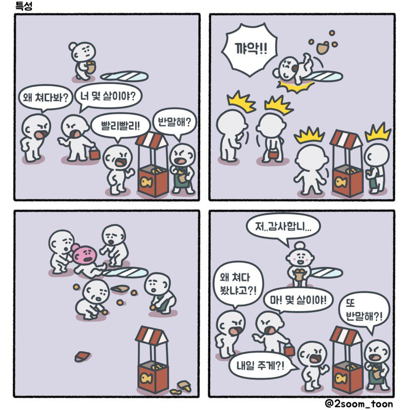
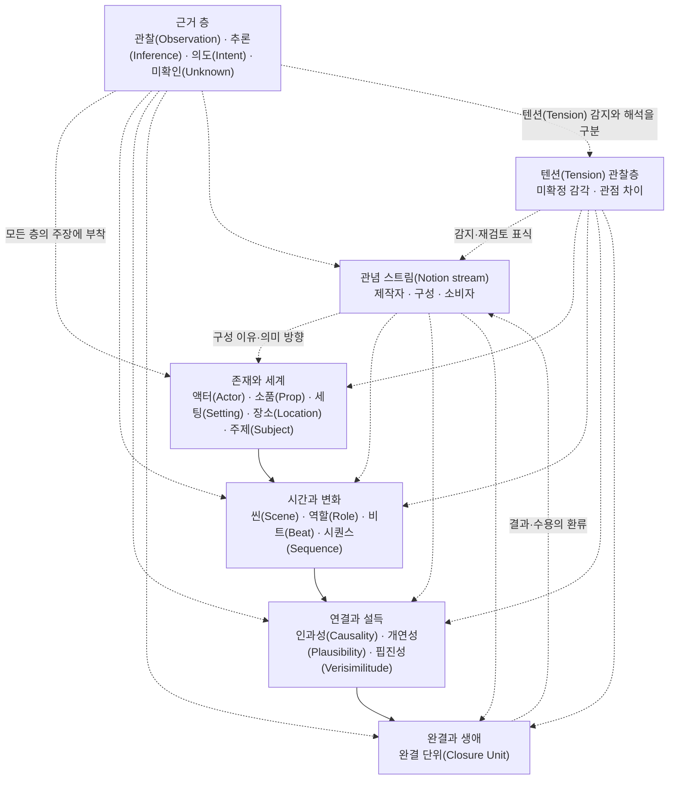

# Scenario-Semantic Synthesis(SSS)

## 왜 SSS를 만들었는가

프로그램을 만들다보면 필히 부딪히는 문제가 있다.

* 이게 맞는건가?
* 왜 이게 여기에 있어야하지?
* 어떤 식으로 전개해야하지?
* 누가 이걸 쓰지?

개발자 수십년의 고찰 끝에 내 결론은,
바라보는 방향에 따라서 제품이 보이는 방향이 달라진다는 것이다.

여러 IoT 장치를 다루는 관리용 앱이라고 생각해보자.
이걸 설치하는 사람의 입장과, 장치의 상태를 관리해야하는 사람의 입장은 다르다.
또한, 누군가는 개별 장치의 특별한 기능만을 요구할 수 있다.
모든 이에게 똑같은 UI를 강조한다면 그 제품은 좋은 제품을 아니라고 본다.
위에서 제기한 내 의문은 늘 똑같은 UI를 제공했기때문에 생긴 의문이었다는거다.

내가 처음에 떠올린 개념은 레이어(Layer)와 의미적 차이(Semantic Gap)이라는 개념이었다.

  

같은 장소, 같은 사람이지만 사람들의 행동이 다르다.
이유는 다른 관점에서 바라보기 때문이다.
요약하자면, 어떤 현실을 다른 관점으로 잘라냈을때 보이는 현실의 다른 면을 레이어라고 불렀고,
관점 차이로 인해서 드러나는 현실적 차이를 의미적 차이라고 불렀다.
그래서 이 모든 레이어와 의미적 차이를 찾아낸다면 좋은 제품을 만들 수 있을거라고 봤다.

이걸 위해서 처음에는 시나리오의 배우-씬-소품-배경-설정 등을 빌려왔다.
내 판단에는 상당히 훌륭한 비유였고, 꽤나 잘 동작하는 비유였다.
하지만, 여전히 어떤 관점으로 어떻게 잘라내고 어떻게 차이를 발견할건지에 대한건 개인의 "느낌"에 의존할 뿐이었다.
구체적인 설명을 위해, 역할과 맥락, 생각하는 법, 관계를 정의하는 방법 등 많은 것을 추가했다.
하지만 여전히 "왜" 이걸 해야하는지에 대한 답은 없었다.
그러다 떠올린게 관념과 관념 스트림(Notion Stream)이다.

봉준호 감독의 기생충이 나에게 큰 영감을 주었다.
시나리오 시점에서 볼 때, 장르(Genre)는 그 자체로 관념이다.
장르에는 기대가 있고, 어떤 방향성이 있다.
그래서 스트림(Stream)이다.

신기하게도 기생충에서 감독은 여러 장르를 오고간다.
그러면서 감독이 제시하는 관념인 빈부격차나 사회갈등에 대한 메시지는 결코 사라지지 않는다.
장르는 그 자체로 거대한 강줄기에 가까워서 제어가 쉽지 않다.
하지만 봉준호 감독은 그 거대한 물줄기를 하나의 강에 실어서 보냈고,
관객이 그 거대한 강을 바라보면서 같은 것을 느꼈다.

그래서 관념과 관념 스트림이 내가 근본적으로 찾고자 하는 왜(Why)와 이유(Reason)이었던 것이다.
하지만 관념이 어떻게 물줄기를 이루는가?
그것 역시 시나리오의 개념을 빌려왔다.
인과성-개연성-핍진성은 작가가 전체 플롯을 독자에게 설득하기 위해 이야기를 해나가는 장치다.
이 개념이 있어야만 제작자가 소비자에게 자신이 말하고자하는 관념을 정확히 전달할 수 있는 것이다.

생각해보면, 
이전에 떠올렸던, 레이어나 의미차이, 맥락, 관계, 그에대한 질문과 이유 등은, 관객 입장에서는 제작자의 관념을 역추적하는 요소였다.
이번에 떠올린건 그걸 굳이 역추적 할 필요가 없다는 것이다.
이 시나리오 관점, 의미적인 통합은 어떠한 컨텐츠는 제작자의 관념을 소비자에게 온전히 전달하는 것을 목표로 한다.

제작자의 관점이 무조건 옳다는 말이 아니다.
작가주의적 영화들이 흥행에 실패하는 일은 흔하다.
다만, 내가 최초에 제기했던 의문들은 그 의미전달조차 못하고 있었다는 것에 대한 반성에서 출발한다.
제작자가 흥행을 목표로 소비자 중심으로 만들고 싶다면, 대부분이 즐기는 블록버스터 액션영화처럼 만들 수 있다.

제작자는 자신이 의도한 관념을 소비자가 최대한 동일하게 이해할 수 있도록 구성한다.
그러나, 소비자가 제작자의 관념을 단순히 받아들이지는 않는다.
소비자 스스로는 자신의 경험과 관념을 통해 의미를 이해하고, 새로운 관념을 창조한다. 
제작자는 자신이 전달하려는 의미를 구성할 수 있지만, 소비자가 어떤 관념을 형성할지는 통제할 수 없다.
그렇다고 하더라도, 제작자가 해야할 일은 오히려 그래서 명확하다.
흥행하는 블록버스터 액션영화처럼 만들려면 그 관념과 물줄기에 집중하라는 것이다.

## SSS란 무엇인가

**Scenario-Semantic Synthesis(SSS)**는 소프트웨어나 작품을 **관념(Notion)의 복수 스트림과 그 정렬**, 그리고 이를 구체화하는 행위자, 무대, 상태 변화, 연결의 설득력, 완결의 생애로 읽고 설계하는 방법론이다. 동시에 아직 설명할 수 없는 감각을 [텐션(Tension)](01-tension.md)으로 보존한다. 화면 목록이나 코드 모듈 목록을 만드는 데 그치지 않고, 제작자와 소비자가 만드는 의미의 방향과 전체 흐름의 여러 지점·관계에서 감지되는 와류를 사용자 경험과 보이지 않는 시스템의 판단 단위에 연결한다.

SSS는 분석할 때 이미 존재하는 의미와 구조를 복원하고, 기획·설계할 때 원하는 경험과 시스템을 같은 언어로 먼저 세운다. 특정 매체·도구·조사 기술에 구속되지 않는다.

## 이름이 뜻하는 것

| 이름 | SSS에서의 뜻 | 뜻하지 않는 것 |
|---|---|---|
| Scenario | 액터(Actor)·역할(Role)·소품(Prop)·세팅(Setting)·장소(Location)·씬(Scene)·비트(Beat)·인과·완결(Closure)이 구체적 맥락(Context)에서 형성하고 변화시키는 시나리오적 전개(Scenario-like Unfolding) | 각본, 사용 사례, 선형 사건열, 고정된 한 경로 또는 모든 요소를 담는 상위 컨테이너 |
| Semantic | 대상에 미리 붙은 의미표가 아니라 제작자·구성·소비자의 관계와 맥락을 지나며 형성·변형·수용되는 의미 | 고정 용어집, 단일 메시지, 배타적 온톨로지(ontology) 또는 제작자 의도의 일방 전달 |
| Synthesis | 분석에서 흩어진 의미와 구조를 복원하고, 설계에서 원하는 변화를 구성하며, 실현과 수용의 결과를 다시 연결해 읽는 지속적 종합(Synthesis) | 차이를 없애는 병합, 합의, 평균, 하나의 최종 해석 또는 완성 선언 |

> Scenario는 SSS의 새 코어 객체가 아니며, 모든 씬(Scene)·시퀀스(Sequence)·완결 단위(Closure Unit)를 지배하는 상위 단위도 아니다. SSS가 의미를 정지된 명세가 아니라 구체적 상황과 행위와 변화 속에서 다룬다는 방법적 성질을 가리킨다.

> SSS의 종합(Synthesis)은 **비환원적 종합(Non-reductive Synthesis)**이다. 서로 다른 관념 스트림(Notion stream), 국소 논리, 텐션(Tension), 미확인(Unknown), 반례와 근거(Evidence)의 차이를 지우지 않고, 그것들이 한 대상에서 어떻게 함께 작동하고 어긋나고 변하는지 읽고 구성한다.

`Scenario-Semantic`의 하이픈은 Scenario와 Semantic이 결합하여 Synthesis를 한정한다는 뜻이다. 시나리오를 만드는 시스템이나 시나리오라는 산출물을 뜻하지 않는다.

### 종합(Synthesis)의 네 동작

| 동작 | 하는 일 | 닫힘으로 오해하지 말 것 |
|---|---|---|
| 분석적 종합(Analytical Synthesis) | 이미 존재하는 경험·구조·의미·근거(Evidence)를 복원하고 연결함 | 하나의 대표 시나리오나 유일한 해석의 발견 |
| 생성적 종합(Generative Synthesis) | 원하는 경험과 변화를 액터(Actor)·씬(Scene)·인과·완결(Closure)로 구성함 | 완성 각본에 모든 요소를 종속시키는 것 |
| 실현 종합(Realization Synthesis) | 의도와 구성을 재료·기술·배우·환경·제약 속 실제 결과로 만듦 | 구현 국소 결정을 전체 의미의 확정으로 승격하는 것 |
| 재종합(Resynthesis) | 실제 결과·운영·수용·반례를 포함해 기존 관계를 다시 읽고 구성함 | 사후 이야기로 봉합하거나 과거 판단을 소급 정당화하는 것 |

이 네 동작은 필수 선형 단계가 아니다. 한 작업 안에서 반복·병행·생략될 수 있으며, 어느 동작도 차이 없는 최종 상태를 보장하지 않는다.

## 한 문장 정의

> Scenario-Semantic Synthesis(SSS)는 액터(Actor)가 어떤 세팅(Setting)과 장소(Location)에서 어떤 역할(Role)로 소품(Prop)을 다루고, 어떤 비트(Beat)를 통해 무엇을 변화시키는 씬(Scene)인지 찾고 구성한다. 그 변화의 인과성(Causality)·개연성(Plausibility)·핍진성(Verisimilitude), 완결 단위(Closure Unit), 주제(Subject), 복수 관념 스트림(Notion stream)의 방향을 차이를 지우지 않은 채 종합하며, 아직 설명되지 않은 감각과 관점 차이는 텐션(Tension)으로 보존한다.

## 문서 구조

번호는 고정 워크플로(Workflow)가 아니라 **개념을 이해하고 실제 작업으로 확장하는 권장 독서 구조**를 나타낸다. `00–18`은 본문이고 `90–99`는 필요할 때 참조하는 부록이며, 템플릿은 번호 밖의 실무 자산이다. 관념(Notion)은 먼저 예고하되 구체 요소와 실제 작업을 본 뒤 다시 읽는다.

### I. 핵심 관념과 모델 — `00–02`

1. [관념(Notion)](00-notion.md): SSS의 가장 중요한 설명과 비지배 원칙
2. [텐션(Tension)](01-tension.md): 설명되지 않은 감각을 보존하는 필수·비지시적 관찰 장치
3. [핵심 모델](02-core-model.md): 액터(Actor)·씬(Scene)·비트(Beat)·인과·완결(Closure) 등 구체 요소와 상호관계

### II. 판단 기반과 양방향 절차 — `03–06`

4. [근거와 인식론](03-evidence-and-epistemics.md): 관찰(Observation)·추론(Inference)·의도(Intent)·미확인(Unknown)을 분리하는 법
5. [경계 판정 지침](04-boundary-decisions.md): 씬(Scene)과 각 요소를 나누고 합치는 기준
6. [분석 절차](05-analysis-workflow.md): 이미 존재하는 소프트웨어·작품·대상의 의미와 구조를 복원하는 법
7. [기획·설계 절차](06-design-workflow.md): 원하는 경험과 시스템을 SSS 구조로 만드는 법

### III. 탐색·실현·환류·조율 — `07–12`

8. [스테이징(Staging)](07-staging.md): 현재 구성을 관점별로 무대에 올려 실현 전에 리허설하는 법
9. [백스테이지(Backstage)](08-backstage.md): 보이는 씬(Scene)과 완결(Closure)을 성립시키는 숨은 조건·판단·상태·제약을 찾는 법
10. [시맨틱 프로브(Semantic Probe)](09-semantic-probes.md): 질문을 다른 표현·관찰·반례·실험에 통과시켜 보이지 않던 의미를 찾는 법
11. [프로덕션(Production)](10-production.md): 현재 의미를 실제 결과로 만들고 결정·근거(Evidence)·EIFS 우선순위를 관리하는 법
12. [리플렉션(Reflection)](11-reflection.md): 실제 결과를 다시 읽어 관념 스트림(Notion stream)·텐션(Tension)·근거(Evidence)를 발견하고 환류하는 법
13. [오케스트레이션(Orchestration)](12-orchestration.md): 분석·설계·프로덕션(Production)의 기능(Function)·배정(Assignment)·근거(Evidence)·의존·인계(Handoff)·통합을 조율하는 법

### IV. 횡단 운용 프로필 — `13–14`

14. [텐션 가이드북(Tension Guidebook)](13-tension-guidebook.md): 텐션(Tension)을 전체 SSS의 횡단 관찰층으로 읽고 저널(Journal)·종결 상태(Closed)·재열림을 운용하는 법
15. [품질 관심사 프로필(Quality Concern Profile)](14-quality-concern-profile.md): 이름 붙기 전의 질문과 분야별 참조 렌즈(Reference Lens)를 관점·관념(Notion)·근거(Evidence)·결정(Decision)에 연결하는 법

### V. 프로젝트 운영과 전승 — `15–18`

16. [프로젝트 구조와 명명법](15-project-structure.md): 권장 디렉터리, 정본 원칙과 안정 ID
17. [품질·유지보수](16-quality-and-maintenance.md): 누락·모순·낡은 링크·의미 부패를 검출하고 갱신하는 법
18. [후속 작업자 실행 규약](17-agent-and-human-handoff.md): 다른 사람이나 에이전트에게 근거·판단·미확인을 잃지 않고 넘기는 법
19. [작업 관찰과 해석](18-observations-and-interpretation.md): 실제 적용에서 드러난 장점·위험·개선 방향

### VI. 참고 부록 — `90–99`

20. [용어집](90-glossary.md): 핵심·작업 용어의 짧은 정의와 혼동 경계
21. [《기생충》 관념(Notion) 예시](91-notion-worked-example-parasite.md): 서로 겹치지 않는 관념 스트림(Notion stream)이 큰 방향에 정렬되는 사례
22. [템플릿](templates/README.md): 실제 문서 작성을 위한 선택적 골격

## 권장 읽기 경로

- **처음 이해할 때:** `00 → 01 → 02 → 03 → 04`를 읽은 뒤, 분석은 `05`, 새 기획은 `06`으로 갈라진다. 실제 작업을 본 뒤 `00`의 관념(Notion)으로 돌아온다.
- **기존 대상을 분석할 때:** `05 → 08 → 09 → 12`를 중심으로 사용하고, 실제 결과나 소비자 수용을 볼 수 있으면 `11`을 연결한다.
- **새 대상을 설계할 때:** `06 → 07 → 09 → 10 → 11`을 왕복하며, 여러 기능(Function)과 작업을 나눌 때 `12`를 사용한다.
- **횡단 질문을 다룰 때:** 설명되지 않은 감각의 생애는 `13`, 여러 분야·직책의 품질 언어는 `14`를 선택적으로 사용한다.
- **프로젝트를 오래 유지하거나 넘길 때:** `15 → 16 → 17`을 사용하고, 방법론 자체를 다시 볼 때 `18`을 읽는다.
- **용어가 막힐 때:** 본문 진행을 멈추지 말고 `90`을 참조한다. 관념(Notion)의 구체 사례가 필요하면 `91`을 본다.

## 구체적인 네 층과 이를 관통하는 관념(Notion)

이 층들은 분류함이 아니라 서로 다른 질문이다. 같은 대상을 여러 층에서 동시에 볼 수 있다. 예를 들어 제안서는 소품(Prop)이고, 계획이라는 주제(Subject)의 핵심 대상이며, 검토 씬(Scene)에서 변경되고, 실행 씬(Scene)으로 전달되며, 검토 세션 완결 단위(Closure Unit)의 잔여물이 된다.

같은 실체가 현재 범위에서 소품(Prop)이면서 장소(Location)이고, 일부 판단에서는 액터(Actor)이며, 여러 씬(Scene)의 가능성을 바꾸는 세팅(Setting)에 참여할 수도 있다. 특히 다른 맥락에서 만든 구성요소·장르 관습·규칙 체계·라이브러리·프레임워크를 가져오면 기능뿐 아니라 성립 조건(Constitutive Condition)·환경 전제(Environmental Premise)·관념적 선택(Notional Choice)도 함께 들어올 수 있다. SSS는 이를 새 코어 유형으로 만들지 않고 기존 요소·인과·관념 스트림(Notion stream)의 관계로 읽는다.

관념(Notion)은 이 층들 위에 군림하는 다섯 번째 상자가 아니라, 제작자·작품 구성·소비자의 관점에서 모든 층을 통과하는 복수의 방향성 있는 의미 스트림(stream)이다. 가장 중요한 설명이지만, 구체 요소를 충분히 본 뒤에야 온전히 발견된다. 먼저 [관념(Notion) 문서](00-notion.md)의 예고와 비지배 원칙을 읽고, 구체 모델을 거친 뒤 다시 돌아오는 것을 권장한다.

텐션(Tension)도 다섯 번째 구조 상자가 아니다. 모든 층과 관념(Notion)에 부착될 수 있는 횡단 관찰층이다. 필수인 것은 텐션(Tension)을 만들어내거나 해결하는 것이 아니라, 감지된 미확정 감각을 버리지 않고 다시 볼 통로다.

## 기본 원칙

- **Scenario는 상위 객체가 아니라 방법적 성질이다.** SSS는 의미를 구체적 맥락(Context)·행위·변화·분기·완결(Closure) 속에서 읽지만, 이를 하나의 각본이나 필수 경로로 묶지 않는다.
- **Semantic은 고정된 의미표가 아니다.** 의미는 제작자·구성·소비자와 실제 결과 사이를 지나며 형성되고 변형된다.
- **Synthesis는 비환원적이다.** 차이·충돌(Conflict)·텐션(Tension)·미확인(Unknown)·반례를 제거해 하나의 결론으로 만들지 않고 함께 읽고 구성할 수 있게 한다.
- **관념(Notion)은 중심이지만 지배하지 않는다.** 모든 구성의 이유와 큰 의미 방향을 설명하지만 액터(Actor)·씬(Scene)·인과의 국소적 자율성을 대체하지 않는다.
- **관념(Notion)은 복수이며 관점 의존적이다.** 기획자, 개발자, 디자이너, 테스터, 작품의 실제 구성, 소비자가 서로 다른 스트림(stream)을 만든다.
- **겹침과 정렬은 다르다.** 같은 개념을 공유하지 않아도 대비·충돌·반전·축적을 통해 큰 의미 방향에 정렬될 수 있다.
- **관념(Notion)은 먼저 예고하고 나중에 발견한다.** 초기 설계에서는 잠정적 씨앗으로 두며, 분석에서는 구체 요소와 관계를 본 뒤 복원한다.
- **텐션(Tension)은 필수이지만 우선순위가 아니다.** 기록 통로는 항상 두되, 개별 텐션(Tension)의 중요성·원인·가치·수정 필요성을 전제하지 않는다.
- **감지와 판정을 분리한다.** 텐션(Tension)이 있었다는 관찰은 버그·개념 충돌·품질 문제의 증거가 아니다.
- **해석과 해소를 강제하지 않는다.** 텐션(Tension)은 미해석·보류·무조치 상태로 남을 수 있으며, 해소가 개선을 뜻하지 않는다.
- **씬(Scene)은 창이 아니라 목적 단위다.** 같은 창 안에 여러 씬(Scene)이 있을 수 있고, 여러 창이 하나의 씬(Scene)을 이룰 수 있다.
- **액터(Actor)는 사람 모양일 필요가 없다.** 상태를 읽고 판정하여 다른 상태를 바꾸는 책임 주체라면 규칙 엔진이나 AI도 액터(Actor)가 될 수 있다.
- **역할(Role)은 액터(Actor)와 다르다.** 액터(Actor)는 전역 정체성이고 역할(Role)은 특정 씬(Scene)에서 가진 목표·권한·책임이다.
- **코어 요소는 배타적 분류가 아니다.** 복합 실체는 현재 질문에서 실제로 수행하는 책임에 따라 액터(Actor)·소품(Prop)·세팅(Setting)·장소(Location)의 여러 읽기를 가질 수 있다.
- **재사용은 기능만 옮기지 않는다.** 편입 구성(Imported Configuration)의 성립 조건(Constitutive Condition)·환경 전제(Environmental Premise)·관념적 선택(Notional Choice)을 구분하되 이를 고정된 본질 분류로 만들지 않는다.
- **비트(Beat)는 의미 있는 최소 변화다.** 클릭이나 함수 호출 자체가 아니라 액터(Actor)의 행동으로 상태·정보·관계·권한이 바뀌는 지점이다.
- **주제(Subject)는 겹쳐야 한다.** 배타적 도메인 분류가 아니라 여러 씬(Scene)과 요소를 가로지르는 주제(Subject)적 탐색 축이다.
- **인과성(Causality)·개연성(Plausibility)·핍진성(Verisimilitude)은 분리한다.** 작동한다고 납득되거나 그럴듯한 것은 아니며, 그 반대도 가능하다.
- **완결(Closure)은 UI 종료와 의미 종료를 구분한다.** 팝업이 닫혀도 그 안에서 발주한 작업은 계속 열려 있을 수 있다.
- **전형적 경로를 필수 순서로 오해하지 않는다.** 반복·건너뜀·병행·취소·상위 단위 흡수를 기록한다.
- **관념(Notion)은 고정하지 않는다.** 확정은 언젠가 오는 단계가 아니라 일어나지 않는 일이다. 고정된 것처럼 보이는 것은 단면에 붙인 이름이며, 관념(Notion)을 참·거짓을 가릴 명제로 다루지 않는다.
- **프로덕션(Production)만은 고정한다.** 코딩·제작 전에 범위 안의 결정을 고정하고 기록한다. 고정하는 것은 의미가 아니라 범위 안의 결정이며, 기록되지 않은 고정은 구현 속에 숨어 사실로 소급된다.
- **근거와 해석을 한 문장에 섞지 않는다.** 확인한 사실, 그 사실의 해석, 아직 모르는 것을 구분한다.
- **그래프와 본문은 양방향으로 연결한다.** 오버뷰의 노드·엣지에는 상세 문서가 있고, 상세 문서에는 오버뷰와 이웃으로 돌아가는 링크가 있어야 한다.

## 최소 산출물

작은 대상이라도 다음 여섯 가지는 남긴다.

1. 씬(Scene) 목록과 각 씬(Scene)의 목적·진입·종료
2. 액터(Actor)/역할(Role), 소품(Prop), 세팅(Setting)/장소(Location)의 핵심 사전
3. 씬(Scene) 간 주요 인과 연결과 세 평가
4. 시작과 끝을 가진 핵심 완결 단위(Closure Unit)
5. 관점별 관념 스트림(Notion stream)과 정렬·긴장·단절 및 비지배 범위
6. 텐션(Tension)을 기록할 통로와, 감지된 경우 감지·해석·평가·활용을 분리한 기록

기존 대상의 조사에 근거한다면 별도의 근거·커버리지 문서도 필수다. 규모가 커질수록 주제 라이브러리(Subject Library)와 자동 링크 검증을 추가한다.
