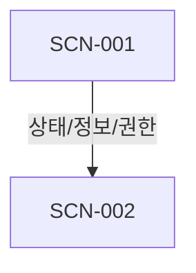

# 씬 인과성 그래프(Scene Causality Graph)

## 그래프 범위

[노드와 엣지(edge)가 무엇을 포함하고 무엇을 생략하는지]

## 전체 그래프

## Edge 유형

- 직접 순차:
- 조건/선택:
- 확률:
- 장거리 상태 전달:
- 권한 전달:
- 정보 전달:
- 환류:
- 내비게이션:

## Edge 목록

| ID | 출발 → 도착 | 전달 | 유형 | 세 평가 요약 |
|---|---|---|---|---|
| | | | | |

## 관점상 취약한 연결

| Edge | 인과성(Causality) 쟁점 | 개연성(Plausibility) 쟁점 | 핍진성(Verisimilitude) 쟁점 | 보강/검증 |
|---|---|---|---|---|
| | | | | |

## 관념(Notion)과 인과 그래프

| 관념 스트림(Notion stream) | 관련 엣지(edge) | 인과를 통해 생기는 의미 변화 | 실제 인과와 해석의 구분 |
|---|---|---|---|
| | | | |

## Edge에서 감지된 텐션(Tension) — 선택적

| 텐션(Tension) | 감지자 | 감지 엣지(edge) | 원인 후보 | 인과성(Causality)·개연성(Plausibility)·핍진성(Verisimilitude) 평가와의 차이 |
|---|---|---|---|---|
| | | | | |
