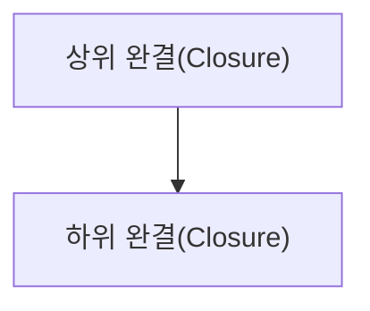

# 완결 단위 라이브러리(Closure Unit Library)

## 프로젝트 정의

[이 대상에서 완결(Closure)의 시작·열림·닫힘을 어떻게 식별하는지. 전형적 경로가 필수 단계가 아님을 명시]

## 단위(Unit) 목록

| ID | 단위(Unit) | 시작 | 정상/대안 완결 | 시간 규모 |
|---|---|---|---|---|
| | | | | |

## 중첩 구조

## 씬(Scene)–완결(Closure) 교차 지도

| 씬(Scene) | 열림 | 진행 | 닫힘 | 잔여물 |
|---|---|---|---|---|
| | | | | |

## 미완결·모호한 단위(Unit)

| 단위(Unit) | 불명확한 시작/종료 | 현재 근거 | 다음 검증 |
|---|---|---|---|
| | | | |

## 관념(Notion)–완결(Closure) 지도

| 관념 스트림(Notion stream) | 열리는 질문/긴장 | 관련 단위(Unit) | 완결별 의미 차이 | 남는 여백·환류 |
|---|---|---|---|---|
| | | | | |

## 텐션(Tension)–완결(Closure) 지도 — 선택적

| 텐션(Tension) | 관련 단위(Unit) | 감지 시점 | 단위(Unit) 종료와 텐션(Tension) 해소의 관계 | 잔류·미해석 |
|---|---|---|---|---|
| | | | 독립/연결/미확인 | |
