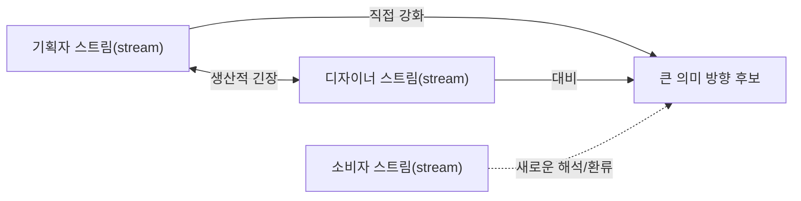

# 관념 스트림(Notion stream) alignment map

## 읽는 법

이 지도는 모든 관념(Notion)을 하나로 병합하거나 완전한 합의를 요구하지 않는다. 같은 개념의 `겹침`과 서로 다른 변화가 큰 방향을 만드는 `정렬`을 분리하며, 생산적 긴장과 우발적 단절을 구분한다.

## 관점별 스트림(stream) 목록

| ID | 관점 주체 | 출발 맥락 | 현재 방향 | 근거 상태 |
|---|---|---|---|---|
| | | | | 선언/구성/작동/추론/수용/환류 |

## 큰 방향 후보

| 후보 | 함께 형성하는 스트림(stream) | 설명하는 범위 | 반례·비지배 범위 | 근거 상태 |
|---|---|---|---|---|
| | | | | |

## Alignment graph

## 관계 지도

| Stream A | Stream B | 개념 겹침 | 정렬 방식 | 판정 | 근거/반례 |
|---|---|---|---|---|---|
| | | 있음/없음/부분 | 강화/축적/대비/충돌/반전/결여/환류/불협화 | 정렬된 차이/생산적 긴장/의도적 불확정/회수되는 어긋남/우발적 단절/미확인 | |

## SSS 요소와의 교차 지도

| 씬(Scene)/액터(Actor)/소품(Prop)/엣지(edge)/완결(Closure) | 관련 스트림(stream) | 각 스트림(stream)의 다른 해석 | 실제 구성의 방향 |
|---|---|---|---|
| | | | |

## 관련 텐션(Tension) — 판정이 아닌 관찰

| 텐션(Tension) | 감지자 | 관련 스트림(stream) | 정렬·충돌과의 관계 후보 | 미확인/반례 |
|---|---|---|---|---|
| | | | | |

텐션(Tension)이 많다고 정렬이 나쁘거나 좋다는 뜻이 아니며, 텐션(Tension)이 없다고 완전한 정렬을 뜻하지 않는다.

## 정렬 감사

- [ ] 제작자 한 명의 선언을 전체 관념(Notion)으로 취급하지 않았다.
- [ ] 담당자별 스트림(stream)과 실제 구성·작동을 구분했다.
- [ ] 소비자의 창조를 정답/오독 이분법으로 처리하지 않았다.
- [ ] 같은 어휘의 반복을 정렬로 오인하지 않았다.
- [ ] 겹치지 않는 스트림(stream)의 대비·충돌·반전을 검토했다.
- [ ] 생산적 긴장을 자동으로 제거하지 않았다.
- [ ] 우발적 단절과 미확인을 숨기지 않았다.
- [ ] 큰 방향으로 설명되지 않는 요소와 반례를 보존했다.
- [ ] 텐션(Tension)을 정렬 점수나 단절 증거로 사용하지 않았다.
