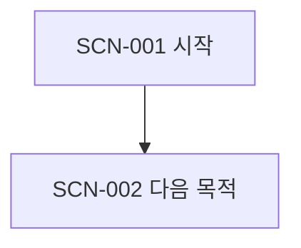

# 씬(Scene) catalog

## 씬(Scene) 경계 원칙

[이 프로젝트에서 목적·권한·시간·종료를 기준으로 어떻게 씬(Scene)을 나눴는지]

## 전체 시퀀스(Sequence)

이 그래프는 [필수 순서/전형적 경로/접근 구조] 중 무엇을 표현하는지 명시한다.

## 씬(Scene) 목록

| ID | 씬(Scene) | 한 문장 목적 | 주요 액터(Actor)/역할(Role) | 주요 완결(Closure) |
|---|---|---|---|---|
| | | | | |

## 시퀀스(Sequence)

### [시퀀스(Sequence) 이름]

- 포함 씬(Scene):
- 함께 읽는 이유:
- 분기·반복·병행:

## 관념 스트림(Notion stream) 관통 지도

| Stream | 관점 주체 | 통과 씬(Scene) | 변화 방향 | 비겹침 정렬·긴장·단절 |
|---|---|---|---|---|
| | | | | |

## 텐션(Tension) 색인 — 기록(record)이 있을 때만

| 텐션(Tension) | 감지자·관점 | 감지 씬(Scene)/전환 | 원인 후보 씬(Scene)/엣지(edge) | 상태 |
|---|---|---|---|---|
| | | | | 미해석/관찰 중/해소/잔류/보류 |

빈 표는 전체 씬(Scene)에 텐션(Tension)이 없다는 증거가 아니다.

## 커버리지 검사

| 원래 표면/로직/작품 구간 | 배정 씬(Scene) | 독립 씬(Scene)이 아닌 경우의 이유 |
|---|---|---|
| | | |
